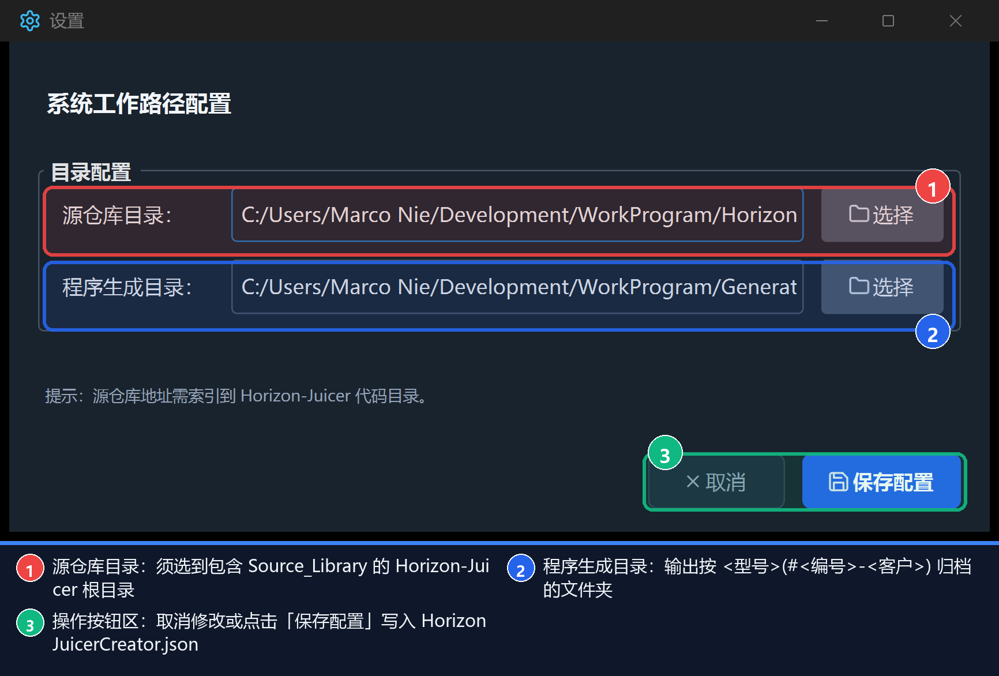

# 1.2 源仓库与输出目录设置

在第一次使用 `HorizonJuicerCreator.exe` 或迁移源码库位置后，必须先完成工作路径配置，否则点击 **程序生成** 时无法检索到 `Source_Library`。

## 1. 打开路径设置界面

在主工作台左上角点击菜单 **打开 → 参数设置**，即可弹出如下图所示的 **系统工作路径配置** 窗口：

## 2. 目录项定义与索引规则

对话框包含两个必填路径框，点击右侧 **选择** 按钮即可浏览本地文件夹：

1. **源仓库目录（sourceDir）**
   - **必须索引到 `Horizon-Juicer` 仓库的根目录**（即内部包含 `Source_Library` 子目录的那一层目录），**不要直接选进 `Source_Library` 内部**。
   - 正确示例：`C:/Users/Marco Nie/Development/WorkProgram/Horizon-Juicer`
   - 界面底部明确提示：`提示：源仓库地址需索引到 Horizon-Juicer 代码目录。`
2. **程序生成目录（destDir）**
   - 指定生成程序包的根存放目录。软件会在该目录下按规则创建名为 `<机床型号>(#<机床编号>-<客户信息>)` 的独立子目录。
   - 正确示例：`C:/Users/Marco Nie/Development/WorkProgram/GeneratedProgram`

## 3. 保存校验与常见错误排查

点击右下角 **保存配置** 按钮后，软件会校验路径并写入用户配置 JSON；点击 **取消** 则放弃修改。

| 异常现象 | 可能原因 | 解决方法 |
| :--- | :--- | :--- |
| 点击生成后提示源目录无效或找不到文件 | `源仓库目录` 错误指向了 `Source_Library` 下一级或选成了空目录 | 重新点击 **打开 → 参数设置**，确保选中包含 `Source_Library` 文件夹的上级根目录 |
| 生成按钮无响应或报写入失败 | `程序生成目录` 路径不存在、无写入权限，或旧目标文件夹正被编辑器/资源管理器占用 | 关闭占用该文件夹的窗口，确认目标盘符与目录权限后重试 |
| 客户/项目多机批量生成想分类归档 | 全部生成在同一目录导致文件夹混杂 | 为不同项目临时切换 `程序生成目录`，或充分利用第 2 章的 **机床编号** 与 **客户信息** 字段命名区分 |
