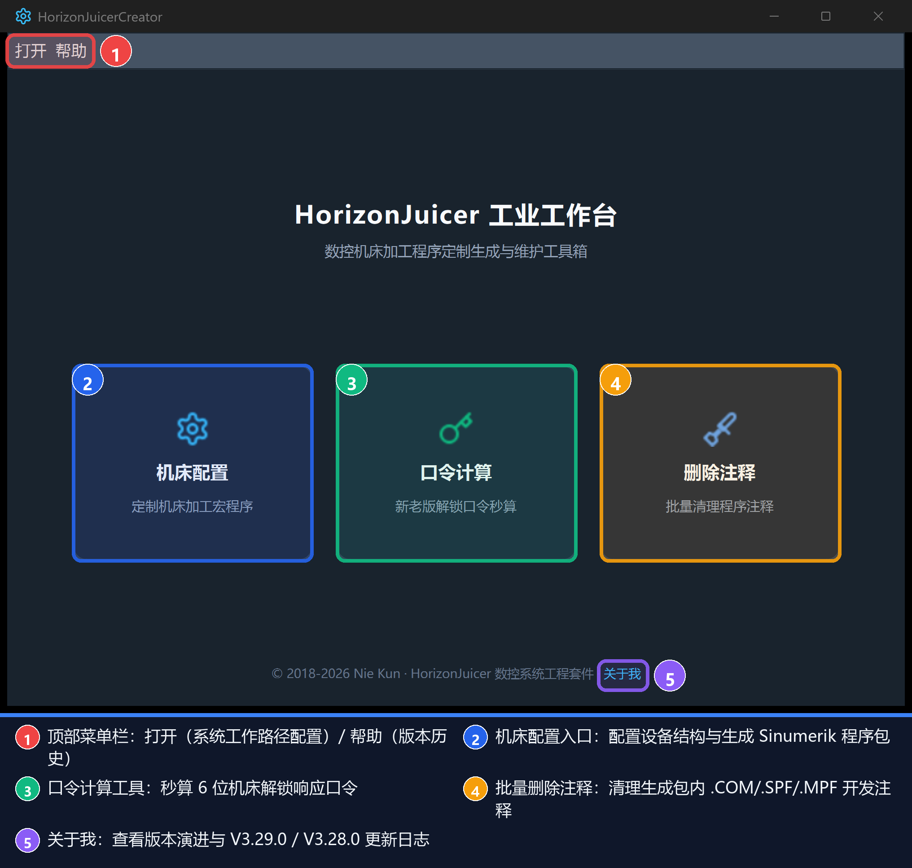
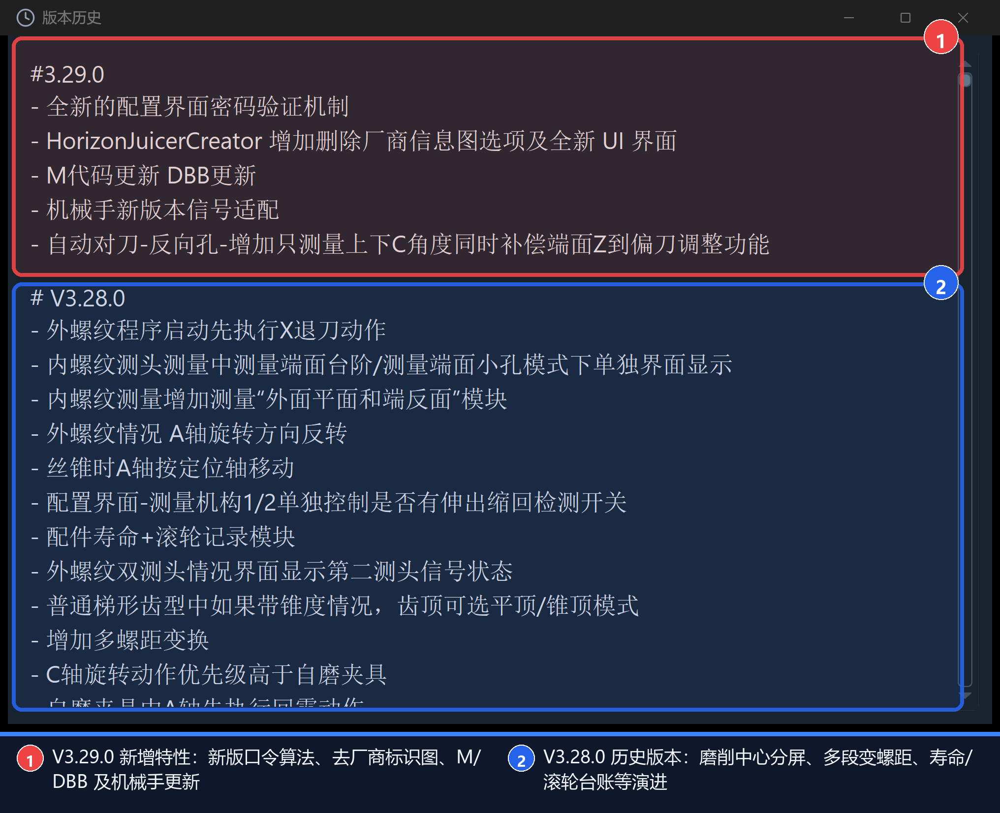

# 1.1 主工作台、菜单栏与版本历史

## 1. 启动软件与主工作台布局

双击运行安装目录下的 `HorizonJuicerCreator.exe`（当前手册基于 `V3.29.0` 版本编写），首先进入软件主工作台界面。主界面采用深色工程风格设计，顶部为功能菜单栏，中央为三大核心功能入口卡片，左下角标注当前软件版本号 `V3.29.0`。



三大功能卡片分工如下：

| 卡片名称 | 核心职责 | 说明 |
| :--- | :--- | :--- |
| **机床配置** | 配置设备型号、结构选配并一键生成程序包 | 最核心的工作流入口，点击进入参数配置页（详见第 2 章） |
| **口令计算** | 生成机床端 **机床配置** 页面的 6 位解锁密码 | 支持 V3.29.0+ 动态随机校验码模式与历史固定编号模式（详见 3.1 节） |
| **删除注释** | 批量清除指定目录下 `.com` / `.spf` / `.mpf` 中的分号注释 | 保留结构化标记注释 `;*` 与 `;"`，减小现场程序体积并防止冗余文本泄露（详见 3.2 节） |

> **提示**：进入任一子功能页后，界面左上角均提供 **返回** 按钮，可随时切回主工作台，各页输入状态在单次会话内自动保留。

## 2. 顶部菜单栏说明

主工作台顶部菜单栏包含两个下拉菜单：

1. **打开（File）**：
   - **参数设置**：弹出工作路径配置对话框，用于指定 `Horizon-Juicer` 源仓库路径及目标程序生成路径（详见 [1.2 源仓库与输出目录设置](path_settings.md)）。
2. **帮助（Help）**：
   - **关于软件**：展示软件版本、编译日期、作者与工程版权信息。
   - **版本更新日志**：打开滚动日志窗口，记录从早期版本至当前版本的功能新增与关键修复明细。



## 3. 配置文件持久化机制

软件启动时会自动读取当前 Windows 用户目录下的配置 JSON 文件：

```text
C:\Users\<当前用户名>\HorizonJuicerCreator.json
```

该文件以 UTF-8 JSON 格式保存以下内容：

- 上一次使用的全部机床配置字段（如 `machineName`、`machineIndex`、`customInfo`、`systemMode`、`machineType` 等 20 余项选项）；
- 上一次设置的路径对象 `programDir`（包含 `sourceDir` 与 `destDir`）。

当工程师点击配置页的 **保存配置** 或触发 **程序生成**，或修改 **参数设置** 对话框并点击保存时，软件均会将最新状态回写到 `HorizonJuicerCreator.json`。

> **注意**：若多台工程师电脑需要统一标准模板，或需要将某型号机床配置固定为团队基线，可直接备份或分发该 `HorizonJuicerCreator.json` 文件（分发后请在目标电脑的 **参数设置** 中重新确认 `源仓库目录` 和 `程序生成目录` 是否存在）。
