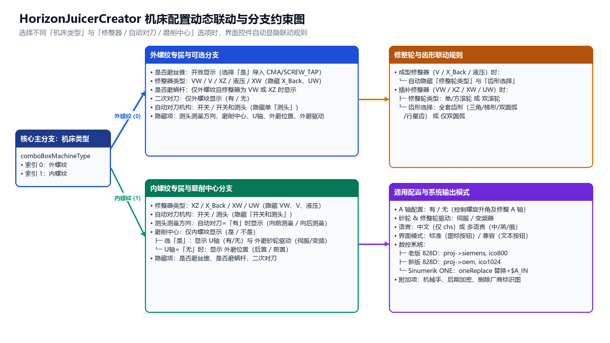

# 第 2 章 机床配置与程序生成

点击主工作台的 **机床配置** 卡片即可进入 `HorizonJuicerCreator` 的核心工作区。该界面采用左侧配置表单 + 右侧状态与操作控制区的布局，在界面内部各参数之间实现了严格的动态显示与互斥联动校验。

在生成每一套设备程序前，建议按照以下三步核对本章节内容：

1. [2.1 机床信息、系统平台与安全选项](machine_and_system_info.md) —— 核对机床命名、语言、目标数控系统版本及界面兼容模式；
2. [2.2 机床结构、修整器与硬件选配联动](structure_options.md) —— 根据机械电气图纸配置外/内螺纹、丝锥、蜗杆、磨削中心、U 轴、修整器类型、自动对刀测头及主轴控制方式；
3. [2.3 生成目录结构与规格编码解析](output_structure.md) —— 了解生成文件夹的内部组成与配置编码字段含义。
