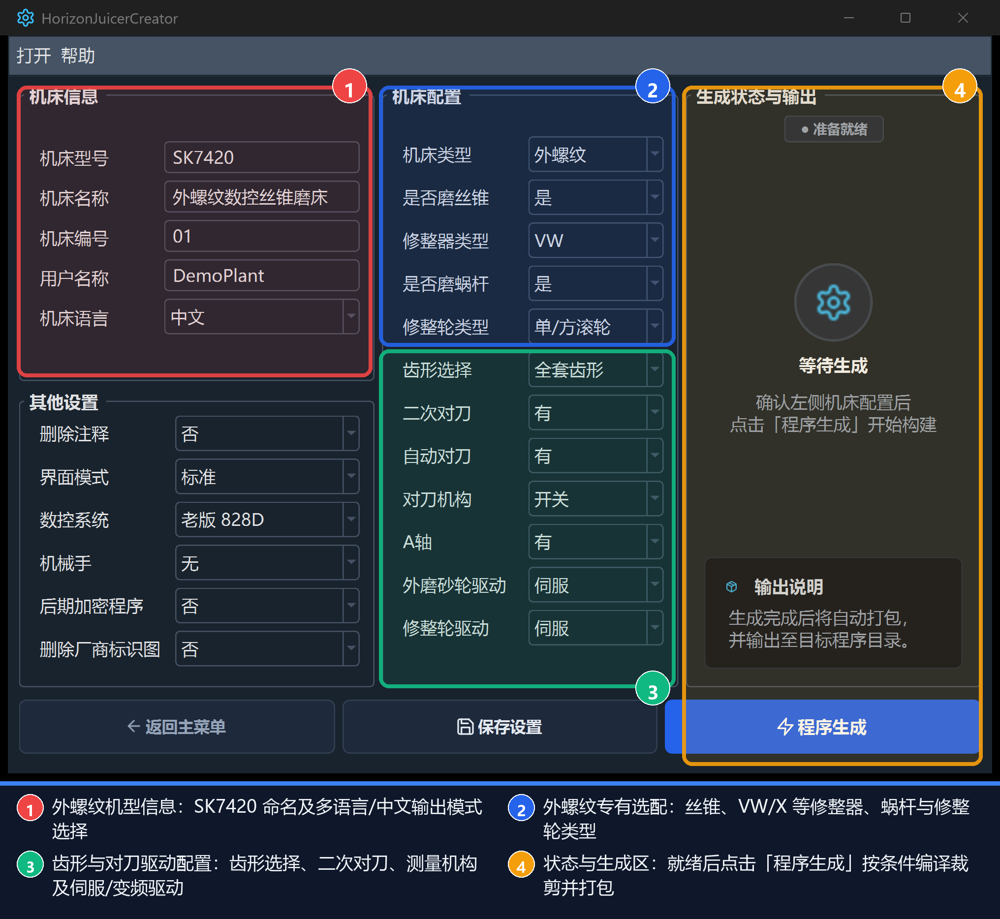

# 2.1 机床信息、系统平台与安全选项

机床配置页面顶部与下半部分负责定义设备标识信息、目标西门子系统平台、HMI 兼容性以及通用附件功能开关。

## 1. 机床标识信息（Machine Information）

| 界面字段 | JSON 键名 | 用途与处理规则 |
| :--- | :--- | :--- |
| **机床型号** | `machineName` | 作为输出目录前缀，同时软件会自动把 `Source_Library/MPF/INFO_INIT.MPF` **重命名为 `<机床型号>.MPF`**。生成前软件会自动对特殊字符进行规范化替换：**`*`、`×` 转为小写 `x`，`/` 转为 `_`**（例如 `SK7420*1000` 自动转为 `SK7420x1000`）。 |
| **设备名称** | `machineNameLng` | 用于写入 HMI **设备信息**（`a_info.com`）与相关显示文本中，支持中文描述（如 `外螺纹数控丝锥磨床`、`内螺纹磨削中心`）。 |
| **机床编号** | `machineIndex` | 建议填写两位或多位数字编号（如 `01`、`02`），用于输出目录名中的 `#<编号>` 标识，并在 `INFO_INIT.MPF` 内设置设备编号。 |
| **客户信息** | `customInfo` | 填写客户简称或项目代号，拼接在输出目录名最后（如 `SK7420(#01-DemoPlant)`）。 |

> **重要提醒**：`机床型号`、`机床编号` 与 `客户信息` 会共同构成生成目标文件夹名称 `<machineName>(#<machineIndex>-<customInfo>)`。如果任意字段包含 Windows 路径非法字符，请避免使用 `:`、`?`、`"`、`<`、`>`、`|`、`\`。

## 2. 系统类型与界面语言选项

| 界面字段 | JSON 键名 & UI 枚举（索引从 `0` 起） | 底层生成差异（由 `generatepro.cpp` 控制） |
| :--- | :--- | :--- |
| **机床语言** | `lng`：`0` 中文 / `1` 多语言 | `lng=0` 时移除 `;ifIsENG` 英文/多语言段、保留纯中文；`lng=1` 时移除 `;ifIsCHS` 并打包多语言 `almc_*.txt` 与 `hlp/eng`、`hlp/rus` 三语帮助资源，便于在现场切换中/英/俄三语显示。 |
| **数控系统** | `systemMode`：`0` 老版 828D | 将 HMI 运行包写入 `System-CF-Card/siemens` 与 `user`，使用 `ico800`（`800×600`）图标资源。在 **SinuTrain 840D sl 4.8 SP4** 中预览测试时优先选择此模式（或与 840D sl 共用目录）。 |
| | `1` 新版 828D | 将核心系统界面文件放入 `System-CF-Card/oem` 与 `user` 目录（不生成 `siemens` 覆盖包），并将 `ico800` 资源切换为 `ico1024`（`1024×768`）适配高分辨率面板。 |
| | `2` Sinumerik ONE | 同样输出到 `oem` + `user`（`ico1024`），并额外执行 `oneReplace.json` 跨平台映射表： ① 把传统 <code>&#36;A_DBB[...]</code>、DB4900 等信号批量替换为 ONE 的高速输入/输出符号（如 <code>&#36;A_IN[...]</code>、`digitInpVal[...]`）； ② 适配 `DB10.DBX107.0/1` 系统信号与 `1170×600` 宽屏面板坐标。 |
| **界面模式** | `hmiMode`：`0` 标准 / `1` 兼容 | `0 标准`：保留图标文件引用（如 `\\S_003.png`）与完整软键扩展属性（`,pa0`、`],ac`）； `1 兼容`：自动剥离图片按钮及 `,pa0` 等修饰属性，用于兼容部分老固件 EasyScreen 解析器。 |

## 3. 代码处理与扩展功能开关

| 界面字段 | JSON 键名 & UI 枚举（实机存储索引） | 功能说明 |
| :--- | :--- | :--- |
| **删除注释** | `ifRemoveComments`：**`0` 是 / `1` 否** | **注意索引顺序**：下拉第 1 项 **`0 = 是`**（生成完成后自动剥离 `.COM`/`.SPF`/`.MPF` 中常规 `;` 注释，保留 `;*` 与 `;\"` 等语法标记），第 2 项 **`1 = 否`**（保留全部源码注释以便现场调试核对）。 |
| **机械手** | `ifHasLoadingArm`：`0` 无 / `1` 有 | 选 `1 有` 后保留桁架机械手自动上下料交互子程序 `A_JXS_MAIN.SPF` / `B_JXS_ZJ.SPF` / `B_JXS_TEST.SPF`、`M80`～`M97` 握手代码、<code>&#36;A_DBB[30..34/60..67]</code> 互锁及 `Z轴上料位` 显示；选 `0 无` 则彻底裁剪。 |
| **删除厂商标识图** | `ifHasNoneTradeMark`：`0` 否 / `1` 是 | 选 `1 是` 后使用 `Source_Library/HMI/Repository/0_NoneTradeMark` 下的通用无品牌标识欢迎底图，实现 OEM 中性化交付；选 `0 否` 则显示标准出厂品牌图。 |
| **后期加密程序** | `ifHasEncryption`：`0` 否 / `1` 是 | 开启后在主入口 `A_GRINDING.SPF` 等处保留 `ifIsHasEncryption` 分支，运行时强校验控制器硬件序列号 <code>&#36;MN_HW_SERIAL_NUMBER</code>，不匹配时报警 `"设备未授权,请联系厂家！"` 并锁止循环。 |

> **警告**：启用 **加密保护** 时，务必提前核对目标机床 CF 卡的真实 <code>&#36;MN_HW_SERIAL_NUMBER</code>，否则程序包导入现场机床后无法启动循环！
