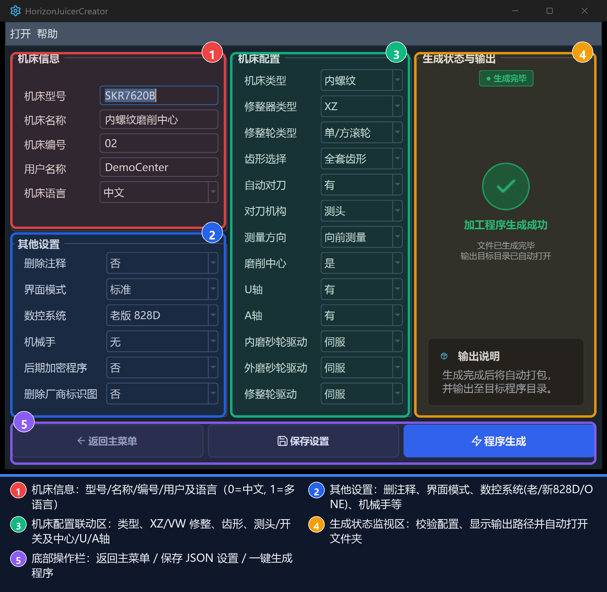

# 2.2 机床结构、修整器与硬件选配联动

机床配置页面的中间区域决定了 `Horizon-Juicer` 代码库中全部条件编译标记（`;ifIs...`）的开关组合。`HorizonJuicerCreator` 内部通过动态显隐逻辑防止无效组合被误选，图例为内螺纹磨削中心典型配置界面：

## 1. 机床主体类型与工艺功能选配

> **关于底层枚举顺序的重要说明**：`HorizonJuicerCreator` 界面下拉框按 `creatorwindow.ui` 顺序保存 `0`/`1` 整数索引；其中部分开关以 **`0` 代表“有/是”**（如 `ifHasScrewTap`、`ifOperation`、`ifHasReOp`、`ifCenter`、`ifHasU`、`ifHasA`），而另一些以 **`0` 代表“否/无”**（如 `ifHasWorm`、`ifHasLoadingArm`、`ifHasEncryption`）。下表严格对应 JSON 与源码真实枚举值：

| 配置项 | JSON 键 & UI 枚举（真实索引） | 联动条件与影响（`creatorwindow.cpp` + `generatepro.cpp`） |
| :--- | :--- | :--- |
| **机床类型** | `machineType`：`0` 外螺纹 / `1` 内螺纹 | 决定核心坐标系、退刀方向、主磨削 Mask（外螺纹 `Mask1` / 内螺纹 `Mask18`）以及对刀模式分支；同时动态隐藏另一机型的专属下拉项。 |
| **是否磨丝锥** | `ifHasScrewTap`：**`0` 是 / `1` 否** | **仅机床类型 = `0` 外螺纹时显示**。选 **`0` 是** 保留 `SCREW_TAP` 直槽/螺旋槽/跳齿铲磨界面（`Mask52`）及 `B 轴` 铲磨控制逻辑。 |
| **磨削中心** | `ifCenter`：**`0` 是 / `1` 不是** | **仅机床类型 = `1` 内螺纹时显示**。选 **`0` 是** 保留复合加工总入口 `A_GRIND_CENTER.SPF`、看板（`a_centermain.com`）以及外圆（`a_centerwaiyuan.com`）、端面（`a_centerduanmian.com`）全套页面与在线测量模块；选 **`1` 不是** 则隐藏外圆 U 轴/外磨砂轮配置。 |
| **是否磨蜗杆** | `ifHasWorm`：`0` 否 / `1` 是 | **仅当外螺纹且修整器为 `0=VW`、`2=XZ`、`5=XW`、`6=UW` 时显示**。选 **`1` 是** 后开放蜗杆模数、压力角、`WORM_SHAPE` 专用修整与 M 代码安全互锁逻辑。 |
| **二次对刀** | `ifHasReOp`：**`0` 有 / `1` 无** | **仅机床类型 = `0` 外螺纹时显示**。选 **`0` 有** 允许现场在 `Mask1` 切换 `首次对刀` / `二次对刀`（`C_OPERATION_RAND.SPF`）；选 **`1` 无** 则强制按首次对刀处理。 |

## 2. 磨削中心外圆拓展选项（仅 `machineType=1` 且 `ifCenter=0` 时可见）

1. **U 轴（`ifHasU`）**：
   - **`0` 有**：设备配有独立 `U` 轴承载外圆砂轮架（外圆/端面切入使用 `U` 轴）。
   - **`1` 无**：无独立 `U` 轴，外圆砂轮与内磨共用 `X` 轴，此时界面动态展开 **外圆砂轮位置（`ifNotHasUExternalPos`）**：**`0` 后置 / `1` 前置**，决定外圆共用轴切入方向及 `PROCESS[56/57]` 符号。
2. **外磨砂轮驱动（`exGrindWheelType`）**：
   - **`0` 伺服 / `1` 变频器**：控制 `a_setting.com` `SUB(UP6)` 中外圆砂轮驱动标记，决定 `F_GRINDWHEEL_RUN` 系列子程序输出伺服指令（`S.. M..`）或变频模拟量参数；与是否选 U 轴同步受 `ifCenter==0` 联动显隐。

## 3. 修整器架构与滚轮/齿形组合联动

不同机型搭载的修整器轴系（`wareType` 共 7 项索引 `0..6`）受 **机床类型** 动态过滤（外螺纹隐藏 `5=XW` 与 `6=UW`）：

| 索引 | `wareType` 名称 | 支持的机床类型 | 修整轮类型（`wheelType`）与齿形（`shapeType`）联动规则 |
| :---: | :--- | :--- | :--- |
| `0` | **VW**（V/W 两轴插补） | 外/内螺纹 | 当 `wareType` 属于插补系（**`0=VW` / `2=XZ` / `5=XW` / `6=UW`**）时： • 显示 **修整轮类型**：`0` 单/方滚轮、`1` 双滚轮； • 显示 **齿形选择**：`0` 全套齿形（三角/梯形/双圆弧 + 行星齿）、`1` 双圆弧； • 选 **`6=UW`** 时会在工艺 `Mask5` 及修整画面额外开放 `U/W` 轴与力矩夹紧挡块控制。 |
| `1` | **V**（单 V 轴成型） | 外/内螺纹 | 纯成型/液压修整器：自动隐藏 **是否磨蜗杆**、**修整轮类型** 与 **齿形选择** 下拉框。 |
| `2` | **XZ**（X/Z 两轴插补） | 外/内螺纹 | 同 `0=VW` 插补规则（见 `creator_config_center.png` 示例配置）。 |
| `3` | **X_Back**（单 X 后置成型） | 外/内螺纹 | 自动隐藏插补滚轮与齿形选择。 |
| `4` | **液压**（液压摆缸成型） | 外/内螺纹 | 自动隐藏插补滚轮与齿形选择。 |
| `5` | **XW**（X/W 两轴插补） | **仅内螺纹** | 同 `0=VW` 插补规则；后置靠修配置须配合源码内方向参数核查。 |
| `6` | **UW**（U/W 两轴插补） | **仅内螺纹** | 同 `0=VW` 插补规则，额外激活 `UW` 夹紧力矩逻辑。 |

## 4. 自动对刀、辅助轴与主轴驱动配置

1. **自动对刀（`ifOperation`）**：
   - **`0` 有 / `1` 无**：选 **`0` 有** 后保留 `自动对刀` 画面（`a_auto.com`）与 `C_OPERATION_AUTO.SPF` 全套自动测量子程序；选 **`1` 无** 则隐藏下方 **对刀机构** 与 **测量方向** 下拉框。
   - **对刀机构（`measureMethord`）**：`0` 开关（接近开关）、`1` 测头（接触式测头）、`2` 开关和测头。注意界面联动规则：**外螺纹（`0`）隐藏 `1` 测头**；**内螺纹（`1`）隐藏 `2` 开关和测头**（内孔侧常配独立接近开关或单测头）。
   - **测量方向（`probePos`）**：**`0` 向前测量 / `1` 向后测量**（仅当 **内螺纹 + 有自动对刀** 时显示），决定 `a_setting.com` `SUB(UP6)` 中测头扫描默认初始方向 `VAR_34`（`1` 或 `-1`）。
2. **A 轴（`ifHasA`）**：
   - **`0` 有 / `1` 无**：选 **`0` 有** 开放主磨削画面 `螺旋升角自动偏转`、`B_SCREW` 自动摆角与 `a_setting` `A 轴` 相关参数。
3. **磨削砂轮驱动（`grindWheelType` / `exGrindWheelType`）与修整轮驱动（`dressWheelType`）**：
   - 三者均提供 **`0` 伺服 / `1` 变频器** 两项枚举；注意在 `generatepro.cpp` 与 `a_setting.com` `SUB(UP6)` 中：`0=伺服` 编译 `;ifIsNotSiFuIn...`（输出如 `M1=3 S1=SPEED` 指令），`1=变频器` 编译 `;ifIsSiFuIn...`（通过模拟量变量 `R299=SPEED` + `M13`/`M23`/`M63` 启停），因此在真机首次部署后 **必须执行一次 `VS3 → Mask2` 配置重置** 才能使该标志写入 NC！

## 5. 保存配置与触发生成

- 点击底部的 **保存配置**：仅将当前面板所有选项写入 `~/HorizonJuicerCreator.json`，不触发代码生成。
- 点击右下角 **程序生成**：先自动校验 `源仓库目录`、`程序生成目录` 及必填表单项，随后立即保存 JSON 并在后台工作线程执行条件裁剪、拷贝与跨平台替换。生成期间界面进度指示激活，完成后在目标目录产生完整程序包。
