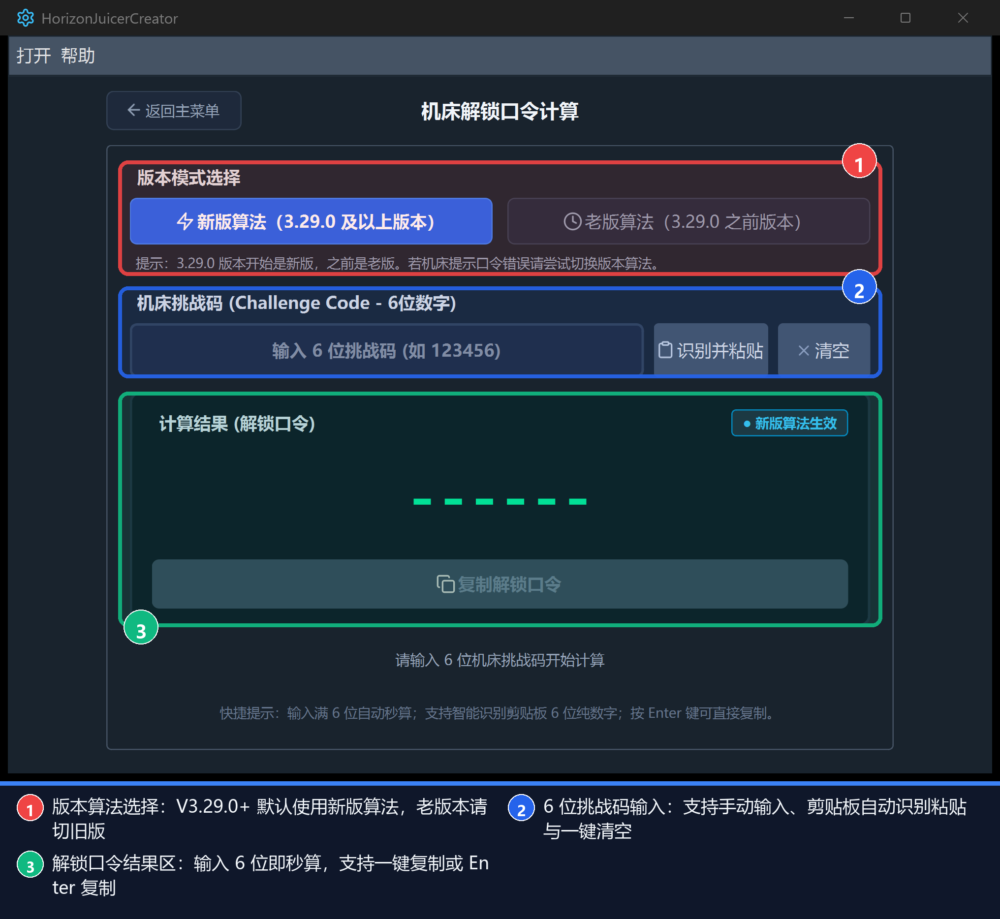

# 3.1 系统动态解锁口令计算器

为了防止终端操作员在日常生产中误改砂轮类型、自动门信号、自动对刀模式或安全限制等机床底层参数，`Horizon-Juicer` 在 **CUSTOM → 机床配置** 入口前设置了口令保护校验界面（`a_setting.com` `Mask0`）。调试人员需使用 `HorizonJuicerCreator` 内置的 **口令计算** 工具算出临时解锁密码。



## 1. 新版（>= V3.29.0）与历史版本（< V3.29.0）模式切换

从 **V3.29.0** 起，口令体系由“静态出厂编号映射”升级为“**一机一密 + 每次动态滚动挑战码**”架构。计算器顶部的版本切换开关用于适配不同现场程序包：

| 模式选项 | 适用软件库版本 | 输入数据源 | 特点说明 |
| :--- | :--- | :--- | :--- |
| **V3.29.0 及以上版本（默认）** | `Horizon-Juicer >= V3.29.0` | 机床上随机生成的 **6 位数字挑战码** | 采用基于私有配置文件与硬件持久种子的动态挑战-响应机制，每次进入配置界面challenge码递增变化，防离线枚举与固定密码传播 |
| **V3.29.0 以前历史版本** | 早期历史程序包 | **设备信息** 页中的固定出厂编号（`INI[130]`） | 兼容老机型历史版本（无需读取动态码，直接按老版规则映射算出解锁码） |

## 2. 现场解锁操作全流程（新版 >= V3.29.0）

1. 在机床 SINUMERIK Operate 界面先确认当前访问等级不低于 **`ac3`（用户口令；或服务口令 `ac2` / 制造商口令 `ac1`）**，否则 `VS8` / `VS1` / `VS3` 将不可见或无响应；随后按 `CUSTOM` 键进入 **Welcome 主页面**，点击右侧 **`VS8`（扩展菜单 `[≡▸]`）→ `VS1`（机床配置）** 进入口令验证页（`Mask0`）；
2. 在 **`ac3`（用户口令及以上）** 权限下按下 **`VS3`** Softkey（右下角隐藏触发区），界面右下角区域即会显示一组当前轮次的 **6 位数字挑战码**（范围 `100000` ～ `999999`，如下图右下角所示）；


3. 打开工程师电脑端的 `HorizonJuicerCreator.exe`，进入 **口令计算** 卡片（确保处于新版模式）；
4. **输入并计算**：
   - 手动键入该 6 位挑战码；或直接在微信/聊天软件复制整段消息后点击输入框旁/触发自动识别（内置正则 `\b\d{6}\b` 可智能提取文本中的 6 位数字）；
   - 输入满 6 位后自动计算并显示 **6 位数字解锁口令**（在未输入合法 6 位码时显示为 `------`）。
5. **快捷复制**：按键盘 `Enter` 键或点击结果旁复制按钮即可将 6 位解锁口令写入系统剪贴板；
6. 回到机床界面，将口令填入 **口令验证**（`PASSWD_CHECK`）输入框，验证通过后立即自动跳转至 **机床配置** 主参数页（`Mask1`）。

> **安全声明**：内部口令派生算法与私有密钥常量（形如 `******`）受工程保密约束，不在本操作手册公开数学公式。所有现场解锁均须使用授权 `HorizonJuicerCreator` 客户端与目标设备配套的加密配置完成。

## 3. `machine_sec.ini` 配置层级与异常状态排查

自 `V3.29.0` 起，机床端 `a_setting.com` 在打开口令校验页时会自动按严格优先级搜索私有安全配置文件 `machine_sec.ini`：

```text
检索优先级：user 目录  >  oem 目录  >  siemens 目录
目标路径示例：/<层级>/sinumerik/hmi/cfg/machine_sec.ini
```

检索并校验成功后方可使用动态计算；若该文件缺失、字段不完整或校验参数非法，界面右上角红色提示区（`MSG`）会自动给出明确告警信息：

| HMI 提示状态 | 底层状态标识（`CFG_STATUS`） | 原因分析 | 现场处理建议 |
| :--- | :---: | :--- | :--- |
| **配置正常** | `1` | 在 `user` / `oem` / `siemens` 任一路径成功读取到合法完整参数 | 按正常流程按 `VS3` 获取 6 位挑战码并输入计算结果解锁 |
| **配置丢失** | `0` | 遍历所有 SinuTrain/PCU/NCU 路径均未找到 `machine_sec.ini` | 检查 `System-CF-Card/user(oem/siemens)/sinumerik/hmi/cfg/` 是否完整拷贝导入，并确认文件权限 |
| **配置缺损** | `2` | 找到了 `machine_sec.ini`，但内部必要配置键缺失或被误删 | 从正确生成包重新提取 `machine_sec.ini` 覆盖至目标层级目录，切勿手动删减配置字段 |
| **配置无效** | `3` | 参数取值越界或校验基数/取模配置不符合 6 位码规则（例如关键参数为 0 或上下限越界） | 使用标准模板生成的 `machine_sec.ini` 替换被损坏的文件 |
