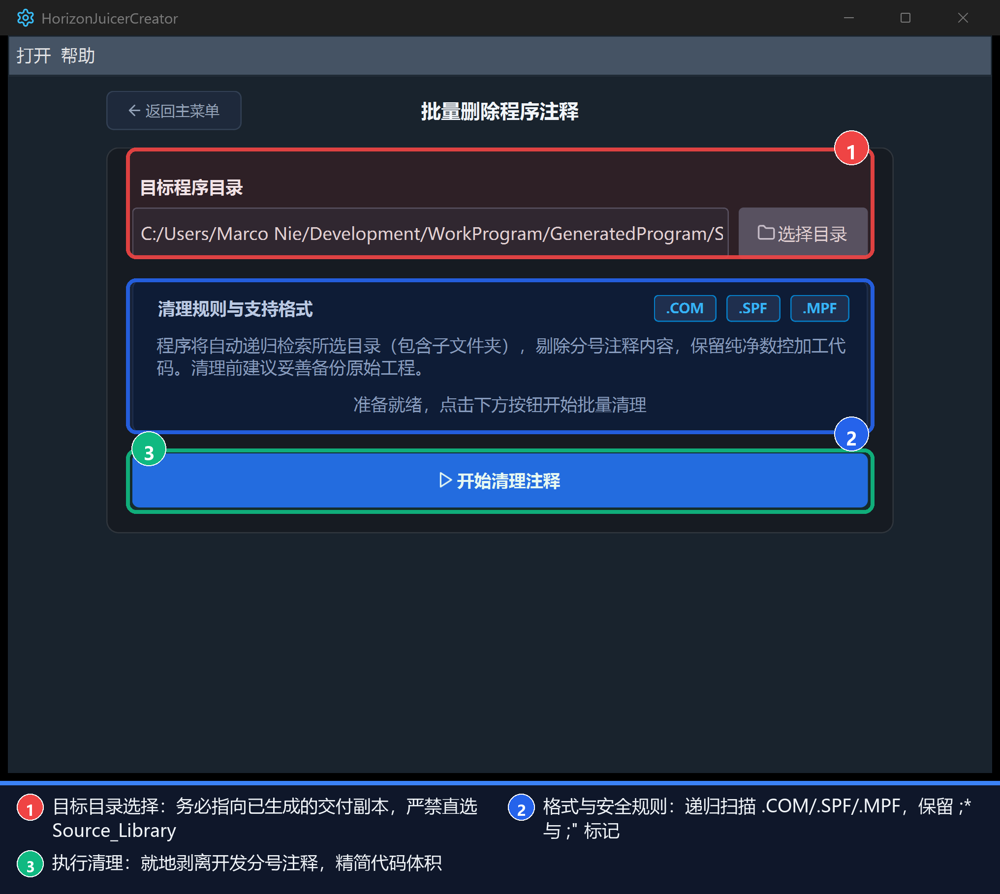

# 3.2 批量删除程序注释工具

在设备调试完毕并准备最终移交给终端客户时，或者在对某一独立修改过的外部备份包进行脱敏整理时，通常需要剥离 NC 子程序与 EasyScreen 界面脚本中的开发备注。`HorizonJuicerCreator` 在主工作台提供了独立的 **删除注释** 工具模块。

## 1. 支持的文件类型与保留规则

点击主工作台 **删除注释** 卡片进入本工具页面，配置目标文件夹后软件会 **递归遍历** 该目录及其全部子文件夹，针对以下三类后缀文件执行安全清洗：

- **`.com`**：SINUMERIK EasyScreen 人机界面配置文件
- **`.spf`**：西门子制造厂/用户子程序
- **`.mpf`**：主加工与初始化程序

### 智能注释识别机制（`removecommit.cpp`）

为了避免误删界面语法和字符串提示内容，注释清洗器在逐行解析 `;` 时严格遵守以下保留规则：

| 行内内容特征 | 处理方式 | 典型示例与原因 |
| :--- | :--- | :--- |
| 常规行内/整行 `;` 注释 | **删除** | `G90 G01 X=INI[23];外螺纹退刀` → 清除 `;外螺纹退刀` |
| **`\;*`** 结构化注释/下拉列表标记 | **完整保留** | `.com` 定义下拉枚举或特定标记（如 `;*0=否`）时不被破坏 |
| **`\;\"`** 引号关联字符 | **完整保留** | 防止引号及特殊字符串语法内包含分号时发生误截断 |

## 2. 使用步骤与安全注意事项

1. 点击工具页的目录 **选择** 按钮（或直接输入本地文件夹绝对路径）；
2. 确认目标路径正确无误后，点击执行清理按钮开始处理；
3. 处理完成后界面提示执行结果及扫描统计信息。

> **警告**：**删除注释** 工具是 **就地直接覆盖原文件** 的不可逆操作！切勿直接对 `Horizon-Juicer/Source_Library` 原始代码仓库执行此操作（否则将丢失开发维护备注及部分生成裁剪所依赖的 `;ifIs...` 条件标记！）。请务必只针对已经生成好的客户交付目录或提前复制出来的副本执行注释清理。
