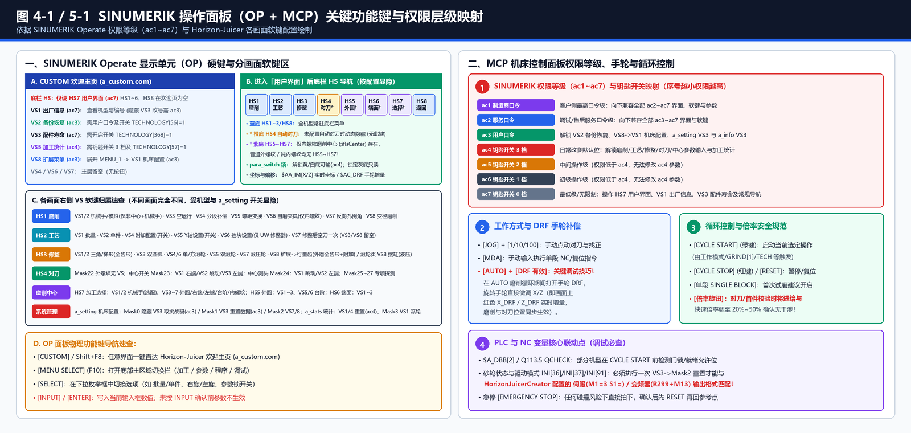

# 4.1 真机 NC-Data 与 CF 卡部署流程

由 `HorizonJuicerCreator` 生成交付包的目录严格划分为两部分：**`NC-Data/`（进 NC 控制器内存）** 与 **`System-CF-Card/`（进 HMI 面板/CF 卡文件系统）**。两部分缺一不可。

## 1. 部署前必查的 NC 机床数据（MD）

在激活全局变量定义文件 `MGUD.DEF` 之前，请先进入机床 **调试 → 机床数据 → 通用机床数据** 核对并调整以下两个核心系统参数：

| 机床数据号 | 参数名称 / 用途 | 要求设定值 | 说明与注意事项 |
| :--- | :--- | :---: | :--- |
| **`MD18120`** | `MM_NUM_GUD_NAMES_NCK`（NCK 区域全局用户数据名称数量） | **`>= 70`** | `MGUD.DEF` 内声明了海量 `INI`、`DRESSER`、`PROCESS`、`TECHNOLOGY` 等数组与字符串变量，默认值偏小时激活 `MGUD` 会报内存不足 |
| **`MD18660`** | `MM_NUM_SYNACT_GUD_REAL[1]`（同步动作可用的 Real 型固定 SYG 变量数） | 按需设为 **`20`** | 同步动作中无法直接使用普通 GUD 变量，若需要开放 `SYG_RM[0]`～`SYG_RM[19]` 供同步动作使用，可设该参数为 `20` |

> **提示**：修改 `MD18120` 后通常需要执行一次 **NCK 复位（PO Restart）** 使其内存重新分配生效，建议先备份当前机床总系列备份文件（Archive）后再行修改。

## 2. NC-Data 导入顺序（严格先 DEF，后 CMA 与 MPF）

可通过 **前部 USB 接口** 拷贝或使用 **WinSCP / FileZilla** 经由服务网口传输至控制器，必须严格遵守以下顺序：

1. **导入并激活 `DEF/MGUD.DEF`（第一步）**：
   - 将 `NC-Data/DEF/MGUD.DEF` 传入控制器 **定义（Definitions）** 目录；
   - 在程序管理器中选中 `MGUD.DEF`，点击右侧软键 **激活（Activate）**，确认无报警后所有全局数组即建立完毕。
2. **导入子程序 `CMA/*.SPF`（第二步）**：
   - 将 `NC-Data/CMA/` 下全部 `.SPF` 文件传入系统 **制造厂循环（Manufacturer Cycles）** 目录（即 `/_N_CMA_DIR`）。
3. **导入主程序 `MPF/<机床型号>.MPF`（第三步）**：
   - 将 `NC-Data/MPF/<机床型号>.MPF` 传入 **零件程序（Part Programs）** 目录。
   - **重要初始化操作**：第一次投产调试前，请务必检查 `<机床型号>.MPF` 内的轴速度（`INI[54]`～`INI[65]`、S轴/V/W/U/A速度）、主轴等待延时（`INI[71]`、`INI[112..115]`）、换刀指令标记（**禁止在未安装或未配置 `TCHANGE` 子程序时直接保留无效 `T0 D0`**，需按源码内备注视实际机床情况处理），并在 **AUTO** 模式下运行一次该初始化主程序使预设生效。

## 3. System-CF-Card 导入 HMI 系统目录

根据所选目标系统平台的不同，`System-CF-Card` 内的有效目录结构有所差异：

- **828D 老版**：包含 `user`、`oem`、`siemens`
- **828D 新版 / Sinumerik ONE**：包含 `oem`、`user`（`siemens` 由内部标准固件接管或按对应层级存放）

将 `System-CF-Card` 下的全部文件夹整体复制到控制器 CF 卡根目录 `/card/`（PCU50/IPC 可使用 WinSCP 连接至 `/siemens`、`/oem`、`/user` 并对应合并覆盖）：

> **关键一步 — 清理旧版在线帮助缓存**：  
> 每次更新 `hlp` 帮助包后，若老帮助内容或图片未生效，请删除以下缓存目录并重新开机或切换语言：  
> `/card/siemens/sinumerik/sys_cache/hmi/hlp`

## 4. 新设备首次传入数据必做：配置重置（VS3 → Mask2）

> **重要提示（新设备首次传入数据必做配置重置）**：  
> 当向 **全新机床**（或重新激活了 `MGUD.DEF` 清空了全局变量内存的控制器）首次导入程序包并运行一次 `<机床型号>.MPF` 后，**必须**立即进入 **CUSTOM → 右下角 `VS8 扩展菜单` → `VS1 机床配置`**（使用 [3.1 口令计算器](../3_creator_tools/password_calculator.md) 解锁 `Mask0` 进入 `Mask1`），点击右侧软键 **`VS3 重置数据`**，并在 `Mask2` 弹窗中点击 **`VS8 确认`** 执行一次配置重置！  
> **底层原因（`a_setting.com` `SUB(UP6)`）**：新建立的 `MGUD` 变量默认全为 `0`；而 `HorizonJuicerCreator` 已将您勾选的 **砂轮/修整轮伺服或变频驱动（`INI[36]` 内/外磨砂轮、`INI[37]` 修整轮、`INI[91]` 磨削中心外圆砂轮，决定 `F_GRINDWHEEL_RUN.SPF` 发送 `M1=3 S1=` 还是 `R299+M13`）、A 轴使能（`INI[16]`）、自动对刀与测量方向（`INI[69]`、`±1`）、默认安全转速（`1000`/`5000`）以及 `UP1`～`UP9` 输入框读写权限锁** 编译写入了 `SUB(UP6)`。**不执行这次重置，磨削主轴可能无法正常按对应驱动方式启动或关联输入框呈灰显锁定！** 详见 [5.2 机床系统配置与安全解锁](../5_custom_and_system/machine_settings.md)。

## 5. 逻辑驱动器与前置/后置 USB 配置文件（`extdev.ini`）

如果客户需要使用 **外部齿形轨迹程序加载** 或 **参数备份恢复到 USB** 功能，请注意以下两个接口配置要求：

1. **前置 USB 存储（备份与读取）**：
   - 需将 `Source_Library`（或程序包内附带的）配置示例 `extdev.ini` 放入控制器的 `/oem/sinumerik/nck/`（或 `/user/sinumerik/nck/`）目录，并 **重启 CNC 系统** 后生效。
   - 注意：受西门子底层系统限制，**部分固件测试无法直接执行向后置 USB 写入备份**（建议备份优先使用 `内部SPF`、`CF卡` 或正确配置了 `extdev.ini` 的 `前USB`）。
2. **后置 USB 读取外部文件（`//DEV_3`）**：
   - 如需从机床电气柜 **后置 USB** 读取参数备份文件或外部齿形程序，必须在 SINUMERIK Operate **调试 → HMI → 逻辑驱动器（Logical Drives）** 中新增并配置驱动器连接，且逻辑名称必须严格设置为 **`//DEV_3`**。

## 6. 实机首次上电前操作面板速查

### SINUMERIK Operate `ac1`～`ac7` 访问权限对照表

> **说明**：西门子访问等级编号越小权限越高，高权限向下兼容全部低权限软键与输入框（`ac0` 为西门子系统厂商最高级）。

| 访问标识 | 对应口令 / 钥匙开关等级 | 在 `Horizon-Juicer` 中的具体开放范围 |
| :---: | :--- | :--- |
| **`ac1`** | **制造商口令**（客户侧最高口令） | 向下兼容全部 `ac2`～`ac7` 界面、软键与底层参数 |
| **`ac2`** | **服务口令** | 向下兼容全部 `ac3`～`ac7` 界面、软键与底层参数 |
| **`ac3`** | **用户口令** | 解锁 `CUSTOM` 主页 **`VS2 备份恢复`**、**`VS8 扩展菜单 → VS1 机床配置`**、`a_setting` **`Mask0` 隐藏 `VS3`（显示挑战码）** 与 **`Mask1` `VS3 重置数据`**，以及 `a_info` **隐藏 `VS3`（解锁修改出厂编号）** |
| **`ac4`** | **钥匙开关 3 档**（日常改参默认位） | 解锁绝大多数磨削、工艺、修整、对刀、磨削中心及机床配置参数输入框（`WR2, ac4`），并开放 `CUSTOM` 主页 **`VS5 加工统计`** 及统计页 **`VS1 重置统计` / `VS4 重置计数`** |
| **`ac5`** | **钥匙开关 2 档** | 中间操作级（权限低于 `ac4`，不可修改 `ac4` 参数） |
| **`ac6`** | **钥匙开关 1 档** | 初级操作级（权限低于 `ac4`，不可修改 `ac4` 参数） |
| **`ac7`** | **钥匙开关 0 档**（最低级别 / 无限制） | 始终可操作：进入 **`HS7 用户界面`**、查看 **`VS1 出厂信息`** / **`VS3 配件寿命`**，以及各加工画面常规导航软键与只读监控数据 |
