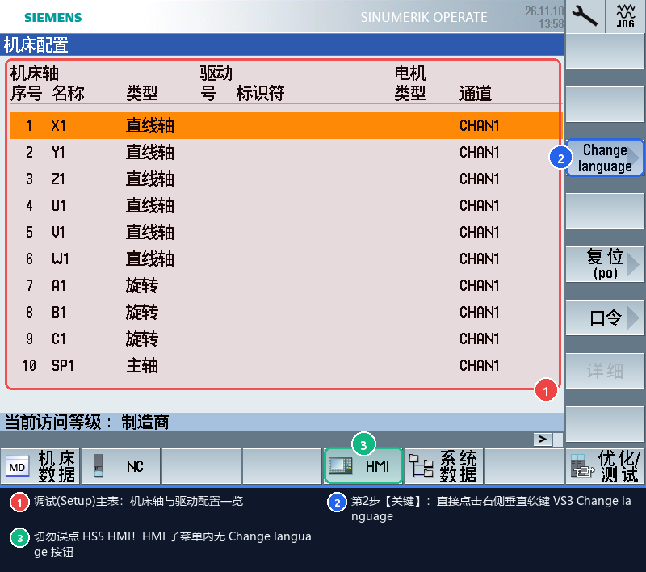
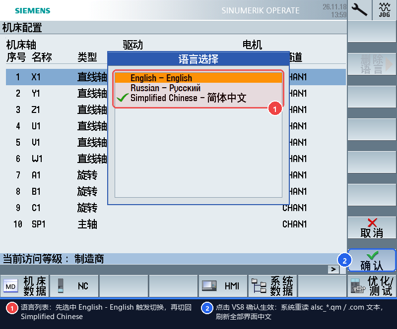
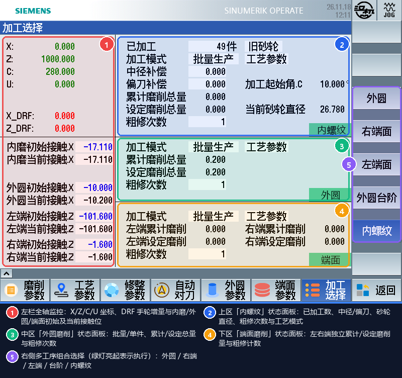

# 4.2 SinuTrain 4.8 SP4 仿真导入与缓存刷新

对于售前方案演示、界面排布验收或参数逻辑测试，强烈建议先利用虚拟机或本机安装的 **SinuTrain for SINUMERIK Operate 840D sl 4.8 SP4** 完成全套画面与流程预演，再前往真机调试。

## 1. 标准软件运行环境

- **SinuTrain 启动程序路径**：
  ```text
  C:\Program Files (x86)\Siemens\SinuTrain\SinuTrain Workbench\sinutrain.exe
  ```
- **目标 HMI 根目录路径**：
  ```text
  C:\Siemens\SinuTrain\SINUMERIK CNC-SW 840D sl 4.8 SP4\hmi
  ```
- **推荐生成配置**：在 `HorizonJuicerCreator` 中将 **系统类型** 设为 **`0`（828D 老版）**，生成的 `System-CF-Card` 下包含 `user`、`oem`、`siemens` 全套兼容目录及 `ico800` 图标，可直接与 SinuTrain 4.8 SP4 匹配（无分辨率错位）。

## 2. 导入界面包与清理帮助缓存

1. 通过 `HorizonJuicerCreator` 生成所需机型的程序包；
2. 打开生成的 `<程序包根目录>\System-CF-Card\`，选中内部全部子文件夹（如 `oem`、`siemens`、`user`）；
3. 将它们直接 **复制并合并覆盖** 到 SinuTrain 的 `hmi` 目标目录中：
   ```text
   C:\Siemens\SinuTrain\SINUMERIK CNC-SW 840D sl 4.8 SP4\hmi
   ```
4. **（可选）删除在线帮助缓存**：如果同时更新了嵌入式帮助手册或图包，删除 `hmi\siemens\sinumerik\sys_cache\hmi\hlp` 目录；
5. 若要在仿真中运行 NC 循环测试，请同时在 SinuTrain 界面内的 **程序管理器** 中按 4.1 节顺序导入并激活 `MGUD.DEF` 与 `CMA/*.SPF`、`MPF/*.MPF`。

> **提示**：首次覆盖前建议先将 `C:\Siemens\SinuTrain\...\hmi` 下的原有 `user`/`oem`/`siemens` 做一次本地快照备份，以便多套不同设备包对比测试后随时恢复干净基线。

## 3. 切换语言热刷新界面文本（关键技巧）

在 SinuTrain 处于运行状态下，每次重复覆盖导入新的 `System-CF-Card`（尤其是更新了 `almc_chs.txt` / `almc_eng.txt` 语言字典或 `.com` 界面布局后），**无需关闭重启整个 SinuTrain 虚拟机**，只需通过切换一次 HMI 语言即可立即重新加载全部界面文本与 EasyScreen 配置：



操作步骤如下：

1. 在虚拟面板右侧按键区按下 **`MENU SELECT`**（或快捷键 `F10`），点击底部水平软键 **`调试`（Setup）** 进入调试主表界面；
2. **直接点击右侧垂直软键 `VS3 Change language`（切换语言）**！
   > **注意**：在 SinuTrain 4.8 SP4 中，`Change language` 直接位于 `调试` 顶层右侧 `VS3` 键上，**千万不要点击底部水平软键 `HS5 HMI`**（进入 `HMI` 子菜单后右侧软键会变更，不再显示 `Change language` 按钮）。
3. 弹出 **语言选择** 列表窗口后（见下图），选择另一种语言（例如先选中 **`English - English`** 并点击右下角 **`VS8 确认`**），等待屏幕闪刷加载完毕；



4. 再次点击右侧 **`VS3 Change language`**，切换回 **`Simplified Chinese - 简体中文`** 并点 **`VS8 确认`** 刷新文本；
5. 最后按下虚拟操作面板的 **`CUSTOM`** 键（或 `F10 → CUSTOM`），即可直接看到最新刷新后的 Horizon-Juicer 定制界面效果（以下为磨削中心加工选择画面实拍）：


