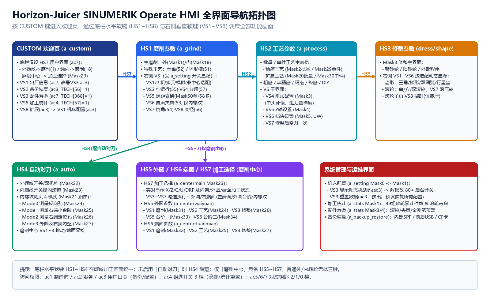

# 第 5 章 系统主页、底层设置、统计与备份

按下机床面板或 SinuTrain 上的 **`CUSTOM`** 实体键，即可进入 `Horizon-Juicer` 专属加工与管理界面系统。整套界面以 `a_custom.com` 为总枢纽，通过顶部/底部水平软键与右侧垂直软键在五大模块之间自由跳转：

本章重点讲解系统级入口与运维管理界面：

- [5.1 CUSTOM 主页导航与设备编号信息](custom_home.md) —— 自定义主入口菜单开关联动规则，以及设备出厂编号查看与修改；
- [5.2 机床系统配置与安全解锁](machine_settings.md) —— 6 位动态密码校验页（`Mask0`）与全部 6 大类、50 余项系统底层开关参数（`Mask1`）；
- [5.3 加工统计、砂轮记录与配件寿命管理](stats_and_life.md) —— 99 组换砂轮统计表、修整轮寿命统计、4 类核心易损件寿命监控与 100 组滚轮编码台账；
- [5.4 NC 全局参数备份与恢复](backup_and_restore.md) —— 一键全量/自定义全局变量导出与还原操作指南。
