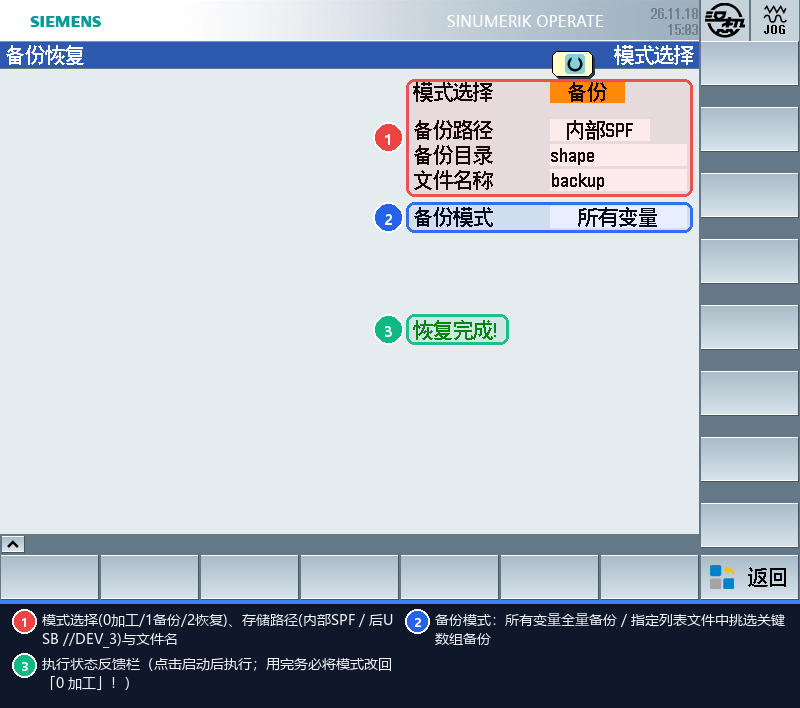

# 5.4 NC 全局参数备份与恢复

在批量更换产品型号（如从 M20 滚珠丝杠切换为 M40 丝杠）或现场维修主板/清零 NC 前，操作员可使用系统内置的 **参数备份恢复** 模块，把所有工件工艺、滚轮位置、对刀结果和修整数据快速保存成可读文本文件，换型时一键还原。

在 **CUSTOM 主页** 点击 **`VS2 备份恢复`**（需 **`ac3` 用户口令及以上** 权限，且在 **机床配置** 中开启 `TECHNOLOGY[56]=1`）即可打开 `a_backup_restore.com`（`Mask0`）；进入后编辑备份路径、目录、名称与备份模式等字段需 **`ac4`（钥匙开关 3 档）** 权限。



## 1. 模式选择与备份介质说明

界面顶行提供核心切换开关 **`MODE_CHOICE`**（绑定 NC 全局变量 **`CHOICE`**）：

| 模式选项（`CHOICE` 值） | 运行效果说明 |
| :--- | :--- |
| **`0`：加工（默认正常生产态）** | 执行主程序时正常进行磨削、修整或对刀 |
| **`1`：备份** | 在 **`AUTO` 模式按下循环启动**，运行 `INFO_INIT` 或 `A_BACKUP_RESTORE.SPF` 后不加工工件，只将当前 NC 参数写入备份文件 |
| **`2`：恢复** | 在 **`AUTO` 模式按下循环启动**，从指定备份文件读取数值并回写覆盖当前 NC 全局变量与 R 参数 |

> **关键警告**：完成参数备份或恢复之后，**必须立即将模式切换回 `0（加工）`**！否则下次操作工按绿键“循环启动”加工零件时，机床不会磨削，而是继续重复备份或用旧备份文件覆盖当前刚刚调好的参数！

### 支持的存储路径选项

- **备份路径（`BACKUP_POS`）**：`0` 内部 SPF（默认用户/子程序存储区）、`2` 前 USB、`3` CF 卡。
  - *注意*：根据西门子测试限制，**前 USB 写入需预先在 `/oem/sinumerik/nck/`（或 `user`）中部署 `extdev.ini` 并重启 CNC**；备份通常不直接向后置 USB 写入。
- **恢复路径（`RESTORE_POS`）**：`0` 内部 SPF、`1` 后 USB（`//DEV_3`）、`2` 前 USB、`3` CF 卡。
  - *注意*：读取后 USB 文件时，必须在 **调试 → HMI → 逻辑驱动器** 中新增名称严格为 **`//DEV_3`** 的路径。

## 2. 全量备份 vs 自定义变量清单（`BACKUP_TYPE`）

| 界面字段 | 含义与要求 |
| :--- | :--- |
| **备份目录 / 文件名称** | 指定导出文件夹名与文件名（如 `WK_M32` / `PAR_M32`）；文件夹若不存在由 NC 自动创建 |
| **备份模式** | `0` **所有变量**：完整打包系统中全部关键 `MGUD` 数组；<br>`1` **自定义变量**：仅按开发者或工艺员提供的变量表读取并导出指定的参数子集 |
| **列表目录 / 列表名称 / 列表行数** | 仅当 `备份模式 = 自定义变量` 时配置：<br>• 列表文件默认存放在系统子程序路径下的指定文件夹内，文件名为纯文本 `.TXT`（输入 **列表名称** 时无需填写 `.TXT` 后缀）；<br>• **列表行数（`FILE_LINE_COUNT`）** 上限为 **`0 ~ 790`** 行，必须准确填写该文本文件包含空行与 `;` 注释行在内的 **实际总行数**！ |

### 自定义备份变量表语法规范（`PAR_DEMO.TXT`）

在文本文件中每行定义一个变量名，遵循以下 4 条语法约定：
1. 最多包含有效变量及注释/空行不超过 `790` 个/行，且 **必须在界面 `列表行数` 中声明文件总行数**；
2. 行首使用分号 **`;`** 开头的行视为注释，运行时自动跳过；空行同样自动跳过；
3. 如需备份 **字符串类型（`STRING`）全局变量**，必须在变量名前加星号 **`*`**；
4. 实数/整数全局数组或系统 `R` 参数直接写名称即可：

```text
;****************************
;PAR_DEMO.TXT (需声明列表行数 = 14)
R0
R1

INI[5]
*STRING
;注释行示例
WORK[5]
;*****************************
```

## 3. 恢复操作标准步骤

1. 打开 **CUSTOM → 备份恢复**；
2. 将 `模式选择` 设为 **`2（恢复）`**；
3. 依次核对 `存储位置`、`恢复文件夹名称`、`恢复程序名`（确认与备份时一致，且目标文件存在）；
4. 切换到 **`AUTO` 模式**，按下机床面板 **循环启动（Cycle Start）**；
5. 观察界面底部状态提示条 `BR_MSG` 返回成功提示，随后 **立刻将 `模式选择` 改回 `0（加工）`**，即可恢复正常生产。
