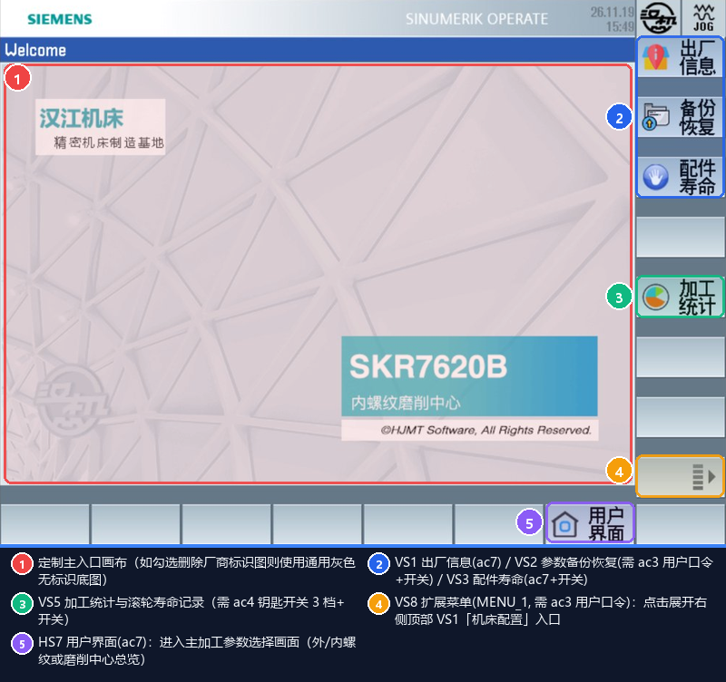
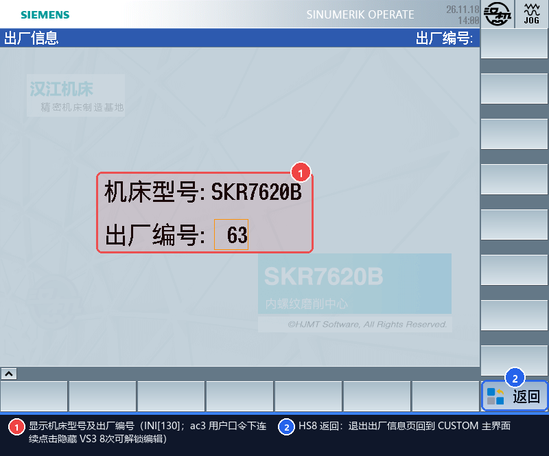
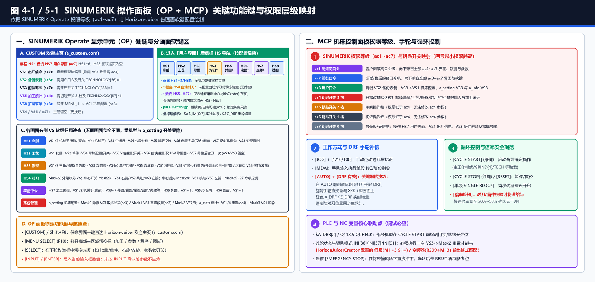

# 5.1 CUSTOM 主页导航与设备编号信息

## 1. CUSTOM 自定义主入口（`a_custom.com`）

按下机床面板 **`CUSTOM`** 键（或 Area Menu **`HS8 用户界面`**）后进入 **Welcome** 欢迎主页（标题由 <code>&#36;85019</code> 对应文字显示），首页中央展示设备定制主图形（依据系统分辨率自动加载 `ico800/.../custom.png`、`ico1024/.../custom.png` 或无商标版图片）。

欢迎主页下方水平软键与右侧垂直软键排布受系统参数与访问等级动态控制（注：`a_custom.com` 欢迎页底栏**仅设 `HS7 用户界面`**，`HS1`～`HS6` 与 `HS8` 均为空；右侧主层 **`VS4`、`VS6`、`VS7` 为空**）：

| 软键位置 | 按钮名称 | 跳转目标界面（`.com`） | 显示条件 / 访问权限说明 |
| :---: | :--- | :--- | :--- |
| **`HS7`** | **用户界面（磨削主入口）** | - 普通机型 → 螺纹主磨削参数（`a_grind.com`） - 磨削中心（`;ifIsCenter`）→ 加工选择总看板（`a_centermain.com`） | 常驻显示（**`ac7` 钥匙开关 0 档**即可操作；对应 `a_custom.com` `Start` 主页 `HS7`） |
| **`VS1`** | **出厂信息** | 设备型号与出厂编号界面（`a_info.com`） | 常驻显示（**`ac7` 钥匙开关 0 档**可查看） |
| **`VS2`** | **备份恢复** | 参数备份与恢复（`a_backup_restore.com`） | 需 **`ac3`（用户口令及以上）** 权限，且在 **机床配置** 中开启 **参数备份恢复界面**（NC：`TECHNOLOGY[56]` = `1`） |
| **`VS3`** | **配件寿命** | 易损配件寿命监控台账（`a_stats.com` `Mask3`） | **`ac7`（钥匙开关 0 档）** 权限即可进入，需开启 **配件寿命管理**（NC：`TECHNOLOGY[368]` = `1`） |
| **`VS5`** | **加工统计** | 砂轮记录与修整轮生命周期统计（`a_stats.com` `Mask1`） | 需 **`ac4`（钥匙开关 3 档及以上）** 权限，且开启 **加工统计界面**（NC：`TECHNOLOGY[57]` = `1`） |
| **`VS8` → `VS1`** | **扩展菜单 → 机床配置** | 口令验证与机床底层参数设定（`a_setting.com`） | 需 **`ac3`（用户口令及以上）** 权限：点击右侧 **`VS8`（`[≡▸]`，`ac3`）** 展开二级菜单 **`MENU_1`**，再点击 **`VS1 机床配置`（`ac3`）**（按 **`VS8` 返回** 退出二级菜单） |

> **提示**：对于早期兼容模式面板（`hmiMode = 1`），`HS`/`VS` 仅展示纯文字标签而隐藏内置小图标；部分早期定制布局也可能将常用入口直接映射在底部 `HS1`～`HS8`，实际跳转规则一致。

## 2. 设备信息 / 出厂信息界面（`a_info.com`）

点击首页 **`VS1 出厂信息`** 打开出厂信息页（`Mask0`），向客户与售后工程师展示当前机床硬件档案：

| 显示/操作项 | 关联变量（NC 索引） | 说明 |
| :--- | :--- | :--- |
| **机床型号** | 文本资源 `machineNameLng` / 机型标识 | 展示设备中文名称及出厂型号规格（只读展示，如 `内螺纹磨削中心`） |
| **出厂编号** | `INI[130]`（HMI 为 `INI[131]`） | 默认显示当前设备出厂序列号，用于追踪机身配置与历史版密码核算 |
| **`VS3` 软键（隐藏修改触发）** | `COUNT` / `INI[130]` | 需 **`ac3`（用户口令及以上）** 权限：现场售后需要更新或录入出厂编号时，连续点击 **`VS3`** 8 次（`COUNT >= 8`）可将 `INI[130]`（HMI `INI[131]`）由只读切换为可编辑输入框（`WR3` → `WR2`）并保存 |
| **`HS8` 返回** | — | 返回 `CUSTOM` 主页面 |

## 3. 多语言切换支持

整个 `Horizon-Juicer` 界面文本字典全面支持 **简体中文（`almc_chs.txt`，语言号 `8`）**、**英文（`almc_eng.txt`，语言号 `3`）** 与 **俄文（`almc_rus.txt`，语言号 `57`）**。

不光 EasyScreen 菜单文本框文本会自动跟随 SINUMERIK Operate 语言设置切换，NC 子程序内部的所有报警弹窗（如 `C_ALARM.SPF`）也会实时读取系统变量 **<code>&#36;AN_LANGUAGE_ON_HMI</code>** 自动输出对应语种的精确中文、英文或俄文故障描述！

## 4. MCP 操作面板功能键与 C 轴手摇旋转（`B_C_MOV.SPF`）

在进入磨削画面与自动运行前，操作员常通过西门子 OP 软键区与 MCP 物理面板按钮触发自定义界面、砂轮修整、对刀、冷却及 C 轴旋转功能：

其中涉及 **C 轴点动/自动连续旋转调试（如校表、找正或换装夹具）** 的底层程序 `B_C_MOV.SPF` 运行逻辑如下：
- 当检测到 MCP C 轴旋转触发信号（<code>&#36;A_DBB[6]==1</code>）时，程序根据配置判定旋转执行模式与 C 轴主轴映射参数 `MD35000 $MA_SPIND_ASSIGN_TO_MACHAX[C]`；
- 调试工装同心度时，请确认修整及对刀灯熄灭且无运动报警，再按对应 MCP 功能键触发旋转或停止。
