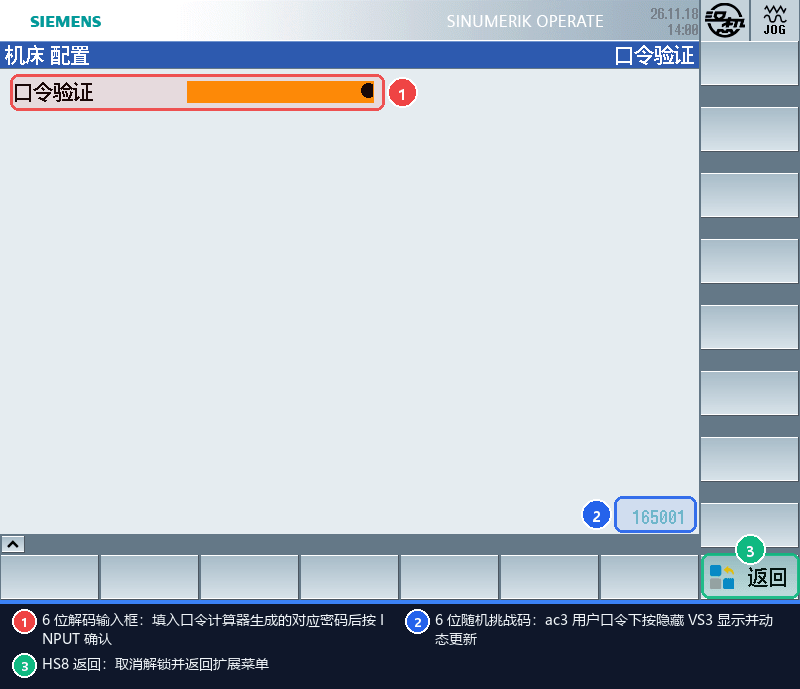
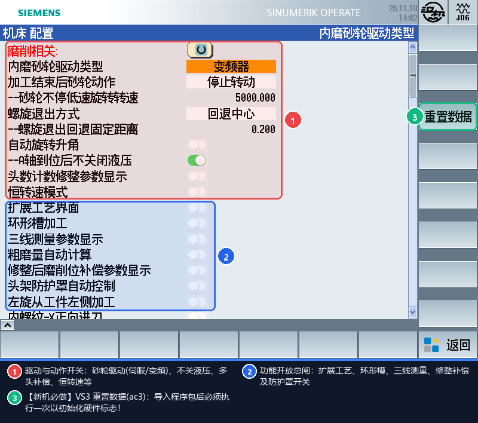
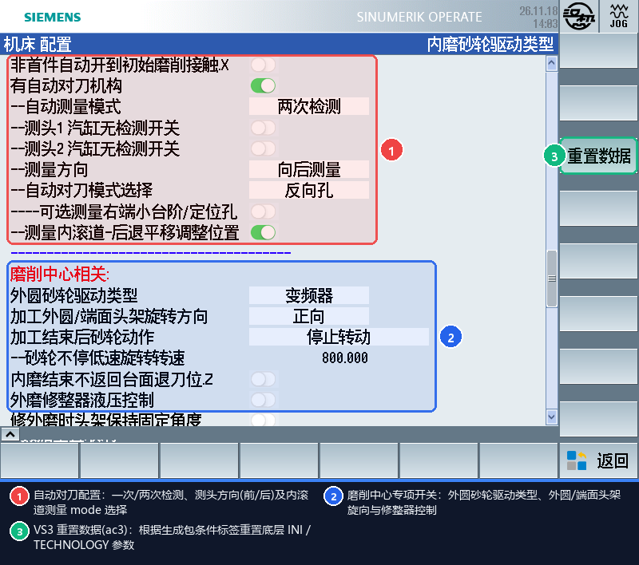
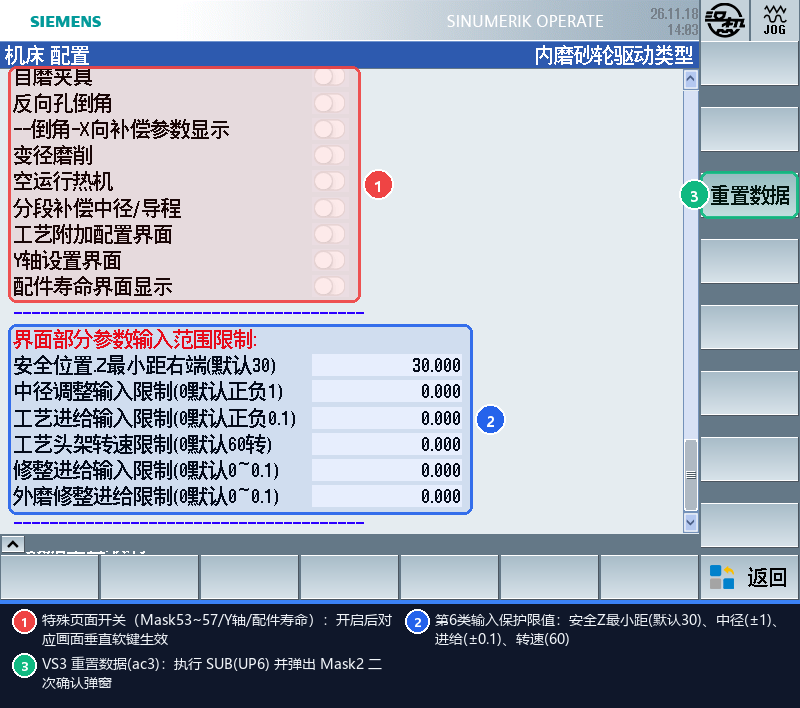
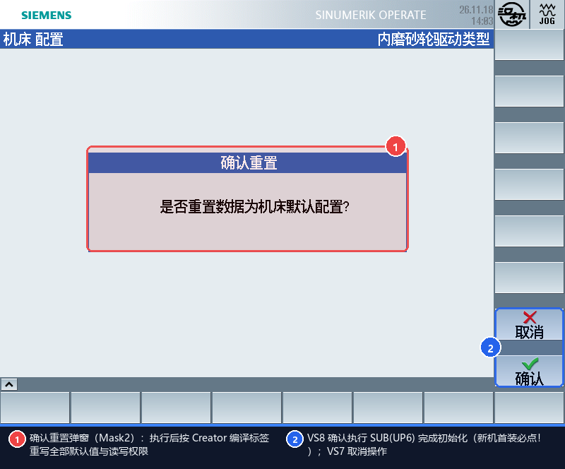

# 5.2 机床系统配置与安全解锁

**机床配置**（`a_setting.com`）集中管理所有影响机床安全逻辑、电主轴类型、自动门/防护罩联锁、修整对刀策略以及扩展模块开关的系统级配置。为防止操作工误修改，本页前设了动态密码锁。

## 1. 动态解锁口令验证（`Mask0`）

从 **CUSTOM 主页** 点击 **`VS8`（扩展菜单 `[≡▸]`）→ `VS1`（机床配置）** 后，首先进入口令解锁页 `Mask0`（基于 `Horizon-Juicer >= V3.29.0` 架构；注意 `VS8 → VS1` 入口、`Mask0` 隐藏 **`VS3`** 以及 `Mask1` **`VS3 重置数据`** 均要求系统处于 **`ac3`（用户口令；或服务口令 `ac2` / 制造商口令 `ac1`）** 以上权限，而 `Mask1` 内大多数参数输入框需 **`ac4`（钥匙开关 3 档）** 权限方可修改）：

1. **自动环境自检**：进入界面时后台按 `user > oem > siemens` 层级优先顺序查找私有配置文件 `machine_sec.ini` 并校验字段有效性。如右侧红色状态框提示 `配置丢失`、`配置缺损` 或 `配置无效`，请先按 [3.1 节](../3_creator_tools/password_calculator.md) 方法恢复配置包后再继续；
2. **获取 6 位挑战码**：按下右侧垂直软键 **`VS3`**，右下角将显示当前生成的 **6 位数字挑战码**（持久化种子每次递增变化，防止重放）；
3. **计算并输入解锁**：在调试电脑 `HorizonJuicerCreator` 的 **口令计算** 工具中，或登录网页版口令计算器 [https://hjpc.niekun.net/](https://hjpc.niekun.net/)（需向管理员申请账户和密码，见 [3.1 节](../3_creator_tools/password_calculator.md)）填入该 6 位挑战码算出 6 位动态密码，再回到机床界面填入 **`口令验证`**（`PASSWD_CHECK`）输入框，验证通过即自动切入 `Mask1` 主参数配置页。

> **安全说明**：核心密钥盐值与口令派生计算规则（以 `******` 脱敏代指）在本地加密配置中运行，本手册不公开内部算法常量，请勿尝试手动修改 `machine_sec.ini` 内参数，否则会触发 `配置无效` 告警。

## 2. 六大类底层配置参数详表（`Mask1`）

进入 `Mask1` 后，屏幕按功能分区展示 6 大类配置项（右侧滚动条可上下浏览全表）。下表同时列出 **NC 变量名（0-based，用于 `.SPF` 与 `MGUD.DEF`）** 与 **HMI 脚本引用名（1-based，`NC+1`）**，方便现场跨文件核对：

### 2.1 第一类：磨削配置

| HMI 参数名称 | NC 变量（0-based） | HMI 引用（1-based） | 可选值与含义说明 |
| :--- | :--- | :--- | :--- |
| **内磨/外磨砂轮驱动类型** | `INI[36]` | `INI[37]` | `0` 变频器/模拟量 / `1` 伺服电机（`F_GRINDWHEEL_RUN.SPF` 按 `INI[36]` 判断发 `M13`/`R299` 还是 `M1=3 S1=`；代码生成阶段亦按选配确定控制分支） |
| **程序结束砂轮停止** | `INI[79]` | `INI[80]` | `0` 停止 / `1` 不停（保持当前转速）/ `2` 不停且按低速旋转 |
| **砂轮低速旋转转速** | `TECHNOLOGY[9]` | `TECHNOLOGY[10]` | 当结束模式设为低速不停时的维持转速（RPM） |
| **内螺纹螺旋退出方式** | `TECHNOLOGY[234]` | `TECHNOLOGY[235]` | *仅内螺纹*：`0` 退回工件中心 / `1` 后退固定安全距离 |
| **螺旋退出后退距离** | `TECHNOLOGY[235]` | `TECHNOLOGY[236]` | *仅内螺纹*：螺旋退出方式为 `1` 时使用的 X 退刀距离（mm） |
| **螺旋升角使能** | `INI[16]` | `INI[17]` | *需配 A 轴*：`0` 否 / `1` 是，决定程序运行时是否转动 A 轴 |
| **转完 A 轴不关闭液压** | `INI[158]` | `INI[159]` | *需配 A 轴*：`0` 转完关闭液压 / `1` 保持夹紧松开液压状态 |
| **按头数修整参数显示** | `WORK[4]` | `WORK[5]` | `0` 隐藏 / `1` 在工艺界面开放“多头磨完计数 vs 每头计数”开关 |
| **砂轮恒转速模式** | `INI[144]` | `INI[145]` | `0` 否（按线速度自动换算 RPM）/ `1` 是（开放直接输入恒定 RPM） |
| **扩展工艺开关** | `PROCESS[15]` | `PROCESS[16]` | `0` 精简工艺参数表 / `1` 扩展工艺参数表（含分工序修整参数与批量/单件分化） |
| **环形槽功能开关** | `RING[49]` | `RING[50]` | `0` 隐藏 / `1` 在磨削参数界面开启“螺纹 / 环形槽”切换开关 |
| **三线测量参数显示** | `INI[148]` | `INI[149]` | *仅内螺纹*：`0` 隐藏 / `1` 在工艺界面底部显示三线/钢球/终尺寸 `H` |
| **粗磨量自动计算** | `TECHNOLOGY[233]` | `TECHNOLOGY[234]` | `0` 否 / `1` 是（开启后由总余量与后三道工序自动反算粗磨进给深度） |
| **加工中修整补偿显示** | `DRESSER[58]` | `DRESSER[59]` | `0` 隐藏 / `1` 在修整界面显示 `加工中修整位置补偿量`（用于修正系统性尺寸漂移） |
| **内螺纹头架防护罩控制** | `PROCESS[120]` | `PROCESS[121]` | *仅内螺纹*：`0` 无 / `1` 自动伸出缩回控制（`F_SHIELD_CONTROL`） |
| **内螺纹左旋左侧加工** | `TECHNOLOGY[65]` | `TECHNOLOGY[66]` | *仅内螺纹*：`0` 否（默认从右向左）/ `1` 是（左旋工件改从左向右） |
| **外螺纹左旋右侧加工** | `TECHNOLOGY[168]` | `TECHNOLOGY[169]` | *仅外螺纹*：`0` 否 / `1` 是 |
| **内螺纹正向进刀磨削** | `WORK[7]` | `WORK[8]` | *仅内螺纹*：`0` 否（常规负向切入）/ `1` 是（正向进刀磨削方向） |
| **结束关闭修整/对刀键** | `INI[70]` | `INI[71]` | `0` 否 / `1` 程序结束时自动发 `M78`/`M61` 熄灭 MCP 修整及对刀按键灯 |
| **是否有自动门** | `PROCESS[52]` | `PROCESS[53]` | `0` 否 / `1` 是 |
| **自动门选择** | `TECHNOLOGY[59]` | `TECHNOLOGY[60]` | `1` 自动门 1（<code>&#36;A_DBB[9/10]</code>）/ `2` 自动门 2（<code>&#36;A_DBB[22/23]</code>） |
| **自动门开关检测** | `TECHNOLOGY[64]` | `TECHNOLOGY[65]` | `0` 不检测到位信号（延时放行）/ `1` 强制等待开关检测信号 |
| **粗磨消空程使能** | `TECHNOLOGY[293]` | `TECHNOLOGY[294]` | `0` 否 / `1` 是（利用 <code>&#36;A_IN[15]</code> 声发射/碰撞接触信号快速消空程） |
| **起始加工工序选择使能** | `SHAPE_MODEL[63]` | `SHAPE_MODEL[64]` | `0` 否 / `1` 是（在批量磨削界面允许指定从半精/精磨及第几循环接续加工） |
| **断电回退使能** | `TECHNOLOGY[299]` | `TECHNOLOGY[300]` | `0` 否 / `1` 是（配合 <code>&#36;A_DBB[25]</code> 与 `F_POWEROFF_PROTECT.SPF` 执行瞬时退刀） |
| **断电回退后退距离** | `INI[19]` | `INI[20]` | 断电保护触发后的 X 轴回退距离（程序内强制安全限幅 `0`～`5 mm`） |
| **磨削冷却附加通道** | `TECHNOLOGY[307]` | `TECHNOLOGY[308]` | `0` 无 / `1` 附加开启 `M28` / `2` 附加开启 `M38` |
| **压力检测信号显示** | `TECHNOLOGY[367]` | `TECHNOLOGY[368]` | `0` 隐藏 / `1` 在工艺界面显示气压/油压监控状态 |
| **双向进刀量输入模式** | `TECHNOLOGY[369]` | `TECHNOLOGY[370]` | `0` 输入值代表往返两次的总和 / `1` 输入值代表单次单向进刀量 |

### 2.2 第二类：修整配置

| HMI 参数名称 | NC 变量（0-based） | HMI 引用（1-based） | 可选值与含义说明 |
| :--- | :--- | :--- | :--- |
| **修整轮类型选择** | `INI[37]` | `INI[38]` | `0` 模拟量 / `1` 伺服 |
| **程序结束修整轮停止** | `PROCESS[128]` | `PROCESS[129]` | `0` 停止 / `1` 不停（保持转速）/ `2` 不停且低速旋转 |
| **修整轮低速旋转转速** | `PROCESS[129]` | `PROCESS[130]` | 设为低速不停时的维持 RPM |
| **新砂轮插补修整模式** | `INI[88]` | `INI[89]` | `0` 抬齿高模式（逐层逼近齿顶）/ `1` 偏半个砂轮宽度模式（先单边切入成形） |
| **通用齿型插补平面** | `DRESSER[56]` | `DRESSER[57]` | `0` `G17`（1-2 几何轴）/ `1` `G18`（1-3 几何轴）/ `2` `G19`（2-3 几何轴） |
| **修整时 A 轴角度显示** | `INI[154]` | `INI[155]` | *需配 A 轴*：`0` 隐藏 / `1` 在修整界面显示 `修整角度`（用于大导程干涉修整） |
| **修整轮反向旋转** | `INI[155]` | `INI[156]` | `0` 不反 / `1` 反向旋转（切换滚轮 M 指令正反转方向） |
| **外部齿形参数显示** | `DRESSER[110]` | `DRESSER[111]` | `0` 否 / `1` 在修整界面显示外部轮廓轨迹文件名与存储位置选框 |
| **外部轨迹无外围延长** | `DRESSER[106]` | `DRESSER[107]` | `0` 有外围斜线延长 / `1` 无外围延长部分 |
| **每 20 次刷新砂轮转速** | `INI[111]` | `INI[112]` | `0` 跳过 / `1` 长循环修整时每 20 次重新调用转速计算并延时 3 秒（防止直径缩小后线速度偏差） |
| **提前一刀启动滚轮** | `DRESSER[57]` | `DRESSER[58]` | `0` 否 / `1` 是（减少磨削中修整的等待延时） |
| **新砂轮是否为成型砂轮** | `TECHNOLOGY[58]` | `TECHNOLOGY[59]` | *仅内螺纹*：`0` 隐藏 / `1` 显示 `普通/成型` 切换框 |
| **三角/梯形/双圆弧扩展显示** | `SHAPE_MODEL[6/26/110]` | `SHAPE_MODEL[7/27/111]` | 分别控制三角带凹槽选择、梯形扩展（偏梯形/戴帽梯形）、双圆弧扩展选项是否开放 |
| **开放附加齿型** | `DRESSER[114]` | `DRESSER[115]` | `0` 否 / `1` 是 |
| **新砂轮轮廓单独修整** | `TECHNOLOGY[302]` | `TECHNOLOGY[303]` | `0` 否 / `1` 在修整界面显示新砂轮轮廓单独进给量与速度框 |
| **成型修完左右靠磨** | `TECHNOLOGY[308]` | `TECHNOLOGY[309]` | `0` 否 / `1` 滚压成型修整完成后自动向左右靠磨修整砂轮两侧面 |
| **平面修砂轮（内孔磨砂轮修整）** | `TECHNOLOGY[431]` | `TECHNOLOGY[432]` | `0` 否 / `1` 是（默认 `0`）；开启后在修整主界面 `齿形` 下拉框动态追加 `平面` 选项，并按需显示 `平面锥度`（`DRESSER[141]`） |

> **旧版本控制器升级提醒**：`TECHNOLOGY[431]`（HMI：`TECHNOLOGY[432]`）依赖扩展后的新版 `MGUD.DEF`（`DEF NCK REAL TECHNOLOGY[500]`）；若早期的机台控制器内仍为 `TECHNOLOGY[420]` 等旧版定义，直接升级程序包需先**备份原有 GUD 数据**，再导入并重新激活新版 `MGUD.DEF`（随后执行 `VS3 重置数据` 与恢复业务参数），否则该开关在界面上会因变量越界而无法显示图标或生效。

### 2.3 第三类：对刀配置

| HMI 参数名称 | NC 变量（0-based） | HMI 引用（1-based） | 可选值与含义说明 |
| :--- | :--- | :--- | :--- |
| **手动对刀模式** | `INI[109]` | `INI[110]` | `0` Z-C 插补对刀 / `1` 静止对刀（不伴随 C 轴螺旋插补） |
| **首件对刀 C 起始角度** | `TOOL_SET[56]` | `TOOL_SET[57]` | `0` 以当前停留角度起算 / `1` 强制回到 C=`0°` 开始对刀 |
| **非首件 X 直移接触位** | `PROCESS[121]` | `PROCESS[122]` | `0` 否 / `1` 非首件工件对刀时 X 轴直接开到初始磨削接触位置 |
| **是否有自动对刀** | `INI[69]` | `INI[70]` | `0` 无 / `1` 有（需软件也勾选了自动对刀生成条件） |
| **自动测量检测次数** | `INI[159]` | `INI[160]` | `0` 两次（粗碰快测 + 回退慢速复测，精度最高）/ `1` 一次直测 |
| **自动对刀后直接磨削** | `INI[90]` | `INI[91]` | *非磨削中心*：`0` 对完刀结束退刀等待确认 / `1` 对刀合格后直接衔接磨削循环 |
| **测量机构 1/2 伸出检测** | `INI[157]` / `INI[160]` | `INI[158]` / `INI[161]` | `0` 依赖汽缸伸出/缩回到位开关信号（<code>&#36;A_DBB[7/8/20/21]</code>）/ `1` 无传感器开关 |
| **内螺纹测头测量位置** | `TOOL_SET[43]` | `TOOL_SET[44]` | *内螺纹+自动对刀*：`1` 工件后侧方向 / `-1` 工件前侧方向 |
| **内螺纹测量方式选择** | `TECHNOLOGY[158]` | `TECHNOLOGY[159]` | *内螺纹+自动对刀*：`0` 接近开关 / `1` 接触式测头 |
| **可选右端面小台阶检测** | `TECHNOLOGY[128]` | `TECHNOLOGY[129]` | `0` 隐藏 / `1` 开放模式 1 选项 |
| **测内滚道防碰退让** | `TECHNOLOGY[349]` | `TECHNOLOGY[350]` | `0` 否 / `1` 首次进入滚道如瞬间接触先退出再左右探测 |

### 2.4 第四类：磨削中心配置（仅磨削中心显示/生效）

| HMI 参数名称 | NC 变量（0-based） | HMI 引用（1-based） | 可选值与含义说明 |
| :--- | :--- | :--- | :--- |
| **外圆砂轮类型选择** | `INI[91]` | `INI[92]` | `0` 模拟量 / `1` 伺服 |
| **外圆/端面头架旋向** | `TECHNOLOGY[230]` | `TECHNOLOGY[231]` | `0` 正转（`M3`）/ `1` 反转（`M4`） |
| **程序结束外圆砂轮停止** | `INI[92]` | `INI[93]` | `0` 立刻停 / `1` 低速旋转至结束 / `2` 低速持续不停 |
| **外圆砂轮低速旋转转速** | `TOOL_SET[6]` | `TOOL_SET[7]` | 维持低速旋转时设定的 RPM |
| **只磨内磨不回外磨Z** | `PROCESS[118]` | `PROCESS[119]` | `0` 结束后返回外圆安全 Z 位 / `1` 仅加工内螺纹时不执行外磨 Z 返回以节省节拍 |
| **外磨液压修整器控制** | `PROCESS[50]` | `PROCESS[51]` | `0` 固定金刚笔 / `1` 液压伸缩式修整器（检查 <code>&#36;A_DBB[26/27]</code>） |
| **外磨修整头架固定角** | `DRESSER[54]` | `DRESSER[55]` | `0` 否 / `1` 修整外圆砂轮时令头架停转并定位到 `DRESSER[55]` 角度 |
| **侧门关闭检测开关** | `TOOL_SET[18]` | `TOOL_SET[19]` | `0` 无 / `1` 启动前强制等待 <code>&#36;A_DBB[80]==1</code> 并提示 `"等待侧门关闭"` |
| **外圆在线测量显示与速度** | `INI[149]` / `INI[116..119]` | `INI[150]` / `INI[117..120]` | 控制外圆量仪界面开启及 `FA`/`F3`/`F2` 阶段触发速度与延时 |

### 2.5 第五类与第六类：扩展界面开关 & 参数安全限制

| 分类 | HMI 参数名称 | NC 变量（0-based） | HMI 引用（1-based） | 作用说明 |
| :--- | :--- | :--- | :--- | :--- |
| **扩展界面** | **参数备份恢复界面** | `TECHNOLOGY[56]` | `TECHNOLOGY[57]` | `0` 隐藏 / `1` 在 `CUSTOM` 主页激活 **`VS2 备份恢复`** |
| **扩展界面** | **加工统计界面** | `TECHNOLOGY[57]` | `TECHNOLOGY[58]` | `0` 隐藏 / `1` 在 `CUSTOM` 主页激活 **`VS5 加工统计`** |
| **扩展界面** | **修整轮生命周期显示** | `TECHNOLOGY[134]` | `TECHNOLOGY[135]` | `0` 不显示 / `1` 在统计页开启滚轮次数与修整量生命上限 |
| **扩展界面** | **机械手按钮开启** | `TOOL_SET[16]` | `TOOL_SET[17]` | *机械手选配*：`0` 关 / `1` 在加工页显示 `VS1 用机械手` 与 `VS2 模拟测试` |
| **扩展界面** | **螺距变换界面** | `TOOL_SET[61]` | `TOOL_SET[62]` | `0` 隐藏 / `1` 单段螺距变换（`Mask50`） / `2` 多段螺距变换（`Mask58`） |
| **扩展界面** | **自磨夹具界面** | `TECHNOLOGY[232]` | `TECHNOLOGY[233]` | *仅内螺纹*：`0` 隐藏 / `1` 开启 `VS6 自磨夹具`（`Mask53`） |
| **扩展界面** | **反向孔倒角界面** | `INI[21]` | `INI[22]` | *仅内螺纹*：`0` 隐藏 / `1` 开启 `VS7 反向孔倒角`（`Mask54`） |
| **扩展界面** | **倒角 X 向补偿参数显示** | `TECHNOLOGY[291]` | `TECHNOLOGY[292]` | *仅内螺纹*：`0` 隐藏 / `1` 在 `Mask54` 显示第 1～20 孔终磨 X 向补偿列 |
| **扩展界面** | **两端变径磨削界面** | `TECHNOLOGY[108]` | `TECHNOLOGY[109]` | `0` 隐藏 / `1` 开启 `VS8 变径磨削`（`Mask56`） |
| **扩展界面** | **空运行热机界面** | `TECHNOLOGY[55]` | `TECHNOLOGY[56]` | `0` 隐藏 / `1` 开启 `VS3 空运行`（`Mask55`） |
| **扩展界面** | **分段补偿界面开启** | `TECHNOLOGY[309]` | `TECHNOLOGY[310]` | `0` 隐藏 / `1` 开启 `VS4 分段补偿`（`Mask57`；区别于画面内使能 `TECHNOLOGY[310]`） |
| **扩展界面** | **工艺附加配置界面** | `TECHNOLOGY[126]` | `TECHNOLOGY[127]` | `0` 隐藏 / `1` 在工艺表右侧开启 `VS4 附加配置`（`Mask3`：梯度进刀与分头补偿） |
| **扩展界面** | **Y 轴设置界面** | `TECHNOLOGY[359]` | `TECHNOLOGY[360]` | `0` 隐藏 / `1` 在工艺表右侧开启 `VS5 Y 轴设置`（`Mask4`） |
| **扩展界面** | **配件寿命界面显示** | `TECHNOLOGY[368]` | `TECHNOLOGY[369]` | `0` 隐藏 / `1` 在 `CUSTOM` 主页激活 `VS3 配件寿命`（`a_stats.com` `Mask3`） |
| **输入限制** | **内螺纹安全 Z 最小距** | `TECHNOLOGY[387]` | `TECHNOLOGY[388]` | 默认 `0` 时按 **`30 mm`** 检校，防砂轮未退净撞坏测头/卡盘 |
| **输入限制** | **中径调整输入限值** | `TOOL_SET[11]` | `TOOL_SET[12]` | 默认 `0` 时界面强制限定单次中径微调范围为 **`±1 mm`** |
| **输入限制** | **工艺非粗磨进给限值** | `TOOL_SET[12]` | `TOOL_SET[13]` | 默认 `0` 时半精/精/终磨进给限制为 **`±0.1 mm`**，防止操作工输错量撞车 |
| **输入限制** | **头架转速输入限值** | `TECHNOLOGY[159]` | `TECHNOLOGY[160]` | 默认 `0` 时螺纹工艺头架转速最高限定为 **`60 RPM`** |
| **输入限制** | **常规修整进给量限值** | `TOOL_SET[13]` | `TOOL_SET[14]` | 默认 `0` 时限制螺纹砂轮每次修整切深在 **`0 ~ 0.1 mm`** 之内 |
| **输入限制** | **磨削中心外圆/端面修整进给限值** | `TOOL_SET[14]` | `TOOL_SET[15]` | 默认 `0` 时限制磨削中心外圆与端面每次修整进给量在 **`0 ~ 0.1 mm`** 之内 |

## 3. 配置重置功能（`VS3 重置数据` → `Mask2`）【新设备必做】

> **重要提示**：
> **新设备首次传入数据包（或重新激活 `MGUD.DEF`）后，必须在解锁进入 `Mask1` 后立即执行一次 `VS3 重置数据 → Mask2 确认重置`！**
> 否则 NC 全局数组仍停留在出厂全 `0`/未初始化状态，可能导致砂轮驱动方式（`INI[36]` / `VAR_2`）、默认低速转速、安全输入限值及可扩展界面读写标志处于异常初始态，直接影响后续修整、对刀与磨削联动逻辑。

1. 在 `Mask1` 页面按下右侧垂直软键 **`VS3 重置数据`**，弹出 **`确认重置`** 对话框（`Mask2`）；
2. 若误触该按钮，直接点击 **`VS7 取消`** 返回，不改写任何当前参数；
3. 点击 **`VS8 确认`** 后，系统调用内置初始化子块 **`SUB(UP6)`**，依据当前代码包生成时的机型选配把所有 `INI`、`TECHNOLOGY`、`TOOL_SET`、`DRESSER`、`PROCESS` 配置位一次性写入标准出厂预设值，保证参数初始化完整正确。

> **全量控件名与后台联动查询**：如需核对 `a_setting.com` 全部 `VAR_*` 控件编号、后台隐藏初始化项、`SUB(UP1)`～`SUB(UP9)` 读写联动以及 `HorizonJuicerCreator` 配置界面 31 个 JSON 字段的全量对应关系，请参阅附录 [10.3 全量配置界面对应变量表](../10_appendix_and_troubleshooting/config_ui_variables.md)。
