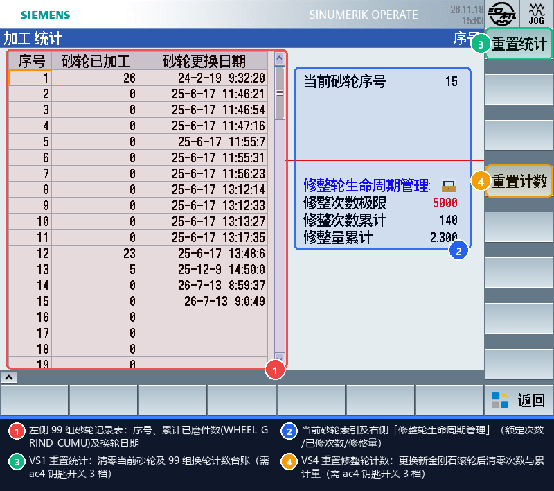
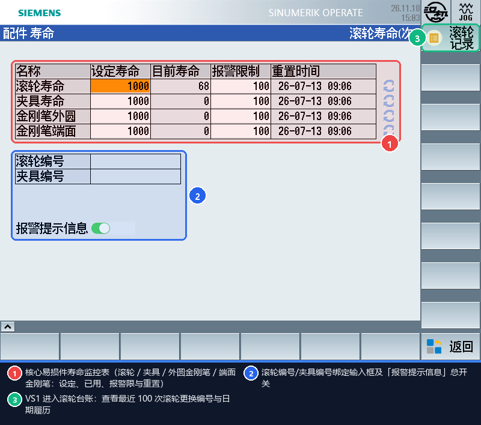
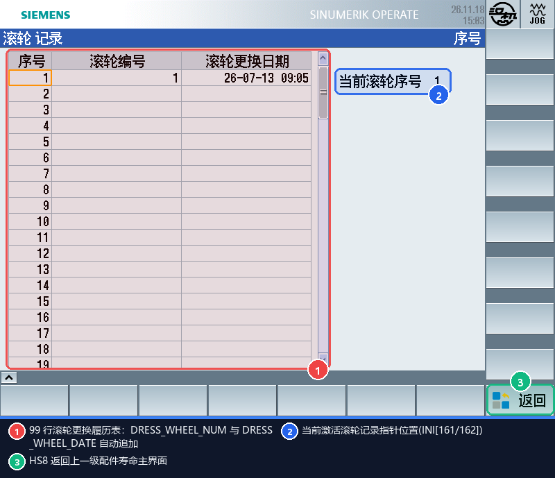

# 5.3 加工统计、砂轮记录与配件寿命管理

在 **CUSTOM 主页** 上，**`VS5 加工统计`**（需 **`ac4` 钥匙开关 3 档** 及 `TECHNOLOGY[57] = 1` 开启，进入 `a_stats.com` **`Mask1`**）与 **`VS3 配件寿命`**（**`ac7` 钥匙开关 0 档** 即可进入，需 `TECHNOLOGY[368] = 1` 开启，进入 `a_stats.com` **`Mask3`**）为两个独立的垂直软键入口，共同隶属于 `a_stats.com` 模块，将“工艺质量追溯”与“耗材预警防错”集中管理。

## 1. 加工统计主视图与修整轮生命周期（`Mask1`）

### 1.1 左侧：99 组换砂轮历史加工台账
每次在磨削/修整流程（如 `B_DRESS.SPF` 中 `DRESSER[5] == 0` 切换新砂轮，或初次运行）启用新砂轮时，系统会自动将 **当前砂轮序号**（`CUR_WHEEL`）加 1（范围 `1～99` 循环覆盖），并在 **该编号记录表** 中写下两条实时数据：
- **`WHEEL_CHANGED_DATA[CUR_WHEEL]`**：本次更换启用新砂轮时的控制器年月日与时分秒时间戳；
- **`WHEEL_GRIND_CUMU[CUR_WHEEL]`**：该片砂轮服役期间已累计完成的合格工件加工数量。

> **管理作用**：工艺主管可直观调阅最近 99 次更换砂轮的时间跨度与单轮产出效率（件/片），识别砂轮批次质量波动或修整过度问题。

### 1.2 右侧：修整轮生命周期统计（当 `TECHNOLOGY[134] = 1` 显示）
- **`修整轮生命周期次数设置`（`TECHNOLOGY[135]`）**：设定单只金刚石滚轮/修整轮的额定修整次数上限；
- **`修整轮修整次数累计`（`TECHNOLOGY[136]`）** 与 **`修整轮修整量累计`（`TECHNOLOGY[137]`）**：随修整循环自动递增；
- **`VS4 重置修整轮计数`**（需 **`ac4` 钥匙开关 3 档** 权限，且仅在 `TECHNOLOGY[134] = 1` 时显示）：更换新修整轮时按下后通过 `Mask2` 二次确认清零统计；
- **`VS1 重置统计`**（同样需 **`ac4` 钥匙开关 3 档** 权限）：清空历史砂轮加工台账表格。

## 2. 配件寿命管理表（`Mask3` & `B_SET_SERVICE_LIFE.SPF`）

当开启 `配件寿命界面显示`（NC：`TECHNOLOGY[368] = 1` / HMI：`TECHNOLOGY[369]`）时，统计模块集成 **配件寿命管理** 子画面 `Mask3`，对现场 4 种核心易损件实施寿命预警与强制停机互锁：

| 序号 | 监控配件项目 | 设定寿命（NC 变量） | 当前已用计数 | 报警阈值 | 重置时间记录 | 适用机型 |
| :---: | :--- | :--- | :--- | :--- | :--- | :--- |
| **1** | **滚轮** | `SERVICE_LIFE[0]` | `SERVICE_LIFE[10]` | `SERVICE_LIFE[5]` | `SERVICE_LIFE_TXT[0]` | 全机型 |
| **2** | **夹具** | `SERVICE_LIFE[1]` | `SERVICE_LIFE[11]` | `SERVICE_LIFE[6]` | `SERVICE_LIFE_TXT[1]` | 全机型 |
| **3** | **金刚笔一（外圆）** | `SERVICE_LIFE[2]` | `SERVICE_LIFE[12]` | `SERVICE_LIFE[7]` | `SERVICE_LIFE_TXT[2]` | 仅磨削中心（`;ifIsCenter`） |
| **4** | **金刚笔二（端面）** | `SERVICE_LIFE[3]` | `SERVICE_LIFE[13]` | `SERVICE_LIFE[8]` | `SERVICE_LIFE_TXT[3]` | 仅磨削中心（`;ifIsCenter`） |

> **机型差异说明**：对于**普通外/内螺纹机型（`;ifIsNotCenter`）**，`Mask3` 表格仅显示前 2 行（**滚轮**与**夹具**），且底层 `B_SET_SERVICE_LIFE.SPF` 会自动裁剪跳过金刚笔一/二的寿命初始化、计数与报警检查。
>
> **配件编码登记与单行重置**：`Mask3` 表格下方提供 **`滚轮编号`**（NC：`SERVICE_LIFE_TXT[5]` / HMI：`SERVICE_LIFE_TXT[6]`）与 **`夹具编号`**（NC：`SERVICE_LIFE_TXT[6]` / HMI：`SERVICE_LIFE_TXT[7]`）登记框，并设有 **`报警提示信息`**（`SERVICE_LIFE[19]` = `1` 开启）开关；更换任一耗材后勾选该行右侧 **`重置`** 按钮，系统会立即将对应 `目前寿命` 清零并刷新 `重置时间`（`SERVICE_LIFE_TXT[0..3]`）。

### 自动累加与超限停机保护逻辑（`B_SET_SERVICE_LIFE.SPF`）

- 每次执行对应修整或加工循环时，子程序调用 `B_SET_SERVICE_LIFE(2, NUM)` 为对应配件计数 `+1`；
- 每次主程序 `A_GRINDING.SPF` / `A_GRIND_CENTER.SPF` 启动瞬间，立即调用 `B_SET_SERVICE_LIFE(1, 0)`：
  1. 自动补齐尚未初始化的 `SERVICE_LIFE_TXT[0..3]` 起始启用时间戳；
  2. 若 **`是否需要报警`（`SERVICE_LIFE[19]` = `1`）** 且 **当前计数 > 报警限制**（如 `SERVICE_LIFE[10] > SERVICE_LIFE[5]`），系统立即弹出中文报警提示 **“滚轮/夹具/金刚笔一/金刚笔二寿命不足，请更换!”**，并执行 **`M0` + 长延时** 锁死程序，迫使操作员确认更换配件并在此界面点击对应行右侧勾选/重置按钮清零后才能恢复生产！

## 3. 滚轮编号历史台账（`Mask4` / `VS1`）

在 `Mask3` 按下 **`VS1`** 软键可进入 **滚轮编号管理列表** `Mask4`。系统支持记录并管理多达 **100 个滚轮编号（`DRESS_WHEEL_NUM[0..99]`）** 及其对应装机时间（`DRESS_WHEEL_DATE[0..99]`）。通过上方 `当前滚轮序号`（NC：`INI[161]` / HMI：`INI[162]`）绑定当前机台正在使用的滚轮档案，实现单只滚轮从上线到报废的全程可追溯管理。

