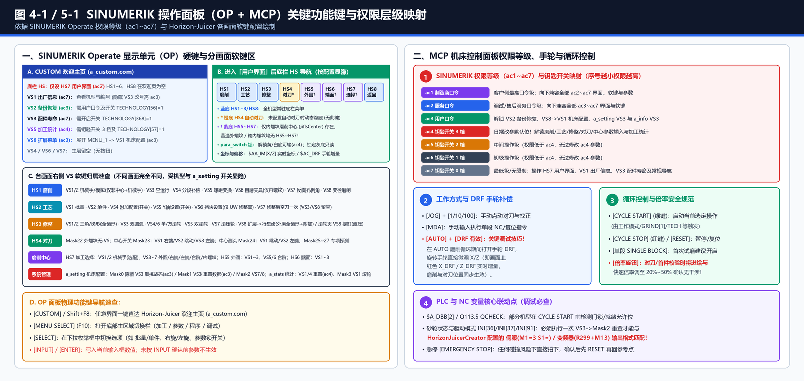

# 第 6 章 螺纹磨削与工艺参数

进入 **CUSTOM → 磨削界面**（普通机型直达 `a_grind.com`，磨削中心由 **加工选择 → 磨削参数/工艺参数** 切换进入）后，整个螺纹磨削子系统按照 `A_GRINDING.SPF → B_SCREW.SPF` 主状态机驱动运行。

## 1. 机床总循环启动调度逻辑（`A_GRINDING.SPF` → `B_SCREW.SPF`）

无论当前要执行 **纯修整**、**首次对刀**、**二次对刀** 还是 **正式磨削加工**，操作员在界面设置好参数并切到 `AUTO` 模式按下绿色 **循环启动（Cycle Start）** 后，NC 按以下严格优先级分支裁决当次动作：

1. **授权与配件寿命门禁**：若开启加密则校对 <code>&#36;MN_HW_SERIAL_NUMBER</code>；随后调用 `B_SET_SERVICE_LIFE(1,0)` 检查滚轮/夹具寿命是否越限；
2. **特殊工况优先抢占**：
   - 若开启 **空运行热机**（`GRIND[9] == 1`）→ 执行 `B_KONG_YUN_XING` 热机循环；
   - 若开启 **自磨夹具**（内螺纹且 `INI[68] == 1`）→ 执行 `A_JIAJU_MAIN` 卡爪磨削与修整；
   - 若切换为 **环形槽加工**（`RING[0] == 1`）→ 调用 `B_RING_GROOVE` 遍历各槽偏移并复调 `B_SCREW`；
3. **主螺纹三态分支裁决（`B_SCREW.SPF`）**：
   - **修整按键亮**（<code>&#36;A_DBB[0] &lt;&gt; 0</code>，即 `GRIND[1] <> 0`）→ 执行 **`B_DRESS` 修整循环** 后结束（不执行对刀或磨削）；
   - **对刀按键亮**（<code>&#36;A_DBB[1] &lt;&gt; 0</code> 或 <code>&#36;A_DBB[5] &lt;&gt; 0</code>，即 `GRIND[2] <> 0`）→ 执行 **`B_OPERATION` 对刀**。若设定 `INI[90] == 1` 且处于纯自动对刀（`GRIND[2] == 2`），则对刀完毕 **直接衔接磨削**；否则结束并停在安全位等待确认；
   - **修整与对刀键全灭**：偏转 `A` 轴至螺旋升角（`INI[20]`），按工艺界面循环次数执行 `C_CYCLE` 多头/单双磨循环及磨削中触发的修整，完成后计数加 1 并校验下次余量砂轮直径是否足够，最后调用 `C_GRINDING_END` 与 `C_ALARM`。

## 2. MCP 操作面板核心物理功能键

实际机台或仿真面板上与本系统强绑定的五个功能硬按键（对应 PLC-NC 交换字节 <code>&#36;A_DBB</code>）如下：

| 操作面板按键 | 触发 PLC/NC 信号 | 功用说明与联锁提醒 |
| :--- | :--- | :--- |
| **砂轮修整键** | <code>&#36;A_DBB[0]</code>（`GRIND[1]`） | 点亮后启动程序仅执行 **砂轮修整**。若在系统设置开启 `INI[70]=1`，修整完成后自动灭灯（`M78`）防误触发 |
| **手动对刀键** | <code>&#36;A_DBB[1]</code>（`GRIND[2]=1`） | 点亮后启动程序进入 **手动手轮对刀**（支持 `首次` 与 `二次`）。同样支持结束后由 `M61` 自动关灯 |
| **自动对刀键** | <code>&#36;A_DBB[5]</code>（`GRIND[2]=2`） | 点亮后调用接近开关或接触式测头执行 **自动寻找起始齿位/端面** |
| **手轮偏置 DRF** | 系统 `DRF` 状态 | 手动对刀及磨削微调时务必点亮 **DRF 键** 并选适当手轮倍率（`1`/`10`/`100`），系统在退刀计算时自动采集 <code>&#36;AC_DRF[X/Z/C]</code> 并执行 `DRFOF` 清零 |
| **紧急退刀键** | <code>&#36;A_DBB[2]</code> | 磨削、对刀或修整任意时刻按下退刀键，触发异步中断 **`PLCASUP1`**：保存坐标与 DRF 值后立即按方向安全退刀至退刀位并复位程序 |

## 3. 自定义工序（`USER_DIY.MPF`）、C 轴手摇（`B_C_MOV.SPF`）与机械手联动

- **自定义单道/专用程序入口（`USER_DIY.MPF`）**：当工艺界面启用 **`DIY` 模式** 时，系统按 `DIY[0..5]` 参数驱动用户定制工艺或调用现场非标节拍程序 `USER_DIY.MPF`，方便在不改动标准四道工艺逻辑下扩展特殊零件循环。
- **C 轴点动/自动旋转测试（`B_C_MOV.SPF`）**：配合 MCP C 轴功能键（<code>&#36;A_DBB[6]==1</code>）与 `MD35000 $MA_SPIND_ASSIGN_TO_MACHAX[C]` 实现找正、校表时的连续或定量转动。
- **自动上下料机械手联动（`A_JXS_MAIN.SPF` / `B_JXS_ZJ.SPF` / `B_JXS_TEST.SPF`）**：当设备选配机械手（`;ifIsHasLoadingArm`）并在机床配置开启 **`机械手按钮开启`**（NC：`TOOL_SET[16]=1` / HMI：`TOOL_SET[17]`）后：
  - 通过加工画面 **`VS1 用机械手`**（NC：`INI[85]` / HMI：`INI[86]`，`0` 否 / `1` 是）控制是否进入自动上下料流程；
  - 通过 **`VS2 模拟测试`**（NC：`GRIND[8]` / HMI：`GRIND[9]`，`0` 否 / `1` 是）启用单步/模拟联锁测试程序 `B_JXS_TEST.SPF`；
  - 依据 `PROCESS[122]`、`R102` 及安全上料位（外磨借用 `INI[28]` 区域字段）与外部机械手完成门开/卡盘松夹/料仓交换握手。

本章各节详解：

- [6.1 主磨削参数与手动对刀操作](main_grinding.md)
- [6.2 工艺参数表、附加配置、Y 轴与 UW 挡块](process_params.md)
- [6.3 丝锥、蜗杆与环形槽专用功能](tap_worm_ring.md)
- [6.4 高级模块（上）：夹具自磨、反向孔倒角、空运行与两端变径](advanced_modules.md)
- [6.5 高级模块（下）：分段补偿与单/多段螺距变换](seg_comp_and_pitch.md)
