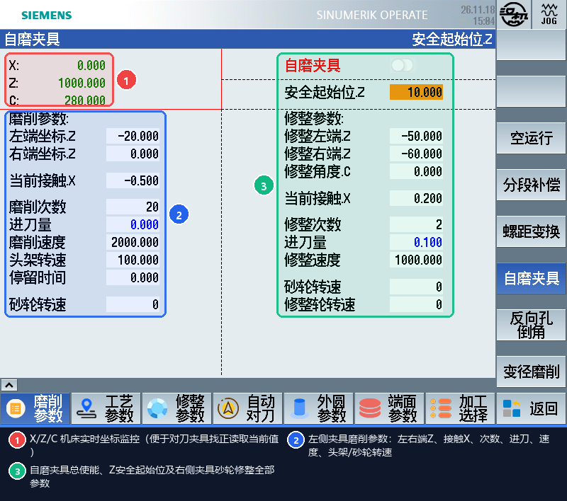
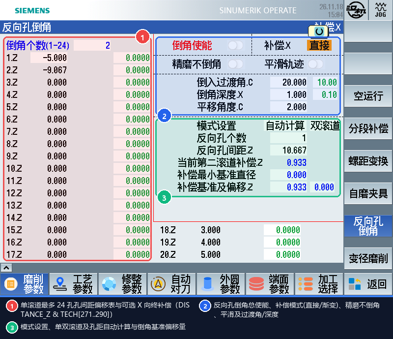
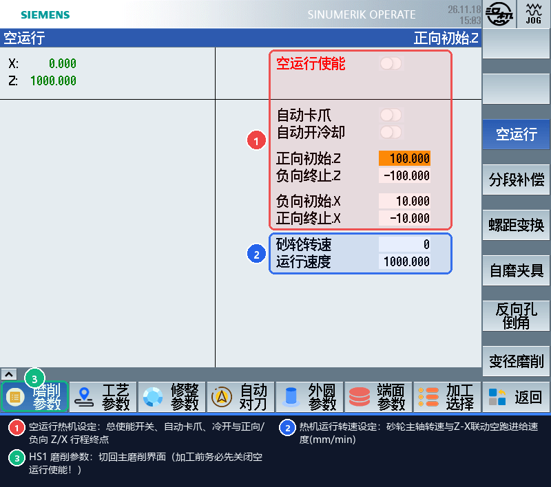
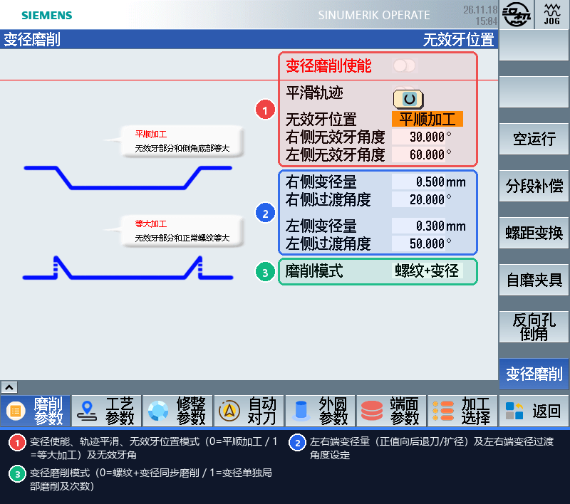
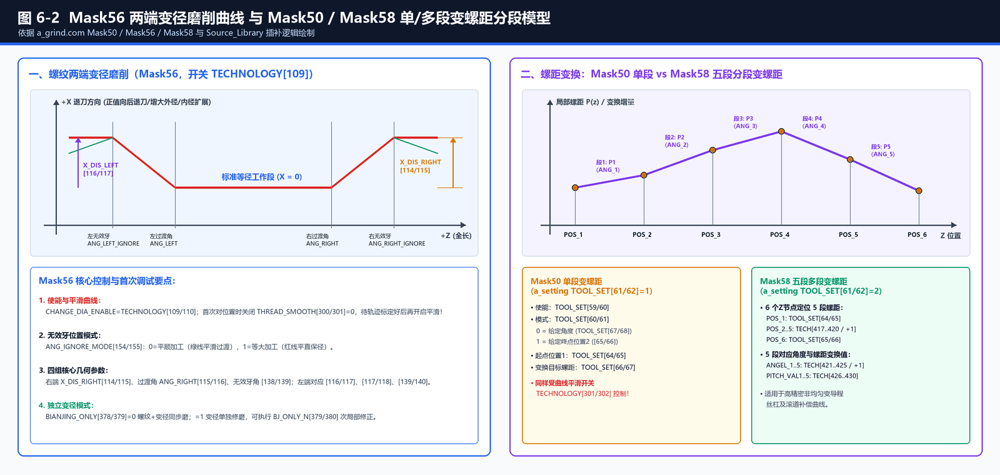
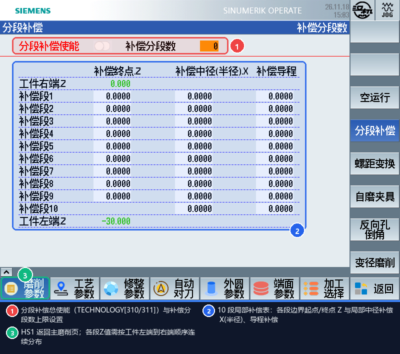
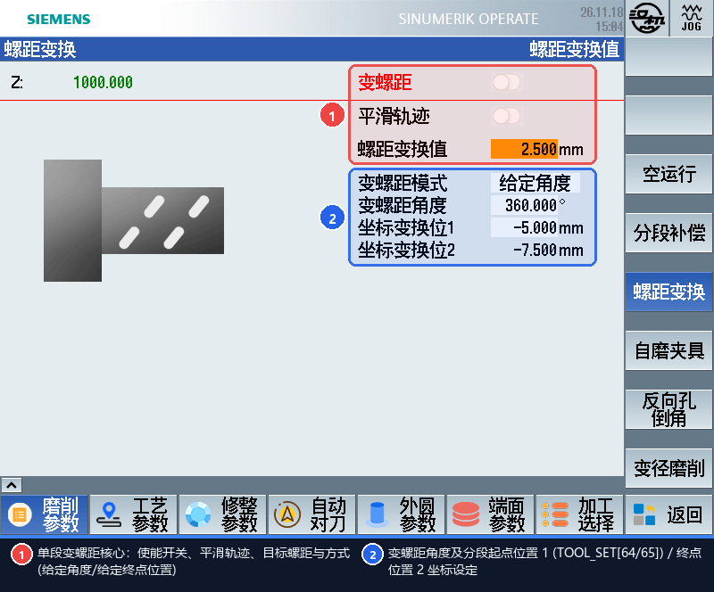
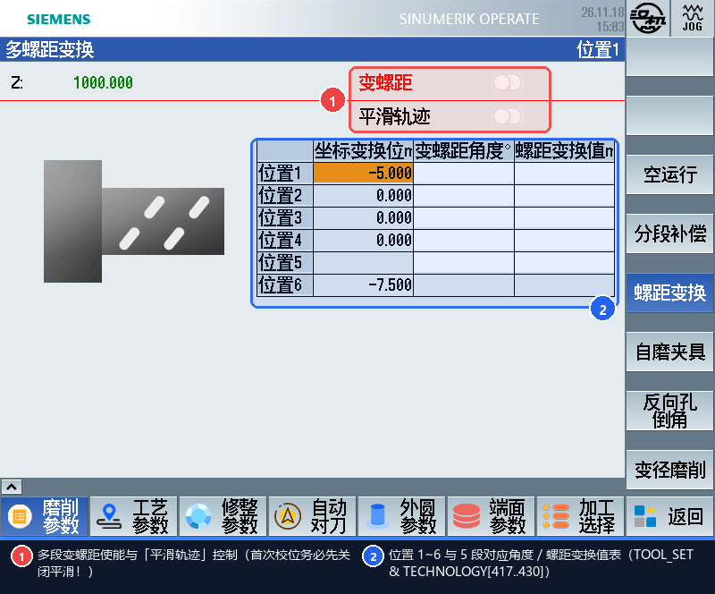

# 6.4 高级模块：夹具自磨、倒角、空运行、变径与分段补偿

在 **内/外螺纹磨削参数界面**（`a_grind.com` `Mask1` / `Mask18`）右侧垂直软键区（`VS3`～`VS8`），集成了**六大**面向特定高难度工艺的扩展功能模块（空运行 `VS3`、分段补偿 `VS4`、螺距变换 `VS5`、自磨夹具 `VS6`[仅内螺纹]、反向孔倒角 `VS7`、变径磨削 `VS8`）。各模块界面入口均可在 **机床配置 → 第五类扩展界面开关** 中按需打开或隐藏；其中 **`VS6 自磨夹具`** 仅内螺纹 `Mask18` 提供（外螺纹 `Mask1` 无此按键），而 **`VS1 用机械手` / `VS2 模拟测试`** 仅在非磨削中心机型勾选机械手选配（`;ifIsNotCenter` + `;ifIsHasLoadingArm`）时出现在本画面右侧。

> **索引换算提醒**：下述所有数组在 `.SPF` 与 `MGUD.DEF` 中均为 **0-based**（如 `INI[68]`、`TECHNOLOGY[310]`）；若需核对 `a_grind.com` EasyScreen 脚本，请统一执行 **HMI 索引 = NC 索引 + 1**（对应 `INI[69]`、`TECHNOLOGY[311]`）。

## 1. 自磨夹具（`Mask53` / `VS6` & `A_JIAJU_MAIN.SPF`）

*仅内螺纹机型开放*（界面显示由 `TECHNOLOGY[232]` / HMI `233` 控制）。用于在机床内部直接修整三爪卡盘/专用夹具卡爪内孔圆度与同轴度，无需拆装工件夹具：

1. **总使能与安全位**：
   - 将右侧开关 **`使能`（`INI[68]`）** 设为 **开**（`1`）；激活后主程序 `A_GRINDING.SPF` 优先转入 `A_JIAJU_MAIN.SPF` 执行自磨夹具循环而不磨工件；
   - 设定 **`夹具磨削 Z 轴安全起始位置`（`INI[89]`）**，运行前 `A` 轴自动归零且 `Z` 轴退回至此安全位置。
2. **左侧：夹具磨削参数（当 MCP 修整键 <code>&#36;A_DBB[0] == 0</code> 运行）**：
   - 测量并输入 **`左端 Z`（`DRESSER[60]`）**、**`右端 Z`（`DRESSER[61]`）**、**`X 接触坐标`（`DRESSER[62]`）**；
   - 设置 **`磨削次数`（`DRESSER[53]`）**、**`进刀量`（`DRESSER[69]`）**、**`水平速度`（`PROCESS[39]`）**、**`头架转速`（`TECHNOLOGY[231]`）**、**`停留时间`（`DRESSER[52]`）** 及 **`砂轮转速`（`DRESSER[118]`）**。
3. **右侧：夹具砂轮修整（当 MCP 修整键 <code>&#36;A_DBB[0] == 1</code> 运行）**：
   - 专门设定夹具磨削砂轮的修整区间 **`修整左/右端 Z`（`DRESSER[63/64]`）**、**`头架 C 起始角`（`INI[67]`）**、**`接触 X`（`DRESSER[65]`）**、**`修整次数/进刀量/速度`（`DRESSER[66/67]/PROCESS[36]`）** 与 **`砂轮/修整轮转速`（`DRESSER[116/117]`）**。

> **警告**：自磨夹具完成后，务必将 `Mask53` 顶部的 **`使能`** 切回 **关（`0`）**，否则按循环启动将继续磨削卡盘而非工件！

## 2. 内螺纹反向孔倒角（`Mask54` / `VS7`）

用于在滚动丝杠/行星丝杠内螺母的换向器反向孔边缘自动磨出平滑倒角，消除滚珠进出回珠器时的冲击：

| 参数组 | NC / R 变量 | 功能详解 |
| :--- | :--- | :--- |
| **总使能与曲线模式** | `INI[82]` / `INI[110]` / `TOOL_SET[17]` | 开关反向孔倒角使能；可单独勾选 **`精磨/终磨不倒角`** 保护最终齿面精度；**`是否平滑曲线`** 建议首次对刀探测位置时保持 **`否`**，正式高速倒角时再开启 |
| **倒角轮廓尺寸** | <code>&#36;R[241]</code> / <code>&#36;R[242]</code> / <code>&#36;R[243]</code> | 设定倒角面 `C` 移动角度、倒角深度与底面 `C` 保持角度（`R243 >= 2°` 以防低速加减速形成振纹），支持配置两端预倒角 `TECHNOLOGY[237/238]` |
| **Z 向孔位计算模式** | `INI[22]` / `INI[44/45/46]` | `0` **手动输入**（手工填写 `R240` 个数 `1~24` 及各孔起始位置 `R244~R267`）； `1` **自动等距计算**（给定反向孔个数、间距与起始位补偿自动排布）； `2` **测头自动探测第一孔推算**（需配有自动对刀） |
| **反向孔类型与双滚道偏移** | `TECHNOLOGY[386]` / `TOOL_SET[7]` / `TECHNOLOGY[67..69]` | 支持 **`0` 双滚道等距** 与 **`1` 单滚道不等距**（独立设置 `孔间距 12..1920`，`TECHNOLOGY[392..411]`）；双滚道支持按基准直径计算第二滚道 Z 偏移与直径补偿 |
| **X 向终磨补偿（`TECHNOLOGY[291/292]`）** | `TECHNOLOGY[271..290]` | 当各反向孔倒角深度存在轻微离散时，可按孔号（第 `1~20` 孔）独立输入 `±0.1 mm` 的倒角终点 X 向补偿，并选 `直接补偿` 或 `向下一孔渐变过渡` |

## 3. 空运行热机程序（`Mask55` / `VS3`）

在冬季冷机开机或长时间停机复产前，用于在未装夹或自动模拟装夹下让机床主轴、冷却系统及各伺服轴预热稳定热变形：

1. 打开 **`使能`（`GRIND[9]`）** 设为 **开**（开启后主程序优先执行 `B_KONG_YUN_XING.SPF`）；
2. 配置是否随动 **`自动卡爪动作`（`TECHNOLOGY[34]`）** 与 **`自动开冷却水`（`TECHNOLOGY[66]`）**；
3. 设定往复热机边界：**`Z 正向/负向起止位置`（`TECHNOLOGY[35/38]`）**、**`X 负向/正向起止位置`（`TECHNOLOGY[39/48]`）**、**`砂轮转速`（`49`）** 与 **`轴运行速度`（`54`）**；
4. 热机结束后同样记得关闭 **`使能`** 恢复正常加工。

## 4. 螺纹两端变径磨削（`Mask56` / `VS8`）

适用于需要两端牙型逐渐退浅或局部让径的滚珠丝杠/特殊螺母：

- **使能开关（`TECHNOLOGY[109]`）** 与 **平滑轨迹（`TECHNOLOGY[300]`）**；
- **无效牙过渡模式（`TECHNOLOGY[154]`）**：设 **`0` 平顺加工** 或 **`1` 等大加工**，配合 **`右/左端无效牙角度`（`TECHNOLOGY[138/139]`）**；
- **左右端变径量与过渡角**：独立设置 **`右端变径量`（`114`，正值后退）/ `过渡角度`（`115`）** 及 **`左端变径量`（`116`）/ `过渡角度`（`117`）**；
- **单独运行模式（`TECHNOLOGY[378/379]`）**：支持选择 `0 = 螺纹+变径同步磨削` 或 `1 = 单独走变径修光` 并指定变径单独磨削次数；底层子程序 `F_ZC_START_CHANGE_DIA_A.SPF` 在独立变径过渡阶段引入 **`DAO_DISTANCE_COE = 1.2`** 外延系数，使倒角段多扫出 20% 滚道衔接行程，防止滚道与倒角交界处产生过切振纹。

## 5. 分段补偿（`Mask57` / `VS4`）与螺距变换（单段 `Mask50` vs 多段 `Mask58` / `VS5`）

| 模块 | 核心参数与用途（均标注 0-based NC / +1 HMI 索引） |
| :--- | :--- |
| **分段补偿中径/导程（`Mask57`）** | 开启 `TECHNOLOGY[310] = 1`（HMI `311`）并设定总分段数 `TECHNOLOGY[311]`（HMI `312`，最多 **`10` 段**），界面绿色回显工件左右端范围。操作员按三坐标检测曲线依次填写入 `第 1～9 段 Z 坐标`（`TECHNOLOGY[332..340]` / HMI `333..341`）、`第 1～10 段中径半径补偿 X`（`312..321` / HMI `313..322`）及 `导程 Z 补偿`（`322..331` / HMI `323..332`），系统在螺旋插补全程实施动态分层补偿 |
| **单段螺距变换（`Mask50`）** | 当机床配置将螺距变换开关设为 **`1`（单段）** 时进入 `Mask50`：通过 `变螺距`（`TOOL_SET[59]` / HMI `60`）、`平滑轨迹`（`TECHNOLOGY[301]` / HMI `302`）、目标 **`螺距变换值`**、**`变螺距模式`**（`给定角度` / `给定终点位置`）、**`变螺距角度`** 及 **`坐标变换位 1 / 位 2`**（`TOOL_SET[64/65]` / HMI `65/66`）完成单一区间的导程突变磨削 |
| **多螺距变换（`Mask58`）** | 当机床配置将螺距变换开关设为 **`2`（多段）** 时进入 `Mask58`：除 `变螺距` 与 `平滑轨迹`（注意首次校位务必先关闭平滑）外，界面扩展为 **`位置 1 ～ 位置 6`**（`POS_1..6`，其中两端起止关联 `TOOL_SET[64/65]` 及中间分段 `TECHNOLOGY[417..420]`），最多切分 **`5` 段变螺距区间**，可逐段配置 `变螺距角度`（`ANGEL_1..5`，`TECHNOLOGY[421..425]` / HMI `422..426`）与目标 `螺距变换值`（`PITCH_VAL1..5`，`TECHNOLOGY[426..430]` / HMI `427..431`），用于预紧双螺母或连续变节距螺杆 |

