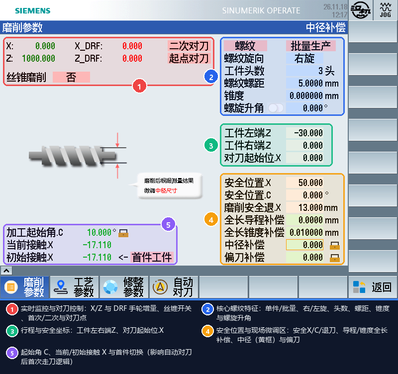
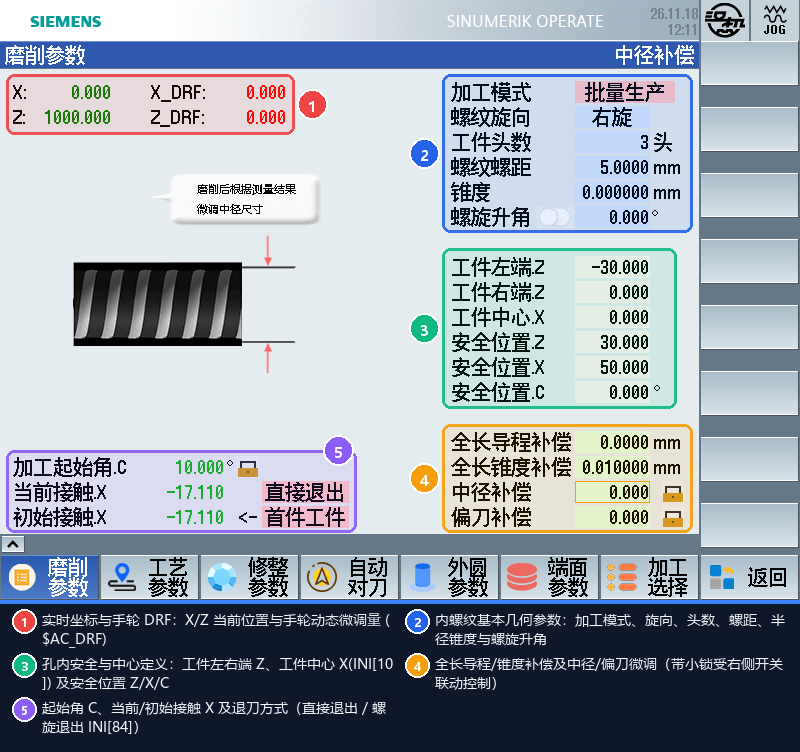
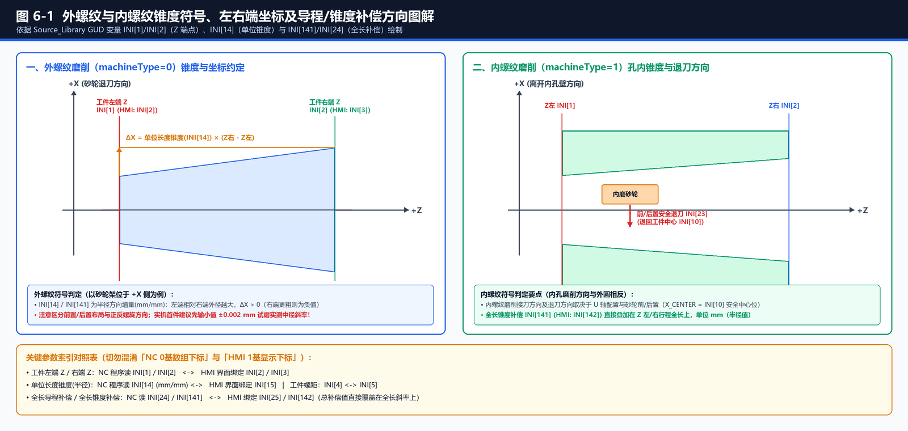

# 6.1 主磨削参数与手动对刀操作

**磨削参数** 界面（`a_grind.com`）按机型自动呈现对应版本：外螺纹主界面为 **`Mask1`**，内螺纹主界面为 **`Mask18`**（隐含写入磨削类型标志 `GRIND[0]`：`0` 外螺纹 / `1` 内螺纹 / `2` 蜗杆 / `3` 外圆 / `4` 环形槽）。界面顶部实时监控机械坐标 `X`/`Z` 与手轮偏置读数 `X_DRF`/`Z_DRF`，并集成了工件尺寸、位置边界与对刀微调全部核心设定。

## 1. 核心参数全解

### 1.1 生产与对刀模式控制

| 参数名 | NC 变量 | 取值与使用场景解析 |
| :--- | :--- | :--- |
| **加工模式** | `INI[26]` | **`0` 单件小批量**：从左侧 **当前磨削接触位**（`PROCESS[4]`）起刀续磨，适合修磨、返修或首件渐进试切； **`1` 批量生产**：每次程序启动均回到 **初始磨削接触位**（`PROCESS[13]`）重新走完完整工艺余量，同时每完一件自动累加已加工计数 |
| **对刀类型** | `TOOL_SET[8]` | **`0` 首次对刀**：用于新安装或重新找正工件，按选定对刀点从安全位置重新切入并刷新 `初始磨削接触位` 与 `头架初始角`； **`1` 二次对刀**：不回退粗位置，直接以先前头架初始角同步插补切入工件齿槽附近，只需用 DRF 手轮微调 X/Z 对准（批量磨削首刀正常后系统会自动翻转为二次对刀以作保护） |
| **选择对刀位置** | `TOOL_SET[19]` | **`0` 起点对刀**（从磨削起点进入）； **`1` 中点对刀**（从工件中点 `(左端+右端)/2` 进入，适合刚性佳对称探测）； **`2` 任意点**（配合下方手动录入 **`任意点对刀位` `INI[134]`**，用于避开台阶/破损段） |
| **是否是首件工件** | `TOOL_SET[57]` | **`0` 首件工件**：手动对刀完成退出时，同时刷新 `初始磨削接触位`、`当前接触位` 与 `头架初始角`； **`1` 非首件**：只重新计算并刷新 `头架初始角`，**保留原来的 `初始磨削接触位` 不变**，确保同一批次逐件手动对刀后中径尺寸高度一致！ |

### 1.2 工件几何特征与锥度/螺旋升角

| 参数名 | NC 变量 | 输入规范与计算公式 |
| :--- | :--- | :--- |
| **螺纹旋向** | `INI[0]` | `0` 右旋 / `1` 左旋（注意右旋与左旋下内/外螺纹插补方向及起刀端设置；左旋如需反向进刀可在系统配置内启用相关开关） |
| **工件头数** | `WORK[0]` | `1`～`N`（多头螺纹自动按 $360^\circ / \text{WORK}[0]$ 均分各头 C 轴起始角） |
| **工件螺距** | `INI[4]` | 填写图纸单牙相邻距离（单头时等于导程；多头时程序内部按 `INI[5] = INI[4] * WORK[0]` 计算总导程） |
| **锥度** | `INI[14]` | **重要约定**：输入值为 **工件每 1 mm 轴向长度上“半径方向”的偏移量**（范围 `-10 ~ 10`）。 典型换算示例： • 图纸给定锥度比 `1:16` → 界面输入算式 `1/16/2`（即 `0.03125`）； • 长 `100 mm` 圆台大端直径 `30`、小端直径 `20` → 输入 `(30-20)/100/2 = 0.05`； • 符号约定：内螺纹 **大头往小头磨输正值**，外螺纹 **小头往大头磨输正值**，反之输负值 |
| **螺旋升角计算** | `INI[38]` | **`1` 开**：输入下方 **工件中径（`INI[39]`）** 后，自动按导程与中径计算螺旋升角写入 `INI[17]`（`INI[20]`）； **`0` 关**：允许手动录入 `-90° ~ 90°` 螺旋升角（以度/分/秒或角度显示） |

### 1.3 边界坐标与退刀安全位置

| 参数名 | 区分内/外 | NC 变量 | 操作测量方法 |
| :--- | :---: | :--- | :--- |
| **工件左端** | 共用 | `INI[1]` | 手动将砂轮移到能完整磨出工件左侧端牙型/退出余量的位置，记录当前 Z 轴坐标 |
| **工件右端** | 共用 | `INI[2]` | 手动将砂轮移到工件右端入刀起始端（需留适当导入安全量），记录当前 Z 轴坐标 |
| **对刀起始位置 / 工件中心** | **外螺纹**：对刀起始 **内螺纹**：工件中心 | `INI[10]` | • **外螺纹**：手动将 X 轴靠近工件外圆安全不干涉处记录 X； • **内螺纹**：精确标定砂轮中心与头架中心重合时的 X 坐标（测量公式：$X_{\text{中心}} = X_{\text{外圆接触}} + D_{\text{工件外径}}/2 + D_{\text{砂轮}}/2$） |
| **台面起始位置 / 上料位置 Z** | **内螺纹**：台面起始 **机械手**：上料位 | `INI[28]` | **内螺纹**：每次磨削/修整停泊安全 Z 位，系统校检须至少离开 `工件右端` 安全距离（默认 `30 mm`，由 `TECHNOLOGY[387]` 限定）；**外螺纹配机械手**：机械手上下料等待 Z 坐标 |
| **退刀位置** | 共用 | `INI[23]` | 加工完成后 X 轴回退到的绝对安全坐标 |
| **安全位置.C** | 共用 | `INI[27]` | 程序结束时头架自动定向停靠的 `C` 轴角度（`0° ~ 360°`），方便工件装卸或机械手抓取定位 |
| **加工起始角.C（头架初始角）** | 共用（只读） | `TOOL_SET[4]` | 每次手动对刀或自动对刀完毕后自动反算并回写的当前工件基准起始角（`0° ~ 360°`） |
| **磨削安全后退距离** | 外螺纹 | `TECHNOLOGY[129]` | 相对于初始磨削接触位的 X 后退量（默认限制 `>= 10 mm`），Z 回退前 X 先退出此距离避免扫坏螺纹牙型 |
| **内螺纹退出方式** | 内螺纹 | `INI[84]` | **`0` 直接退出**：直退到安全中心后沿 Z 拉出（仅当砂轮直径显著小于内孔小径时使用）； **`1` 螺旋退出**：沿着螺旋槽轨迹反向/退刀同步拉出，防小孔径大砂轮退刀啃伤内牙 |

### 1.4 磨削实时尺寸与螺距微调（绿色高亮解锁区）

屏幕右下角及左下角为生产中高频使用的微调项，受右侧小锁开关（`para_switch_1/2/3`）保护，防误触输入：

- **全长导程补偿**（`INI[24]`）：根据激光干涉仪或三坐标检测全长螺距累计误差输入补偿值（mm）；
- **全长锥度补偿**（`INI[141]`）：根据圆度/锥度检测报告输入全长 **半径方向** 锥度微调量；
- **中径调整**（`GRIND[4]`）：输入 **直径方向** 偏差（受 `TOOL_SET[11]` 限值保护，默认 `±1 mm`）。按需要加减磨削余量，为单次补偿——**仅在下次磨削开始时**将补偿量的一半累加到 `初始接触` 与 `当前接触` 后自动清零（单独执行修整或对刀时不处理，保留到磨削时生效）；
- **偏刀调整**（`TOOL_SET[42]`）：当实测螺纹半牙一侧切多一侧切少（偏刀）时输入 Z 向偏移补偿。同样为单次补偿——**仅在下次磨削开始时**折算并累加到 `加工起始角.C` 后自动清零（单独修整或对刀时不消耗）。

## 2. 标准手动对刀操作全步骤（首次对刀 + DRF）

1. **填写基础几何与边界**：正确填好旋向、螺距、左端、右端、安全退刀位及工件中心（外磨填对刀起始位）；
2. **点亮手动对刀键**：确认左侧模式为 **`首次对刀`** 并选好起点/中点/任意点，按下机床操作面板的 **手动对刀** 按键（`GRIND[2] = 1`）并切至 **`AUTO` 模式**；
3. **调低倍率并开启手轮**：将进给倍率与主轴倍率关至最小/安全档，按 **循环启动**；
4. **切入并激活 DRF**：
   - 待砂轮自动旋转至工件上方或孔内开始随 C 轴作 **Z-C 同步螺旋插补** 后，按下操作面板 **`DRF`** 键并选适当手轮步率（`×100` 粗移 → `×10` → `×1` 精调）；
   - *安全提示*：内螺纹默认对刀砂轮不转（`INI[53]=0`）靠眼看/塞尺；外螺纹或丝锥默认 `INI[53]=1500` RPM（可在主初始化 `.MPF` 修改）。推荐在手轮把砂轮轻靠贴合螺纹槽两壁中心后，将 **X 轴向后微退约 `0.1 mm`**，然后略微放大进给倍率走一段，肉眼观察整个行程是否发生后段挤压；
5. **按退刀键结束采样**：对刀位置满意后按下操作面板 **退刀键**（触发 `PLCASUP1.SPF`），系统自动记录瞬时坐标与 <code>&#36;AC_DRF[X/Z/C]</code> 偏置，算出精准 **头架初始角** 与 **初始磨削接触位**，随后退回安全位并 `DRFOF` 清零手轮偏置；
6. **熄灭对刀键准备磨削**：若系统开启 `INI[70]=1` 则会自动灭灯；否则手动关闭 **手动对刀** 键后即可进入工艺页面启动磨削！
