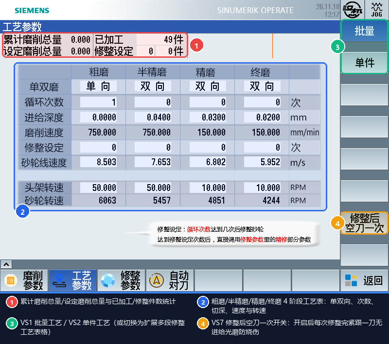
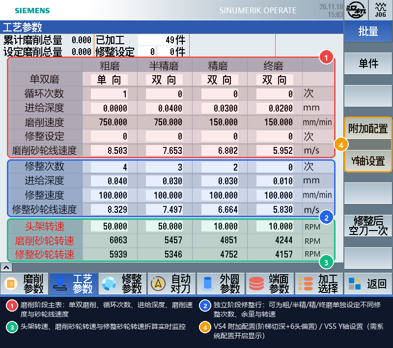
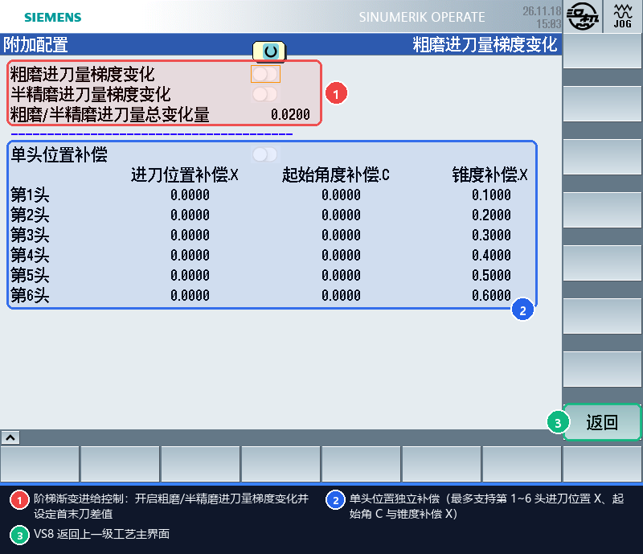
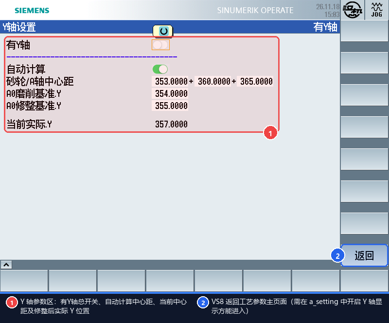

# 6.2 工艺参数表、附加配置、Y 轴与 UW 挡块

**磨削工艺** 界面（`a_process.com`）在 **磨削界面** 底部按下 **`HS2 工艺参数`** 即可打开，是磨削加工的核心工序调度中心。系统依据 **机床配置 → 扩展工艺开关**（NC：`PROCESS[15]` / HMI：`PROCESS[16]`）自动切换展现 **精简工艺界面**（`Mask2/Mask29`）或 **扩展工艺界面**（`Mask20/Mask30`）。

## 1. 四道标准工序表与核心参数

工艺表横向分为四列固定工序：**粗磨 → 半精磨 → 精磨 → 终磨**。右侧垂直软键可切分两套独立工艺配方：
- **`VS1 批量`**：与磨削界面的 `批量生产` 模式对应；
- **`VS2 单件`**：与磨削界面的 `单件小批量` 模式对应（*无论是精简工艺 `Mask2` 批量 / `Mask29` 单件，还是扩展工艺 `Mask20` 批量 / `Mask30` 单件，均分别提供独立的批量与单件参数表*）。

各行参数定义与控制逻辑：

| 行参数名称 | 功能与编程注意事项 |
| :--- | :--- |
| **单双磨** | 切换每道工序为 **`单向`** 还是 **`双向`**（双向可在往返行程均切入磨削，提升高余量材料切除率，精磨通常设为单向以保证表面纹理一致）。注意 **双向进刀量语义** 受系统设置 `TECHNOLOGY[369]` 控制：`0` 表示录入值为 **一去一回的总进刀**（程序内每次取半进给），`1` 表示录入值为 **每次单边进给量** |
| **循环次数** | 本道工序重复磨削的循环遍数；设为 `0` 时自动跳过该道工序（**四道工序的循环次数与进给深度均统一需 `ac4` 钥匙开关 3 档权限修改**） |
| **进给深度（mm）** | 每次循环向工件牙底方向的 X 切深量（同样需 **`ac4` 钥匙开关 3 档** 权限；除粗磨外，半精/精/终磨默认受 `TOOL_SET[12]` 限值 `±0.1 mm` 保护） |
| **磨削速度（mm/min）** | Z 轴与 C 轴联动时，在工件轴向移动参考下等效或设定的进给参考速度（部分机型随 `INI[4]` 与头架转速联动计算并回显） |
| **修整设定（次）** | **极其重要**：控制该道工序 **每完成几次磨削循环** 自动中断磨削去修整一次砂轮。例如图例提示：粗磨次数 `5`、修整设定 `2` → 则在第 `2` 次与第 `4` 次粗磨完毕后分别自动执行 **精修参数** 定义的修整动作（设为 `0` 表示本工序中途不修整） |
| **砂轮线速度（m/s）** | 默认开启恒线速度控制时输入期望线速度（CBN 砂轮常见 `25~45 m/s`），系统依据实时计算砂轮直径动态折算出安全 RPM |
| **头架转速（RPM）** | 决定工件转速与磨削效率（默认受 `TECHNOLOGY[159]` 上限 `60 RPM` 保护；大导程或粗磨高、精磨低） |
| **砂轮转速（RPM）** | 恒线速模式下此行自动反算并只读显示当前转速；当系统开启 **`恒转速模式`（`INI[144]=1`）** 时，该行开放直接手动填写固定 RPM |
| **工艺修整详情行（仅扩展工艺 `Mask20/30` 额外展开）** | 扩展工艺额外允许为 **粗磨、半精磨、精磨、终磨** 四道工序分别单独指定不同的 **工序内修整次数、修整进给量、修整速度、修整砂轮线速度及磨削/修整 RPM**，实现粗磨快修与终磨细修彻底分离 |

## 2. 顶部监控区与按件/按头修整策略

1. **累计磨削总量（`PROCESS[14]`）与设定磨削总量（`PROCESS[12]`）**：实时对比本次加工已切入深度与工艺表四道工序乘积之和（若开启 **`DIY`** 则显示自定义单道工序 `DIY[0..5]` 设定与进度）；
2. **大/小砂轮按件修整（`已加工 INI[73]` vs `大砂轮修整设定 PROCESS[125]` / `小砂轮修整设定 PROCESS[126]`）**：
   - 在批量连续生产时，如单件磨削循环未达修整设定，系统支持按累计工件数触发修整；
   - 以 `PROCESS[127]` 为大小砂轮直径分界点：砂轮直径大于分界值时每 `PROCESS[125]` 件自动精修一次；直径低于分界值后自动切换到每 `PROCESS[126]` 件精修，适应小直径砂轮耐用度变化；
3. **粗磨自动计算（`TECHNOLOGY[233]=1`）**：开启后操作员只需给定 **设定磨削总量** 与后三道光刀参数，程序自动算出 **粗磨进给量/次数** 补齐总余量；
4. **按头数修整开关（`WORK[5]`）**：多头螺纹开启 `WORK[4]=1` 后在右上角显示，可切换为“磨完所有头算 1 次”或“每磨完 1 个头单独计入修整计数”；
5. **三线测量参数区（`INI[148]=1` 且内螺纹时左下角显示）**：直接登记 `工件外径`（`INI[120]` / HMI：`INI[121]`）、`三线测量`（`INI[121]` / HMI：`INI[122]`）、`钢球直径`（`INI[122]` / HMI：`INI[123]`）与 `终尺寸H`（`INI[123]` / HMI：`INI[124]`）作为参考记录（四项均支持 **`ac7` 钥匙开关 0 档** 查看录入；其中 `工件外径` 与 `三线测量` 已取消早期的 `300 mm` 上限限制，仅校验非负 `>= 0`）；
6. **`VS7` 修砂轮后空切设置（`PROCESS[17]`）**：切换为开启后，每次磨削途中修完砂轮回来首刀 **不进刀空磨一次**（按原切深位置走一刀消弹性让刀，按头数修整时无效）。

## 3. 垂直软键三大扩展配置子页（`Mask3` / `Mask4` / `Mask5`）

在工艺参数界面右侧可根据机床硬件与授权选配打开三个专业设置页：

| 软键入口 | 子画面 | 核心设置内容 |
| :---: | :--- | :--- |
| **`VS4`** | **附加配置（`Mask3`）** | 1. **梯度进刀**：分别开关 `粗磨梯度变化`（NC：`TECHNOLOGY[118]` / HMI：`TECHNOLOGY[119]`）与 `半精磨梯度变化`（NC：`TECHNOLOGY[124]` / HMI：`TECHNOLOGY[125]`）及 `总变化量`（NC：`TECHNOLOGY[119]` / HMI：`TECHNOLOGY[120]`，第一刀与最后一刀进给差值；注意：若总变化量大于设定进刀量两倍则自动取消梯度）； 2. **多头分头微调**：开启 `TECHNOLOGY[125]=1`（HMI：`TECHNOLOGY[126]`）后，支持分别对 **第 1 头至第 6 头** 独立输入 `X 进刀补偿`（`TECHNOLOGY[144..149]`）、`C 角度补偿`（`TECHNOLOGY[342..347]`）与 `X 锥度补偿`（`TECHNOLOGY[380..385]`），解决多头丝杠各头分度及尺寸微差 |
| **`VS5`** | **Y 轴设置（`Mask4`）** | 针对带有数控 `Y` 轴偏心补偿机构的多轴磨床：设定电主轴端面距 `A` 轴回转中心距（`TECHNOLOGY[353]`）、`磨杆长度`（`TECHNOLOGY[360]`）、`修整中心到磨杆端面距`（`TECHNOLOGY[365]`）及 `A=0°` 基准 Y 位（`TECHNOLOGY[354/355]`）。开启 `自动计算实际位置`（`TECHNOLOGY[356]=1`）后，系统根据旋转角 `A` 自动解算并补偿磨削/修整 `Y` 轴目标坐标（`TECHNOLOGY[357/358]`） |
| **`VS6`** | **UW 挡块设置（`Mask5`）** | *仅内螺纹配置了 **UW 修整器**（`;ifIsUW`）显示（未配 UW 时界面自动屏蔽该软键）*：当主轴配有机械挡块/力矩夹紧轴（NC：`TECHNOLOGY[364]=1` / HMI：`TECHNOLOGY[365]`）时，设定 **`夹紧位置`**（`TECHNOLOGY[361]` / HMI：`TECHNOLOGY[362]`）、**`松开位置`**（`TECHNOLOGY[362]` / HMI：`TECHNOLOGY[363]`）、**`夹紧力矩 %`**（`TECHNOLOGY[363]` / HMI：`TECHNOLOGY[364]`）与 **`监控范围 mm`**（`TECHNOLOGY[366]` / HMI：`TECHNOLOGY[367]`），配合 <code>&#36;A_DBB[40]</code> / <code>&#36;A_DBB[41]</code> 确保 `UW` 修整期间磨头刚性锁止不发生振动偏移 |

