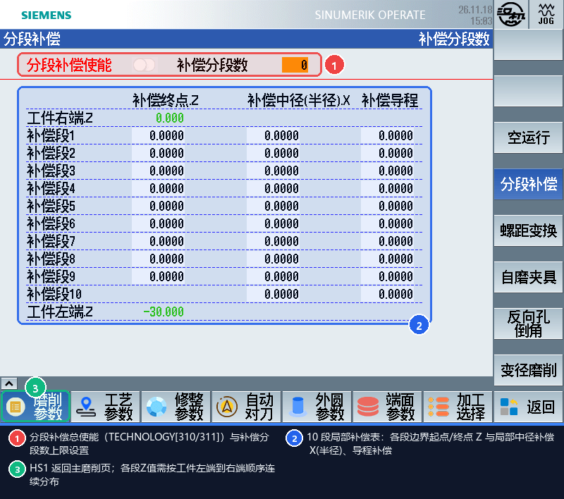
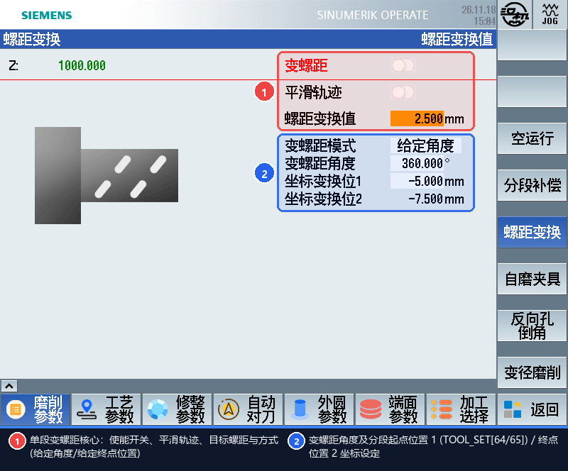
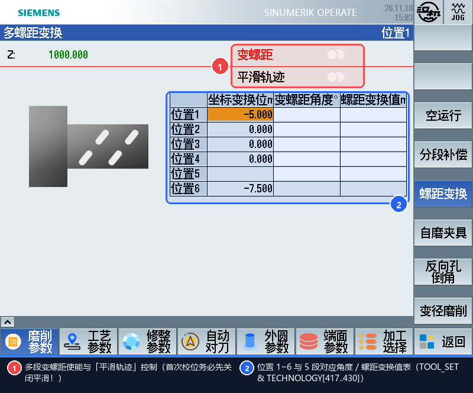

# 6.5 高级模块（下）：分段补偿与单/多段螺距变换

对于精密滚珠丝杠或长螺母存在的局部中径胀缩/螺距非线性漂移，以及双螺母预紧变导程/非等距过渡槽零件，可在 **内/外螺纹磨削参数界面**（`a_grind.com` `Mask1` / `Mask18`）通过右侧垂直软键 **`VS4 分段补偿`** 与 **`VS5 螺距变换`** 启用本节两大高精度插补补偿模块。

> **索引换算提醒**：下表所列 `NC 变量` 均为 `.SPF` 与 `MGUD.DEF` 使用的 **0-based 下标**；对应的 `HMI 脚本`（`a_grind.com` EasyScreen）统一采用 **1-based 下标（`HMI = NC + 1`）**，文中均已并列给出完整变量名，方便跨文件查证。

## 1. 10 段中径与导程分段补偿（`Mask57` / `VS4`）

在 **机床配置 → 第五类扩展界面** 中打开 **`分段补偿界面开启`**（NC：`TECHNOLOGY[309]=1` / HMI：`TECHNOLOGY[310]`）后，即可由 `VS4 分段补偿` 进入 `Mask57`。系统允许将工件有效螺纹全长最多划分为 **10 个连续区间**，在 `Z-C` 螺旋插补过程中动态平滑叠加各段的半径中径修正与导程修正。

| 界面字段 | NC 变量（0-based） | HMI 引用（1-based） | 参数含义与填写规范 |
| :--- | :--- | :--- | :--- |
| **分段补偿使能** | `TECHNOLOGY[310]` | `TECHNOLOGY[311]` | `0` 关闭 / `1` 开启（仅设为 `1` 时螺旋插补主循环读取下表补偿量） |
| **补偿分段数** | `TECHNOLOGY[311]` | `TECHNOLOGY[312]` | 范围 **`0 ~ 10`**（设 `N` 段时需依次填入前 `N-1` 个分界 `Z` 坐标及 `N` 组 X/Z 补偿量） |
| **工件左端.Z / 右端.Z** | `INI[1]` / `INI[2]` | `INI[2]` / `INI[3]` | 界面左侧**绿色只读回显**当前主磨削界面的左右端 Z 坐标边界，用于核对分段点是否落在工件有效范围之内 |
| **第 1～9 段补偿点 Z** | `TECHNOLOGY[332..340]` | `TECHNOLOGY[333..341]` | 第 1 段与第 2 段……直到第 `N-1` 与第 `N` 段的 Z 向分界点绝对坐标，须沿工件磨削方向保持严格单调排序 |
| **第 1～10 段补偿中径.X（半径）** | `TECHNOLOGY[312..321]` | `TECHNOLOGY[313..322]` | 各段在 **X 轴半径方向** 上的微调量（mm；注意区分主画面直径方向“中径调整”） |
| **第 1～10 段补偿螺距.Z** | `TECHNOLOGY[322..331]` | `TECHNOLOGY[323..332]` | 各段对应的导程/螺距轴向补偿量（mm） |

### 现场调试流程建议
1. **采集检测曲线**：试磨一件成品并送三坐标或激光导程仪检测，按轴向长度提取中径误差曲线与螺距累计误差曲线；
2. **划分合理分段**：按热变形或受力变形趋势划出 `N` 段（如 `3～6` 段即可覆盖常见热漂移规律），对照左侧绿色回显的 `INI[1]` / `INI[2]` 确认各分界 `Z` 坐标 `TECHNOLOGY[332..340]` 严格落在两端区间内；
3. **小步保守试补**：先填较小保守值（特别注意 `TECHNOLOGY[312..321]` 为 **半径量**），复磨实测后再逐步精调至全长公差带中央。

## 2. 单段螺距变换（`Mask50` / `VS5`）

当 **机床配置 → 第五类扩展界面** 将 **`螺距变换界面`**（NC：`TOOL_SET[61]` / HMI：`TOOL_SET[62]`）设为 **`1`（单段）** 时，点击 `VS5 螺距变换` 进入 `Mask50`。该模式常用于预紧双螺母中间跨越段或单一局部区间的导程突变（变节距几何与轨迹平滑示意图参见 [6.4 节第 4 部分](advanced_modules.md)）：

| 界面字段 | NC 变量（0-based） | HMI 引用（1-based） | 参数含义与设定规则 |
| :--- | :--- | :--- | :--- |
| **变螺距（总使能）** | `TOOL_SET[59]` | `TOOL_SET[60]` | `0` 关闭 / `1` 开启单段螺距变换 |
| **平滑轨迹** | `TECHNOLOGY[301]` | `TECHNOLOGY[302]` | `0` 否 / `1` 是（开启后加减速拐角采用圆滑过渡曲线；**首次对刀核对起止位置时务必设为 `0 否`**，确认位置准确后再改回 `1`） |
| **螺距变换值** | `TOOL_SET[66]` | `TOOL_SET[67]` | 范围 `0 ~ 100 mm`：变换区间内执行的目标中间段螺距值 |
| **变螺距模式** | `TOOL_SET[60]` | `TOOL_SET[61]` | `0` **给定角度**：从 `坐标变换位 1` 起按给定旋转角跨度 `TOOL_SET[67]` 执行变螺距，并自动计算回显 `坐标变换位 2`； `1` **给定终点位置**：直接指定 `坐标变换位 1` 与 `坐标变换位 2`，由系统自动换算中间过渡角度 |
| **变螺距角度** | `TOOL_SET[67]` | `TOOL_SET[68]` | 位置 1 到位置 2 之间的 C 轴相对旋转角（`°`；模式下设为 `0` 时开放输入） |
| **坐标变换位 1 / 位 2** | `TOOL_SET[64]` / `TOOL_SET[65]` | `TOOL_SET[65]` / `TOOL_SET[66]` | 变螺距区间的起始 Z 坐标与终止 Z 坐标（`模式=0` 时位置 2 为只读自动计算值） |

> **对位关键提示**：在初次试加工或空跑校验 `位置 1` 与 `位置 2` 是否与零件空刀槽/预紧错位槽对齐时，**请务必暂时关闭 `平滑轨迹`（`TECHNOLOGY[301]=0`）**，避免平滑提前或延后插补掩盖真实变换起止点位置！

## 3. 多段（5 区间）螺距变换（`Mask58` / `VS5`）

当 **机床配置 → 第五类扩展界面** 将 **`螺距变换界面`**（NC：`TOOL_SET[61]` / HMI：`TOOL_SET[62]`）设为 **`2`（多段）** 时，点击 `VS5 螺距变换` 切入 `Mask58`。相比单段模式，`Mask58` 将单组起止点扩展为 **`位置 1 ～ 位置 6`** 共 6 个 Z 向节点，支持连续划分最多 **`5` 段独立变螺距区间**：

| 界面区域 | NC 变量（0-based） | HMI 引用（1-based） | 含义与填写约束 |
| :--- | :--- | :--- | :--- |
| **变螺距 / 平滑轨迹** | `TOOL_SET[59]` / `TECHNOLOGY[301]` | `TOOL_SET[60]` / `TECHNOLOGY[302]` | 与单段模式相同；首次校位同样建议先关闭 `平滑轨迹`（`TECHNOLOGY[301]=0`） |
| **位置 1（首节点）** | `TOOL_SET[64]` | `TOOL_SET[65]` | 第 1 段变螺距区间的起始 Z 坐标 |
| **位置 2 ～ 位置 5（中间节点）** | `TECHNOLOGY[417..420]` | `TECHNOLOGY[418..421]` | 依次对应第 1～4 段的终点暨下一段起点的 Z 坐标 |
| **位置 6（末节点）** | `TOOL_SET[65]` | `TOOL_SET[66]` | 最后一段变螺距区间的终止 Z 坐标 |
| **变螺距角度 1 ～ 5（`°`）** | `TECHNOLOGY[421..425]` | `TECHNOLOGY[422..426]` | 第 1～5 段区间内对应的头架 C 轴变换角度 |
| **螺距变换值 1 ～ 5（`mm`）** | `TECHNOLOGY[426..430]` | `TECHNOLOGY[427..431]` | 第 1～5 段区间各自目标螺距值（`> 0`） |

### 顺序校验与报警拦截
- **严格单调顺序约束**：`位置 1` 至 `位置 6` 的有效分段坐标必须沿着工件实际加工方向保持 **严格单调递增或递减**，且启用的目标螺距必须 `> 0`。
- 若节点顺序交叉、相邻位置相等或目标螺距 `<= 0`，主程序初始化检校 `C_PAR_INI` 会立即触发 **10 号报警（`"变螺距设置有误!"`）** 并停机锁定（详见 [10.1 报警代码对照表](../10_appendix_and_troubleshooting/alarms_and_faq.md)）。
