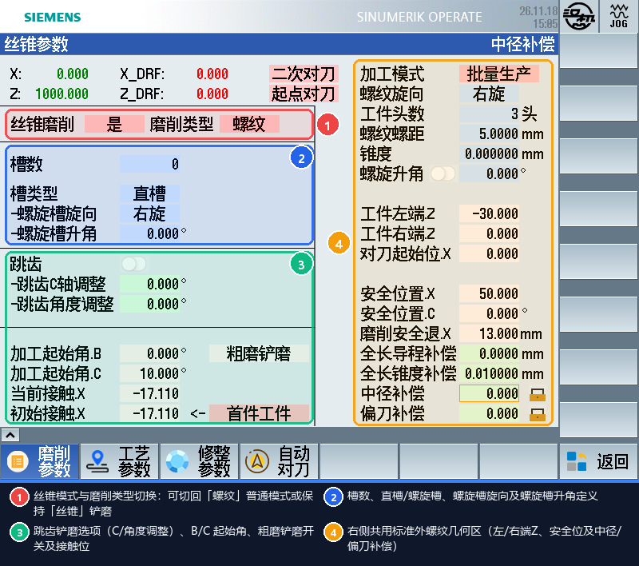
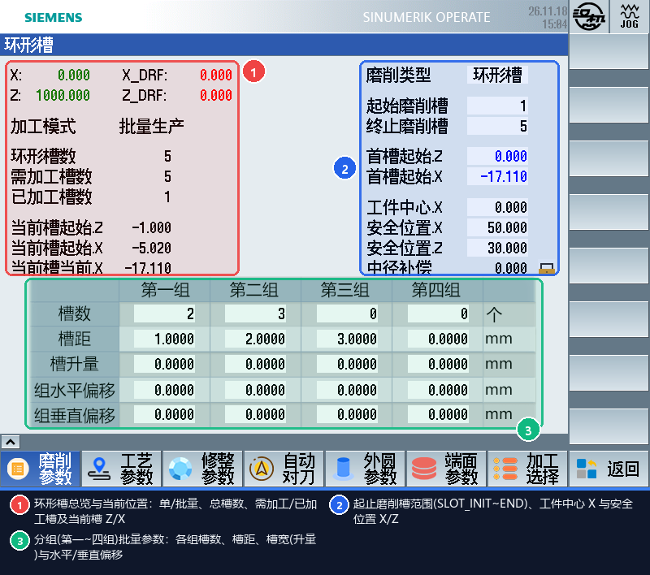

# 6.3 丝锥、蜗杆与环形槽专用功能

除了标准的通用单/多头内外螺纹磨削外，`Horizon-Juicer` 针对丝锥制造、蜗杆传动件以及多组环形凹槽零件内置了高度定制化的专用界面与算法引擎。

## 1. 丝锥铲磨加工（`Mask52` / `SCREW_TAP` / `;ifIsScrewTap`）

当 `HorizonJuicerCreator` 勾选了 **丝锥功能** 时，进入丝锥专用铲磨界面 **`Mask52`**（注：界面 EasyScreen 脚本对以下 `SCREW_TAP[0..8]`、`TECHNOLOGY[174]` 使用 **1-based** 索引，即分别绑定 `SCREW_TAP[1..9]` 与 `TECHNOLOGY[175]`）：

| 界面参数 | NC 变量 | 设置与工艺调节要点 |
| :--- | :--- | :--- |
| **丝锥磨削开关** | `SCREW_TAP[0]` | `0` 普通螺纹 / `1` **丝锥铲磨模式**（打开后使能 B 轴铲磨随动） |
| **槽数** | `SCREW_TAP[1]` | 按丝锥容屑槽数量录入（常见 `3 槽`、`4 槽` 等） |
| **槽类型** | `SCREW_TAP[2]` | `0` **直槽** / `1` **螺旋槽**（选直槽时无需设置后续螺旋槽参数） |
| **螺旋槽旋向** | `SCREW_TAP[3]` | `0` 右旋 / `1` 左旋 |
| **螺旋槽升角** | `SCREW_TAP[4]` | 依据图纸输入 `0° ~ 90°` 螺旋槽角度，程序内部据此解算 B 轴随动补偿系数 `SCREW_TAP[16]` |
| **B 轴起始角** | `SCREW_TAP[5]` | 开始磨削时 `B` 轴（铲磨径向偏心轴）起始相位角；微调该角可改变每齿背铲量起点位置 |
| **粗磨不铲磨** | `TECHNOLOGY[174]` | `0` 正常全程铲磨 / `1` 粗磨仅开圆槽、后续再启动 B 轴铲背（提升粗加工效率并保护砂轮） |
| **跳齿开关** | `SCREW_TAP[6]` | `0` 关闭 / `1` **开启跳齿丝锥铲磨**（如隔齿磨削的特殊丝锥） |
| **跳齿 C 轴调整** | `SCREW_TAP[7]` | `-360° ~ 360°`：若实测铲背轮廓错位或切削刃位置不准，增减此参数令 C 轴起始位置整体前移或后退 |
| **跳齿角度调整** | `SCREW_TAP[8]` | `-360° ~ 360°`：若本该保留完整的齿也被局部磨削损伤，调整此参数精确收窄每次跳过保留的角度区间 |

> **丝锥手动对刀要点**：丝锥对刀时砂轮默认转速为 `1500 RPM`（如需更改应在初始化主程序内修改 `INI[53]`），开启 `DRF` 后需同时关注 **X 轴接触深度** 与 **B 轴相位角度** 以确认铲背曲线与齿槽完美对中；若铲背量太小对刀阶段不易辨认，可先试磨一件实测后再微调 `B轴起始角` 与 `跳齿C/角度调整`。

## 2. 蜗杆磨削模式与冷却/松夹 M 指令（`;ifIsHasWorm`）

当软件生成勾选 **包含蜗杆** 后，在磨削主画面右上角及修整界面会启用蜗杆专有输入与齿形调用接口：

- **输入模式切换（`INI[86]` / HMI `87`）**：支持在 **`0` 输入螺距（`INI[4]`）** 与 **`1` 输入模数（`INI[76]`）** 之间自由切换。选择模数后系统配合工件中径/分度圆直径与旋向自动核算导程及修整参数；
- **蜗杆齿形与修整初始化（`WORM_SHAPE` / `C_DRESS_WORM_INIT.SPF`）**：可指定蜗杆廓形子程序 `WORM_SHAPE`；修整初始化子程序 `DRESS_PART/Worm/C_DRESS_WORM_INIT.SPF` 利用临时 `R` 变量 **`R3 ~ R29`** 统一计算滚轮圆弧半径（`R29=DRESSER[32]`）、砂轮宽度与直径（`R8`/`R9`）、修整中心间距（`R10=DRESSER[34]-DRESSER[33]`）、高低差（`R11=WHEEL[15]`）及 VW/XZ 停留退回速度；
- **OEM 扩展钩子（`M_OPEN.SPF` / `M_CLOSE.SPF`）与冷却/松夹 M 代码**：代码库 `DRESS_PART/Worm/` 下预留 `M_OPEN.SPF` 与 `M_CLOSE.SPF` 子程序挂钩（默认出厂基线为 `RET` 空占位，供设备厂按专机动作扩写）。整机磨削与修整流程涉及的配套 M 代码如下：
  - **`M8` / `M9`**：主磨削冷却开 / 关（内磨/常规冷却泵 1）；
  - **`M28` / `M29`**：修整冷却开 / 关（冷却泵 2，在 `B_DRESS` 修整循环及 `TECHNOLOGY[307]=1` 附加磨削冷却时启用）；
  - **`M38` / `M39`**：淋浴冷却开 / 关（冷却泵 3/外磨冷却，在 `TECHNOLOGY[307]=2` 时附加开启）；
  - **`M35` / `M36`**：砂轮架及 `A` 轴液压松开 / 夹紧。

## 3. 环形槽磨削模式（`Mask51` & `B_RING_GROOVE.SPF`）

当系统设定中开启 `RING[49] = 1`（HMI：`RING[50]`）后，磨削界面左上角呈现 **`螺纹 / 环形槽`** 切换控件（NC：`RING[0]` / HMI：`RING[1]`）。切到 **`1` 环形槽** 后，画面自动跳转至 **环形槽磨削参数页（`Mask51`）**：

| 分区 | 界面字段 | NC 变量 | 操作定义与说明 |
| :--- | :--- | :--- | :--- |
| **起止选择** | **起始磨削槽 / 终止磨削槽** | `RING[2]` / `RING[3]` | 例如总共 12 个槽，正常新件设 `1 ～ 12`；如只需单修第 5～7 槽则改为 `5 ～ 7`，左侧自动统计 **`需加工槽数`**（`RING[4]`）与 **`已加工槽数`**（`RING[5]`） |
| **起刀坐标** | **工件右端 / 初始磨削接触位** | `INI[2]` / `PROCESS[13]` | 手动测量设置第 1 个环形槽的 `Z`（磨削起始 `.Z`）与 `X` 接触位置；`C` 轴仅作圆周转动磨削（`INI[17]=0` 无导程移动） |
| **四组参数矩阵** | **槽数（第 1～4 组）** | `RING[11/21/31/41]` | 支持同一工件最多切出 **4 组** 不同螺距、槽深或偏移的等距环形槽群 |
| | **螺距（第 1～4 组）** | `RING[10/20/30/40]` | 本组内部相邻两槽之间的 Z 向中心距（mm） |
| | **槽升量（第 1～4 组）** | `TECHNOLOGY[164..167]` | *（如用于渐进/螺旋变槽深需求时的单槽深度偏移控制）* |
| | **组水平偏移（Z）** | `RING[12/22/32/42]` | 第 k 组相对于前一组在 Z 向的整体偏移补偿 |
| | **组垂直偏移（X）** | `RING[13/23/33/43]` | 第 k 组相对于前一组在 X 径向的整体台阶偏移，可叠加各组锥度偏移 `RING[14/24/34/44]` |

> **环形槽对刀注意**：从 `B_RING_GROOVE.SPF` 源码逻辑可知，在 `RING[0] == 1` 模式下 **点亮手动/自动对刀键将直接退出不执行插补对刀**（环形槽采用手动靠刀录入第一槽 Z/X 基准点即可）；若点亮 **修整键** 则正常转入 `B_DRESS` 修整砂轮。
