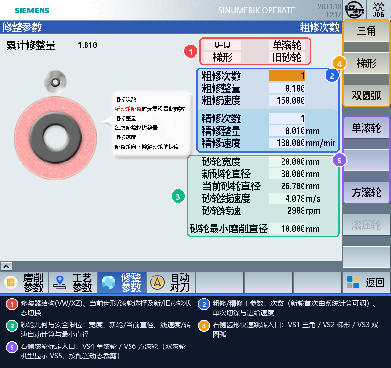
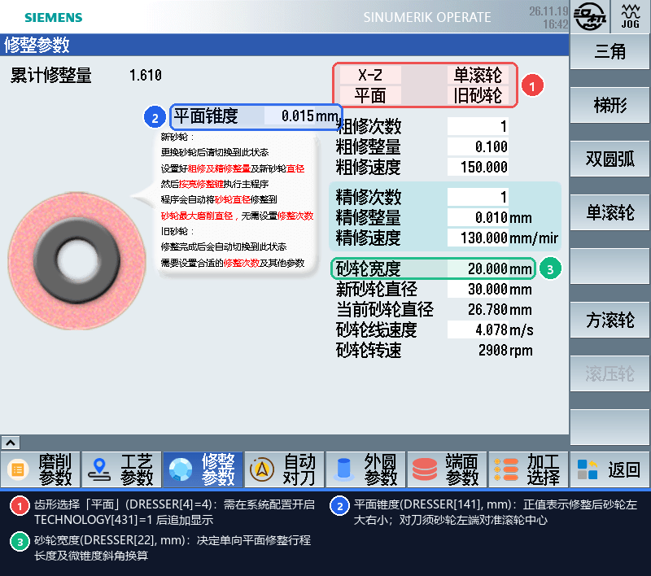

# 7.1 砂轮修整主参数与新/旧砂轮策略

点击任意主界面底部水平软键 **`HS3 修整参数`**，即进入 `a_dress.com`（`Mask3`）。界面左侧显示累计修整量与直观砂轮图标，右侧显示粗修/精修设定与砂轮直径保护边界，最右侧垂直软键（`VS1`～`VS8`）则是进入 **齿形参数** 与 **滚轮校准** 界面的直接入口（各软键受 `HorizonJuicerCreator` 选配条件动态裁剪：`VS1 三角`/`VS2 梯形` 受 `;ifIsAllShape` 控制，`VS3 双圆弧` 受 `;ifIsArc` 控制，`VS4 单滚轮`/`VS6 方滚轮` 受 `;ifIsSingleAndRound` 控制，`VS5 双滚轮` 受 `;ifIsSide` 控制）。

> **架构差异提示**：插补式（`V-W` / `X-Z` / `U-W`）与成型滚压式（`V` / `X` / 液压摆缸）均在此主界面的顶部 **`修整器类型`** 下拉框切换；选中成型或摆缸后，`a_dress.com` 右侧 `VS7 滚压轮` 自动激活，取代三角/梯形/双圆弧等插补齿形软键；若为液压摆缸机型（`;ifIsVH`），进入滚轮子页后可在该子页右侧使用 `VS8 摆缸`。

## 1. 修整器类型与模式组合

界面最上方两个联动状态框自动匹配当前生成软件设定的硬件：

- **修整器类型（`DRESSER[0]`）**：
  - 插补模式：**`VW`**（外/内通用 V-W 两轴）、**`XZ`**（X-Z 插补，含 `X-W`）或 **`UW`**；
  - 成型滚压模式：**`V`**、**`X`（前/后，对应 `DRESSER[37]=0/1`）** 或 **`液压`**（摆缸液压成型，对应 `DRESSER[0]=3`）；
  - 若设备同时配有滚压轮与单轴/双轴修整能力，可直接在 **`VW / V`** 或 **`XZ / X`** 之间自由切换。
- **修整轮类型（`DRESSER[3]`）**：`0` 单滚轮 / `1` 双滚轮 / `2` 方滚轮（选中成型修整器时右侧自动切为 `VS7 滚压轮`，滚轮子页内部包含 `VS8 摆缸`）。
- **齿形选择（`DRESSER[4]`）**：`0` 三角 / `1` 梯形 / `2` 双圆弧（仅外螺纹全齿形且开启附加齿形时，`a_dress.com` 主页右侧 **`VS8` 扩展菜单** 可用，展开二级菜单 `MENU_2` 后点击 `VS1` 可切换 **`行星齿`**）；若在 **机床配置 → 修整配置** 中开启 **`平面修砂轮`（NC：`TECHNOLOGY[431] = 1` / HMI：`TECHNOLOGY[432]`）**，`齿形` 下拉列表会动态追加 **`4` 平面**（独立于 `DRESSER[114]`；若关闭该开关而当前仍停留在 `4`，系统载入时自动回退为 `2 双圆弧`）。

## 2. 新砂轮 vs 旧砂轮 & 新砂轮插补模式

| 界面参数 | NC 变量 | 工作机理与操作建议 |
| :--- | :--- | :--- |
| **砂轮状态** | `DRESSER[5]` | **`0` 新砂轮**：更换新砂轮后务必手动切到此态，正确录入实际 **`新砂轮直径`**（建议比卡尺测量实值偏大约 `0.2 mm` 留空程余量）。 启动修整后，程序将依据 **齿高** 与 **`最大磨削直径`** 自动把砂轮修整成型并达到预定工作直径；一旦完成，系统 **自动将状态切回 `1 旧砂轮`**。 **`1` 旧砂轮**：日常修整使用。按界面下方设置的 **`粗修次数`** 与 **`精修次数`** 从当前接触位继续切入修整 |
| **是否成型砂轮** | `DRESSER[113]` | *当 `TECHNOLOGY[58]=1` 且内螺纹时在 `新砂轮` 旁显示*： **`0` 普通**：毛坯平砂轮，新砂轮开修从齿顶安全抬刀高度逐步一层层修出牙型； **`1` 成型**：砂轮出厂前已被厂家预成型出近似槽型，无需高抬刀空走，直接贴合初始轮廓快速精成型 |
| **新砂轮插补修整模式** | `INI[88]` | 在 **机床配置**（`a_setting.com`）设定： **`0` 抬齿高**：以牙型中心线为中心逐次向深处逼近，最常用； **`1` 偏半个砂轮宽度**：分别从砂轮左右侧面逐步向中心偏置剥除余量（适合深大齿型） |
| **新砂轮轮廓单独参数** | `TECHNOLOGY[302..304]` | 当开启 `TECHNOLOGY[302]=1` 时，粗修框右侧弹出高亮副框（`LUNKUO_FEED` / `LUNKUO_SPEED`），专用于控制新砂轮第一次拉通型面的单刀进给量与修整速度 |

## 3. 粗修、精修与磨削中自动修整参数对照

- **纯修整（手动点亮修整键 <code>&#36;A_DBB[0]</code> 启动）**：顺序执行 **`粗修次数`（`DRESSER[25]`）× `粗修量/粗修速度`** ＋ **`精修次数`（`DRESSER[26]`）× `精修量/精修速度`**。
- **磨削中自动修整（工艺表 `修整设定` 或 `按件修整` 触发）**：**只调用此页面的 `精修次数`、`精修量`、`精修速度` 参数**（*注：若系统开启了扩展工艺表 `Mask20/30`，则优先使用扩展工艺表内部各工序专设的精修进给/速度/转速！*）。

## 4. 砂轮直径护栏、线速度与干涉修整角

| 界面参数 | NC 变量 | 计算规则与报警限值 |
| :--- | :--- | :--- |
| **砂轮宽度** | `DRESSER[22]` | *插补修整器必须准确测量录入*，直接决定左右退刀边沿位置与双侧面居中对称 |
| **新砂轮直径 / 当前直径** | `DRESSER[23]` / `DRESSER[24]` | 每次修整消耗的半径量自动扣减 `DRESSER[24]` 并累计到 **`累计修整量`（`DRESSER[9]`）** |
| **砂轮线速度 / 转速** | `WHEEL_LINESPEED_DRESS[1]` / `DRESSER[36]` | 推荐先设 `22 m/s` 左右再结合材料调试；若系统开了 `INI[144]=1` 恒转速则开放 `DRESSER[36]` 直接输入 RPM |
| **最小磨削直径** | `DRESSER[35]` | 根据砂轮法兰盘外径或内磨杆外径 + `2×齿高` 加上安全余量设定。当 `DRESSER[24] < DRESSER[35]` 时触发 **2 号报警“砂轮太小”** |
| **最大磨削直径** | `DRESSER[49]` | **主要针对内螺纹或限孔尺寸机型**：限制砂轮能顺利进入工件内孔的最大直径；新砂轮修整时会自动将外径修小至此尺寸以下。若加工时当前砂轮直径仍大于此值则报警拦截 |
| **修整角度（A 轴）** | `INI[153]` | 需配 `A` 轴并开启 `INI[154]=1` 后在左上角出现，范围 `-90° ~ 90°`（默认 `0°`）；当磨削大导程/大螺旋升角需要消除干涉修整时设入该角度 |
| **加工中修整补偿** | `DRESSER[70]` | 当开启 `DRESSER[58]=1` 后显示在左上区（`-0.5 ~ 0.5 mm`）：每完成一次 **磨削中修整**，除了正常的砂轮半径补偿外，额外把磨削接触位朝坐标轴方向再微补此数值，常用于消除热膨胀造成的批产尺寸单向漂移 |

## 5. 平面修砂轮（内孔磨砂轮平面与锥度修整，`F_COMMON_SHAPE_10.SPF`）

针对仅需将内孔磨/平面砂轮外圆母线修直（或修出微量防干涉倒锥度）的场景，最新版 `Source_Library` 新增了 **平面修砂轮** 专用模式：

1. **开启与选用路径**：
   - 在 **机床配置 → 修整配置** 中开启 **`平面修砂轮（内孔磨砂轮修整）`**（NC：`TECHNOLOGY[431] = 1` / HMI：`TECHNOLOGY[432] = 1`）；
   - 重新进入 **`HS3 修整参数`** 后，`齿形` 下拉框自动新增 **`平面`**（`DRESSER[4] = 4`）。
2. **`平面锥度` 参数（NC：`DRESSER[141]` / HMI：`DRESSER[142]`，单位：`mm`，`ac4` 权限）**：
   - 仅当 `齿形` 选为 **`平面`** 时在主画面中上方动态显现（切换回三角/梯形/双圆弧时自动隐藏）；
   - **正负号与斜角定义**：**正值表示修整后砂轮左大右小**（沿砂轮全宽 `DRESSER[22]` 产生对应直径/半径锥度差），底层 `F_COMMON_SHAPE_10.SPF` 自动按 $\theta = \operatorname{atan2}(\text{DRESSER}[141],\ \text{DRESSER}[22])$ 构造斜率平面轨迹，所有过渡圆角（`COMMON_RND`）与多线参数自动清零，无需进入独立齿形子页面。
3. **关键对刀起点规范（与标准齿形不同！）**：
   - 标准对称齿形（三角/梯形/双圆弧）以 **砂轮中心对准滚轮中心**，左右对称偏移 $\pm \text{DRESSER}[22]/2$；
   - **平面修对刀起点必须设置为：砂轮左端对准滚轮中心**（`E_COMMON_SHAPE_CACU.SPF` 识别 `F_COMMON_SHAPE_10` 时自动切为非对称单边水平边界 `HORI_5_LEFT = 0`、`HORI_5_RIGHT = -DRESSER[22] - 1`，修整长度 `DRESS_LENGTH = DRESSER[22]`，保证单向均匀扫过整个砂轮宽度）。
4. **旧版升级提示**：`TECHNOLOGY[431]` 依赖扩展后的新版 `MGUD.DEF`（`DEF NCK REAL TECHNOLOGY[500]`）；若早期的机台控制器仍使用 `TECHNOLOGY[420]` 等旧版定义，升级前务必先**备份当前 GUD 数据**，再导入激活新版 `MGUD.DEF` 后重新配置与恢复参数。
