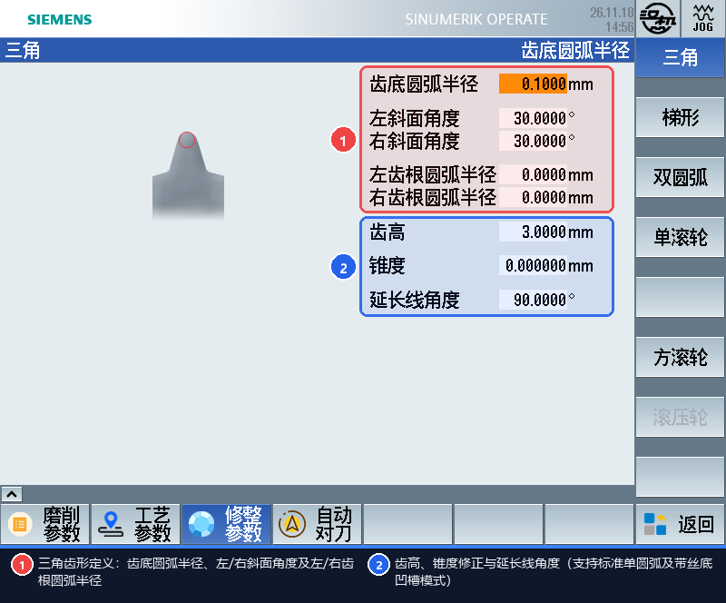
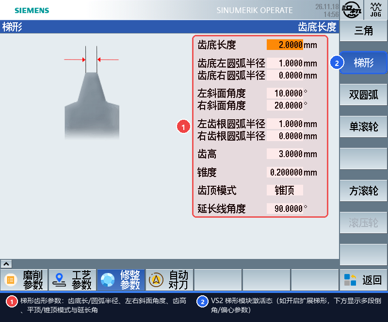
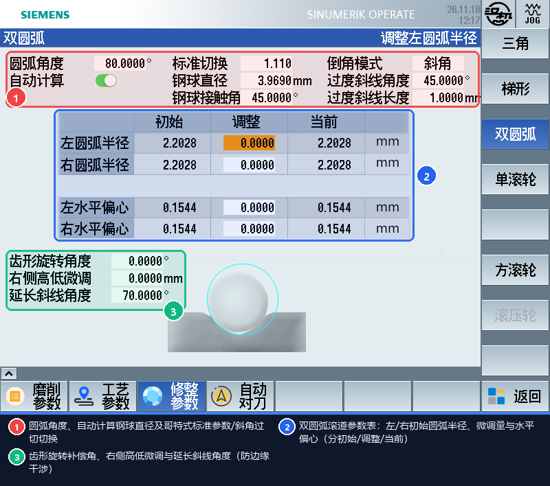
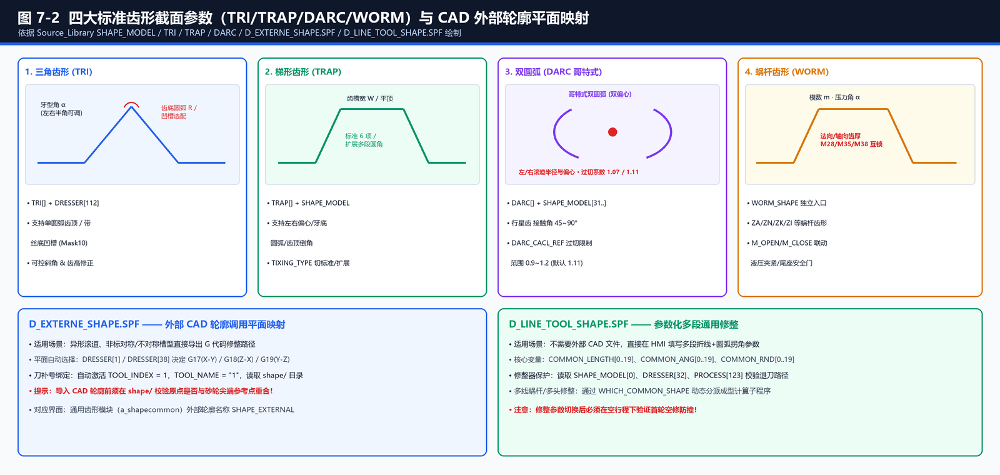

# 7.3 齿形参数、通用齿形模型与多线/外部轨迹

对于 **VW**、**XZ**、**XW**、**UW** 等两轴插补修整器，可以在 **修整参数** 界面点击右侧垂直软键 **`三角`**（`VS1`）、**`梯形`**（`VS2`）、**`双圆弧`**（`VS3`）或下一页 **`行星齿`**（外磨）进入 `a_shapecommon.com` 对应齿形参数页。

## 1. 四大标准齿形参数详解

### 1.1 三角齿形（`Mask7` 标准 / `Mask10` 带丝底凹槽）

- **标准三角（`DRESSER[111] = 0`）**：设置 **`齿底圆弧半径`**（`SHAPE_MODEL[100]`）、**`左/右斜面角度`**（`101`/`102`，与垂线夹角，如 `60°` 公制螺纹单边输 `30°`）、**`左/右齿根圆弧半径`**（`1`/`2`）、**`齿高`**（`103`）、**`锥度`**（`5`）及 **`延长线角度`**（`104`）；
- **带丝底凹槽（`Mask10`，当 `DRESSER[111] = 1` 且 `SHAPE_MODEL[6] = 1` 时）**：拆分为上下两段独立定义 **`上-左/右斜面角度 & 齿高`**（`105/106/107`）与 **`下-左/右斜面角度 & 总齿高`**（`101/102/103`），专门用于带排屑凹槽或特殊顶角的三角螺纹。

### 1.2 梯形齿形（`Mask8` 标准 / `Mask1` 偏梯形 / `Mask3` 戴帽梯形）

根据 `系统配置` 是否打开 `SHAPE_MODEL[26] = 1`，允许通过顶端下拉框切换三种梯形模式（`SHAPE_MODEL[25]`）：

1. **`0` 标准对称/等腰梯形（`Mask8`）**：设定 `齿底长度`（`90`）、`齿底左/右圆弧半径`（`91/92`）、`左/右斜面角度`（`93/94`）、`左/右齿根圆弧 R`（`3/4`）、`齿高`（`95`）、`锥度`（`11`）、`齿顶模式`（`24`：`0` 平顶 / `1` 锥顶）与 `延长线角度`（`96`）；
2. **`1` 扩展偏梯形/锯齿形（`Mask1`）**：按螺距直接输入 `螺距`（`10`）、`中径宽度`（`12`）、`中径高度`（`13`）、`齿底高度`（`14`）、`左/右半角`（`15/16`）、`左/右齿尖 R`（`17/18`）与 `左/右齿底 R`（`19/20`）；
3. **`2` 戴帽梯形（`Mask3`）**：两段斜面结构，区分上下斜面角度（`97/98` & `93/94`）及上下齿高（`99` & `95`）。

### 1.3 双圆弧（哥特式）滚道齿形（`Mask9`）

广泛用于高精度滚珠丝杠与滚珠螺母磨削，参数表支持“**原始图纸值 + 现场修调量 = 当前执行值**”的三列分离机制：

| 参数项目 | 原始设定 | 现场调整 | 当前执行（只读叠加） | 说明 |
| :--- | :--- | :--- | :--- | :--- |
| **左/右圆弧半径** | `SHAPE_MODEL[112/113]` | `SHAPE_MODEL[116/117]` | `SHAPE_MODEL[80/81]` | 实际修整轮廓的左/右圆弧槽半径 $R$ |
| **左/右水平偏心** | `SHAPE_MODEL[114/115]` | `SHAPE_MODEL[118/119]` | `SHAPE_MODEL[82/83]` | 圆弧中心相对于齿中心线的水平偏心距 $e$ |
| **自动计算功能** | `DRESSER[39]`（0否/1是） | `标准切换`（`DARC_CACL_REF`，NC `DRESSER[112]` / HMI `113`，范围 `0.9~1.2`，默认 **`1.110`**；紧贴合滚珠滚道常用 **`1.07`**） | 输入 **`钢球直径`**（`22`）与 **`接触角`**（`23`） | 开启后自动按下面公式推算初始圆弧半径与水平偏心！ |

**双圆弧自动计算官方公式**（源自 `Horizon-Juicer` 内部算法与用户帮助规范）：

$$R = k \cdot \frac{D_b}{2} \qquad (k \in [0.9, 1.2], \ \text{默认标准 } k = 1.11, \ \text{紧贴合参考 } 1.07)$$

$$e = \left( R - \frac{D_b}{2} \right) \cdot \sin\left( \frac{\alpha}{180} \cdot \pi \right)$$

其中 $D_b$ 为钢球直径（mm），$\alpha$ 为接触角（°）。

- **接触角实测非对称补偿技巧**：
  1. **`齿形旋转角度`（`SHAPE_MODEL[7]`，`±5°`）**：保持两侧圆弧半径不变，将整个双圆弧截面围绕牙顶中心微转一个小角度（**正值逆时针，负值顺时针**），快速消除左右接触角对称偏差；
  2. **`右侧高低微调`（`SHAPE_MODEL[89]`，`±0.2 mm`）**：不改圆弧半径的前提下单独上下偏置右半侧（**正值右抬高，负值右降低**）；
  3. **`齿底倒角方式`（`27`）**：选 `0 斜角` 配角度/长度（`84/87`）或 `1 圆角` 配 `齿底圆角半径`（`28`，注意圆角半径需大于滚轮尖端圆弧半径）。

### 1.4 外磨行星齿与四大标准齿形对照（`Mask2`）

*仅外螺纹在 `VS8 下一页` 可选*：结构同样采用三列左/右圆弧及偏心表（`SHAPE_MODEL[30..41]`），附加 **`修整圆弧角度`**（`42`，`45°~90°`）、**`过渡斜线角/长`**（`43/44`）、**`齿顶过渡方式`**（`49`：`0` 圆弧/`1` 平顶）、**`齿顶 R/中径/小径/中径接触角`**（`45~48`）。

## 2. 多线修整、外部轨迹与通用“10 线段积木模型”

1. **多线（多牙）一体修整**：
   - 在三角（`SHAPE_MODEL[8/9/29/73]`）、梯形（`74/66/75/76`）及双圆弧（`77/67/78/79`）界面左下/右下角均设有 **多线修整** 扩展栏，可一次性在单片宽砂轮上同时修出 `N` 个等螺距牙槽，支持 **`间隔螺距`** 与 **`齿高补偿`**（正值令左侧齿逐个变矮以作渐进切入牙）。
2. **外部自定义齿形轨迹（`DRESSER[139]` & `D_EXTERNE_SHAPE.SPF` / `D_LINE_TOOL_SHAPE.SPF`）**：
   - 当标准三角/梯形/双圆弧无法满足特殊异形螺杆时，在 **修整配置** 打开 **`外部齿形参数显示`（NC：`DRESSER[110]=1` / HMI：`111`）**，可在修整主画面选择调用外挂曲线子程序：
     - **`D_EXTERNE_SHAPE.SPF`（`1 = 左右分开修整`）**：按 `DRESSER[56]` 设定的插补平面（`G17` / `G18` / `G19`）与 `TOOL_INDEX=1` 刀具配置分段切入修整；
     - **`D_LINE_TOOL_SHAPE.SPF`（`2 = 带刀具半径补偿的连续轨迹曲线`）**：读取单段完整廓形程序并开启刀具半径补偿走通轮廓；
     - 支持 `SHAPE_MODEL[0]`（HMI `1`）指定存放介质：`0 内置`、`1 后USB（//DEV_3）`、`2 前USB`、`3 CF卡`。
3. **通用 10 线段积木模型原理（`Research/.../CommonShapeUserGuide`）**：
   - 底层 `D_COMMON_SHAPE.SPF` 将任意对称/非对称槽型以垂直中心线为准拆成 **左 5 段 + 右 5 段（共 10 段）**；每段由 **长度（`COMMON_LENGTH[i]`）、与垂直向下方向的夹角（`COMMON_ANG[i]`）、过渡圆角（`COMMON_RND[i]`）** 三个元素拼装，通过 `E_COMMON_DARC_ANG`、`E_COMMON_LINE_TO_ARC` 等积木子程序自动交点求取与滚轮半径补偿，极大简化非标牙型的定制开发。
