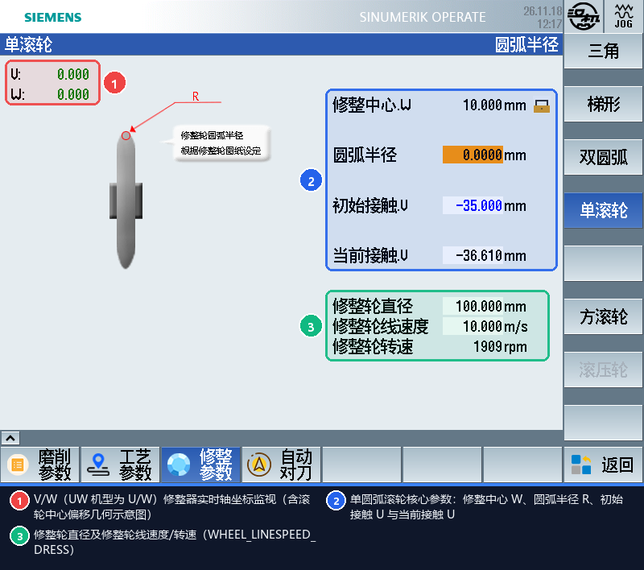
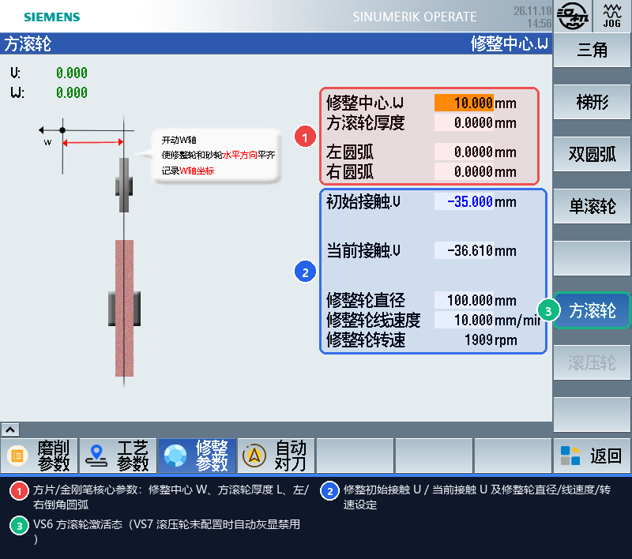
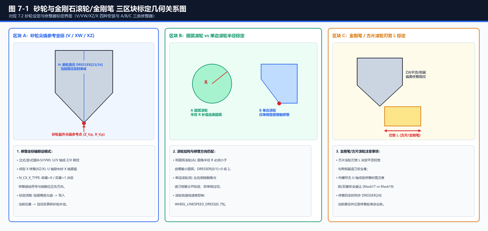

# 7.2 滚轮类型与修整中心校准方法

在 **修整参数** 界面（`a_dress.com`）按配置动态显示的右侧垂直软键中点击 **`单滚轮`**（`VS4`）、**`双滚轮`**（`VS5`）、**`方滚轮`**（`VS6`）或 **`滚压轮`**（`VS7`），即可进入 `a_dressware.com` 对应硬件型号的滚轮标定页；若配置为液压摆缸机型（`;ifIsVH`），进入 `a_dressware.com` 滚轮子界面后可点击子页右侧 **`摆缸`**（`VS8`）切入 `Mask15`。

## 1. 四类常见滚轮配置面与核心参数

| 滚轮类型 | 对应 Mask 编号 | 专属几何特征参数 | 共有参数 |
| :--- | :--- | :--- | :--- |
| **单滚轮** | `Mask4`（VW/UW） `Mask12`（XZ/XW） | **`圆弧半径`**（`WHEEL[4]`，即滚轮尖端圆弧角 `R`，务必查图纸输入精确值，精度至 `0.0001 mm`） | **修整中心**、`初始接触位置`、`当前接触位置`、**`修整轮直径`**（`WHEEL[0]`）、**`修整轮线速度`**（`WHEEL[1]`，常用 `15 m/s`）与自动换算的 **`修整轮转速`**（`WHEEL[19]`） |
| **方滚轮** | `Mask6`（VW/UW） `Mask14`（XZ/XW） | **`方滚轮厚度`**（`WHEEL[3]`）、**`左圆弧半径`**（`WHEEL[8]`）、**`右圆弧半径`**（`WHEEL[9]`） | 同上，影响方滚轮修整两侧砂轮边缘时的偏置宽度与倒圆补偿 |
| **双滚轮** | `Mask5`（VW） | **`双滚轮间距`**（`WHEEL[2]`）、**`左/右圆弧半径`**（`WHEEL[6/7]`）、**`左右轮高低差`**（`WHEEL[15]`：实测左高右低输正，左低右高输负）、左/右端分别独立的初始与当前接触位（`WHEEL[12/13]` & `[10/11]`） | 同上，专用于两边对称或高速双面成型插补 |
| **滚压轮 / 摆缸** | `Mask11`（VW） `Mask16/17/19`（XZ/X） `Mask15`（液压摆缸） | **`粗修停留时间`**（`DRESSER[47]`）与 **`精修停留时间`**（`WHEEL[18]`，推荐 `1 s`）；**`修整中反向距离`**（`INI[11]`：`0 ~ 1 mm`，`0` 表示持续进给不退让）；**`齿高`**（`DRESSER[1]`）；**`轮廓成型接触`**（`WHEEL[12]`）；及 **`成型修完侧面靠磨`** 参数（`TECHNOLOGY[308/350/351]`）；液压摆缸页同时实时监控 `液压左/右` 开关信号 | **`VW/XZ`** 下的滚压轮仍需设置 `修整中心`，`XZ`/`X` 模式需校验 `修整中心距` |

> **UW 修整器专有项（`;ifIsUW`）**：若机床配置为 **`UW`** 修整器，`Mask4`/`6`/`11` 左下方额外开放 **`UW 修整位 .X`（`DRESSER[140]`）**，用于定义修整期间主轴 `X` 轴所处的固定工作位坐标；同时页顶显示 `回零时砂轮与修整轮中心距`（`DRESSER[2]`）。

## 2. 两大关键原点校准计算公式（现场必测）

第一次安装调试、更换滚轮或撞机重新找回零点后，必须严格按下面两步完成原点参数标定（受右上角小锁图标 `para_switch` 保护，需先点击解锁后再修改）：

### 2.1 水平轴“修整中心”校准（`DRESSER[21]`，适用于插补及 VW 滚压轮）

保证修整器在 `W` 轴或 `Z` 轴方向处于砂轮厚度正中央的标定步骤：
1. 在手动状态下开动滚轮（`V/W` 或 `X/Z`）使滚轮 **左侧边沿** 轻碰接触砂轮 **右侧端面**（或对应侧面贴齐），记录水平坐标 `W1`（或 `Z1`）；
2. 让滚轮绕开后贴合砂轮 **另一侧端面**，记录水平坐标 `W2`（或 `Z2`）；
3. 计算中心位置填入 **`修整中心`**：
   $$\text{修整中心} = \frac{W_1 + W_2}{2} \quad \text{或} \quad \frac{Z_1 + Z_2}{2}$$
4. 涉及 **UW/XZ 回零安全中心距** 或 **方/双滚轮宽度** 时，程序内会自动叠加砂轮宽度 `DRESSER[22]` 与方/双滚轮几何偏置完成居中对齐。

### 2.2 X/V 轴“修整中心距”与“初始接触”校准（`DRESSER[2]`）

- **在 `V-W` / `V` 独立轴机构中**：直接移动 `V` 轴让新砂轮最高点轻碰滚轮外沿，将此时的 `V` 轴坐标直接录入 **`初始接触位置`**（`WHEEL[14]`）与 **`当前接触位置`**（`WHEEL[10]`）即可；
- **在 `X-Z` / `X` 共享 X 轴机构中（必须通过 `修整中心距` 解算动态径向关系）**：
  1. 在 **修整参数** 填入新砂轮实测直径 $D_1$（`DRESSER[23]`），在 **滚轮界面** 填入滚轮图纸外径 $D_2$（`WHEEL[0]`）及圆弧半径/齿高；
  2. 手动移动 `X` 轴让砂轮外圆外沿刚接触滚轮外沿，记录此刻机械坐标 $X_1$，填入 **`当前接触.X`**；
  3. 计算两中心距（注意正负方向符号与机床结构对应）：
     $$\text{修整中心距} = \left| X_1 + \frac{D_1}{2} + \frac{D_2}{2} \right| \quad \text{或} \quad \left| X_1 - \frac{D_1}{2} - \frac{D_2}{2} \right|$$
  4. **黄金校验方法**：把算出的 `修整中心距`（注意判断正负方向，通常砂轮在滚轮正向输入正值、负向输入负值）填入并回车后，**立刻观察下方只读计算的 `初始接触.X` 数值是否与刚才填入的 `当前接触.X` 完全相等**——若相等，说明方向与中心距标定 **100% 准确**；若不相等或差了一个滚轮直径，立刻检查公式正负号！
