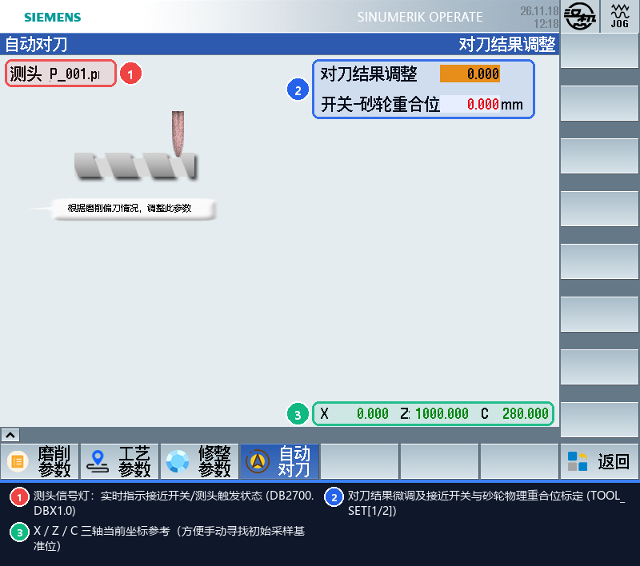
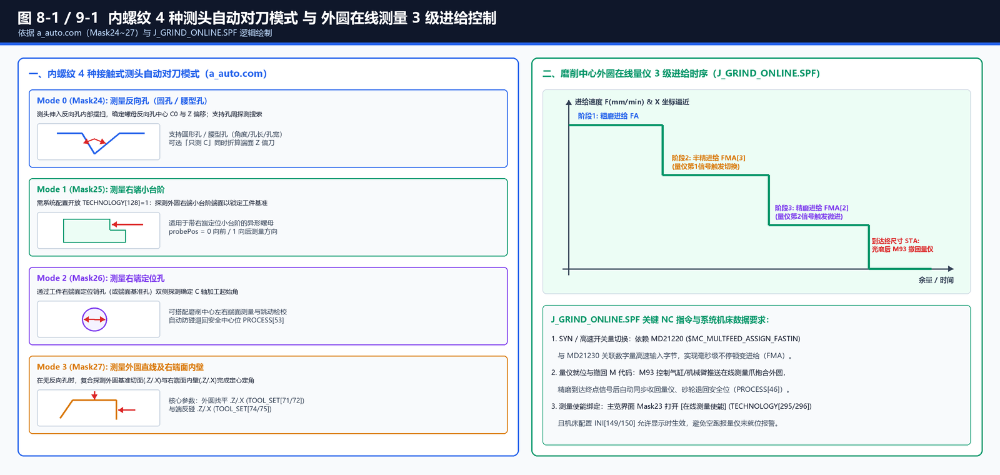

# 8.1 外螺纹自动对刀标定与测量

外螺纹自动对刀画面对应 `a_auto.com` 中的 **`Mask22`**。系统依据生成时选定的测量硬件组合（仅接近开关、仅测头、或 **开关 + 测头双机构并存**）自动显示对应的标定坐标系字段。

## 1. 界面参数与首次装配标定方法

| 参数名称 | NC 变量 | 显示条件 | 精准测量/标定步骤 |
| :--- | :--- | :--- | :--- |
| **对刀结果调整** | `TOOL_SET[41]` | 常驻显示 | 完成自动对刀后试磨一件，若仍存在轻微偏刀（一侧切深一侧切浅），直接在此增减修正量即可，**无需破坏下面标定的物理零点基准** |
| **砂轮中心与接近开关重合 Z 坐标** | `INI[42]` | 配有接近开关（`TOOL_SET[31]=1`） | 手动移动 `Z` 轴，使 **接近开关检测中心** 正好对准 **砂轮齿顶中心线**（或利用标准校对棒对照确认），读取记录此时 `Z` 轴机械坐标 |
| **砂轮中心与测头中心重合 Z 坐标** | `INI[42]` | 配有测头且无开关（`TOOL_SET[49]=1`） | 手动移动 `Z` 轴，使 **测头红宝石球中心** 对准 **砂轮齿顶中心线**，记录 `Z` 轴坐标（或采用下文标准端面互算公式反推） |
| **测量 - 开关水平距** | `TOOL_SET[50]` | **双机构同时存在**（开关+测头） | 仅在同时安装了测头和接近开关时显示： 测量接近开关中心与测头球心之间的水平方向净距——若 **测头在左侧 / 开关在右侧，输入正值**，反之输入负值 |
| **测头信号灯 1 / 2** | `DB2700.DBX1.0` / `DBX1.1` | — | 界面左上角实时反馈传感器通断状态（`0` 灭 / `1` 亮）；安装或调试时用手轻拨测针或金属片贴近开关，确认灯随动作秒变后再运行自动程序 |

> **提示**：关于外螺纹自动对刀所需的工件位置边界（左端、右端、螺距、对刀位等），NC 自动从 **磨削参数（`Mask1`）** 同步读取；界面左下角同样常驻显示当前机械坐标 `X`、`Z`、`C` 方便校对。

## 2. 外螺纹自动对刀标准作业步骤

1. **完成首次基准标定**：按上表填入 `重合 Z 坐标`（以及双机构下的 `测头-开关水平距`），并先将 `对刀结果调整` 设为 `0`；
2. **设定磨削基础边界**：进入 **磨削参数** 页，填好工件螺距、旋向、头数、左右端坐标，以及安全退刀位置；
3. **选定对刀模式与动作**：
   - 点亮机床操作面板上的 **自动对刀键**（对应 <code>&#36;A_DBB[5]</code>，此时注意关闭 **修整键** 与 **手动对刀键**）；
   - 如希望自动对刀完成后 **自动紧接着直接开始磨削**，确认 **机床配置** 中已将 `自动对刀后是否直接磨削`（`INI[90]`）设为 **`1`（是）**；若为稳妥起见先仅对刀验证，将其保持为 `0`；
4. **切到 `AUTO` 启动**：按绿色 **循环启动**：
   - 测量机构伸出（若配有开关信号则等待到位信号置 `1`）；
   - Z/C 轴定位后按预设转速探触工件螺纹牙槽（提取波峰/波谷与第一个/第二个齿中心 C 角 `TOOL_SET[37..39]`）；
   - 算得准确 `C 轴起始角`（`TOOL_SET[4]`）后测量机构缩回；
5. **收尾与偏刀微调**：
   - 若试磨发现微量偏刀，回到 `a_auto.com` `Mask22` 调整顶部的 **`对刀结果调整`（`TOOL_SET[41]`）** 并复磨校验即可。
