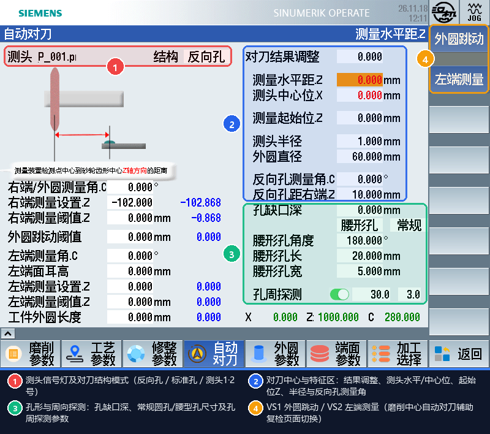
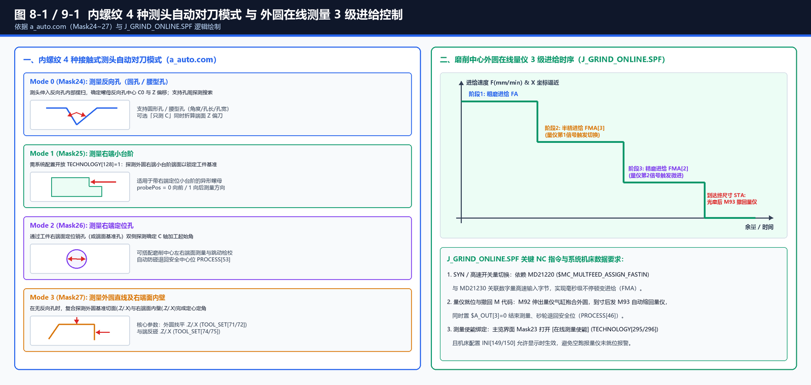
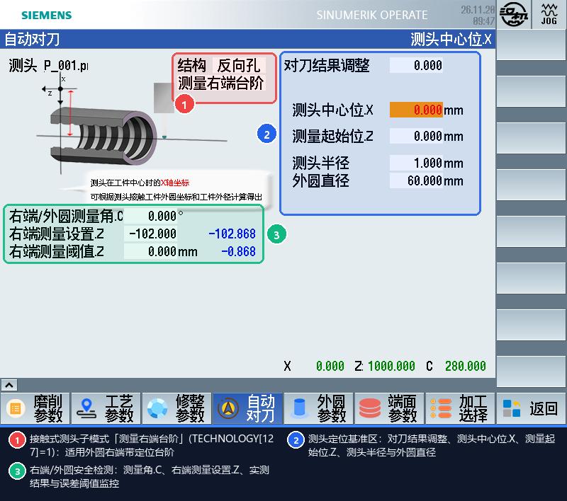
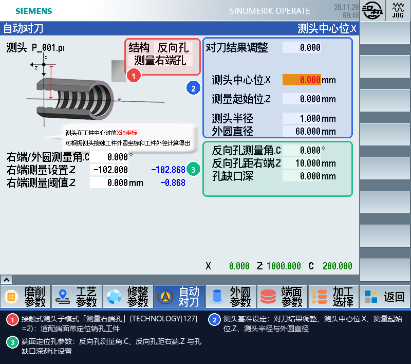
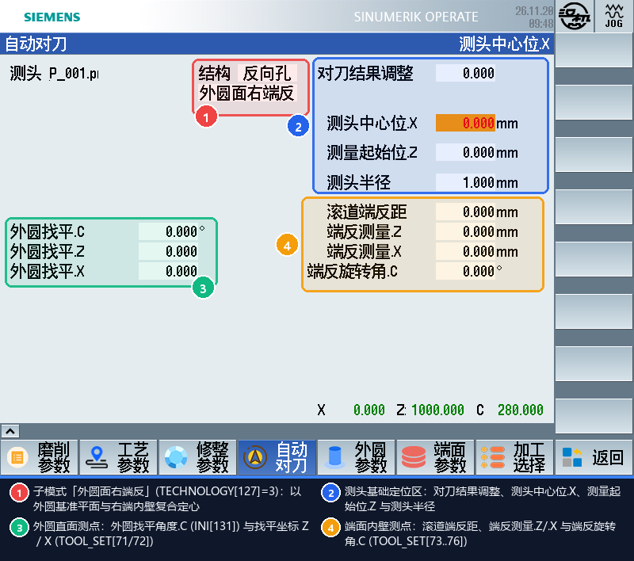
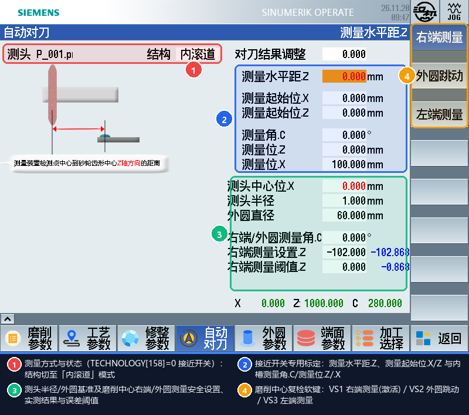

# 8.2 内螺纹与磨削中心自动对刀标定

内螺纹（含磨削中心）自动对刀画面对应 `a_auto.com` 中的 **`Mask21`（路由总控）→ `Mask23`～`Mask27`**，依据底层配置的传感器类型与测量模式自动适配显示内容。

## 1. 两种内螺纹传感器与四类测头模式路由（`Mask21`）

在 **系统配置 → 对刀配置** 中可通过 **`内螺纹测量方式`（NC：`TECHNOLOGY[158]` / HMI：`TECHNOLOGY[159]`）** 选择：

- **`0` 接近开关测量内滚道（`Mask23`）**
- **`1` 接触式测头**：由 `a_auto.com` `Mask21` 根据左上角 **`测量模式`（NC：`TECHNOLOGY[127]` / HMI：`TECHNOLOGY[128]`）** 精确加载下列 4 个独立子画面：
  - **`0` 测量反向孔（`Mask24`）**：适用内部带圆孔或腰型换向器孔的滚珠丝杠螺母（默认主力模式）；
  - **`1` 测量右端小台阶（`Mask25`）**（需 `TECHNOLOGY[128]=1` / HMI：`TECHNOLOGY[129]` 开放）：适用外圆右端有基准小台阶定位的异形工件；
  - **`2` 测量右端定位孔（`Mask26`）**：通过端面定位销孔确定 C 轴角度；
  - **`3` 测量外圆直线及右端面内壁（`Mask27`）**：在无反向孔时通过外圆基准切面与端面内壁复合定心（支持 `外圆找平 .Z/.X` `TOOL_SET[71/72]` 与 `端反碰 .Z/.X` `TOOL_SET[74/75]`）。

## 2. 公共传感器与反向孔几何参数详解

| 参数名称 | NC 变量 | 标定方法与现场设置说明 |
| :--- | :--- | :--- |
| **对刀结果调整** | `TOOL_SET[41]` | 试磨后发现整体偏刀时输入的整体微调值（mm），不影响标定基准 |
| **测头/开关水平距** | `TOOL_SET[10]` | **极其关键的基准参数**（见上图左图红箭头）： ① 开动机床使测头/开关接触工件右侧端面，记 Z 坐标 `Z1`； ② 移开测头，让砂轮齿顶对准同一右端面，记 Z 坐标 `Z2`； ③ 已知测头球头半径 $R_1$，填入 $\text{测量水平距} = \left| Z_1 - R_1 - Z_2 \right|$ |
| **测头中心位** | `PROCESS[53]` | 测头球心正好位于工件回转中心线时的 X 轴坐标（接触外圆测 X 坐标再加工件外半径算出） |
| **Z 轴测量起点** | `INI[48]` | 测头伸出并保证工件在安全孔外约 `50 mm` 处的 Z 轴起点 |
| **测头半径 / 工件大径** | `TOOL_SET[9]` / `INI[34]` | 按测头图纸和工件实际大径填写（影响防碰绕行路径与进孔间隙） |
| **反向孔测量角 / 距右端** | `INI[49]` / `INI[35]` | 预先找准让测头伸入后大致位于反向孔中央的 `C` 轴角度与端面到孔心距离；`孔缺口深`（`PROCESS[54]`）用于侧边有开口时自动避让缺口边缘 |
| **反向孔类型** | `TOOL_SET[22]` | `0` **圆形孔** / `1` **腰型孔**（选腰型孔时填 **`腰型孔角度`** `INI[31]`、**`孔长`** `INI[32]`、**`孔宽`** `INI[33]`；通常右旋大于 `90°`，左旋小于 `90°`） |
| **孔周探测功能** | `TECHNOLOGY[155..157]` | 工件来料无粗定位夹具时，开启 **`孔周探测 = 是`** 并设 `探测范围`（如 `30°`）与 `探测步距`（如 `5°`），当首次直进无法入孔时头架自动步进摆角搜寻孔位 |
| **测量模式（只测 C）** | `INI[162]` | `0` **常规**：测上下（C）+ 左右（Z）定位孔中心； `1` **只测 C**：仅测上下定圆周角，同时将端面定位偏差折算到磨削 `偏刀调整` |

### 2.1 扩展接触式测头子模式标定要点（`Mask25` / `Mask26` / `Mask27`）

除默认模式 `0`（反向孔，`Mask24`）外，当选用其他三种接触式测头子模式时，需按下列各 Mask 专属字段补充标定：

| 测量模式 / 子画面 | 适用工件场景 | 核心专有参数（NC 0-based）与标定逻辑 |
| :--- | :--- | :--- |
| **模式 `1`：测量右端小台阶（`Mask25`）** *需配置 `TECHNOLOGY[128]=1`* | 工件外圆右端加工有同心定位小台阶（无反向孔或不便伸孔） | 使用 **`测头中心位.X`（`PROCESS[53]`）**、**`测量起始位.Z`（`INI[48]`）**、**`测头半径`（`TOOL_SET[9]`）**、**`外圆直径`（`INI[34]`）** 与 **`右端测量设置/角度/阈值`（`INI[136]` / `INI[131]` / `INI[137]`）**，通过右端面与基准小台阶协同锁定轴向 Z 及起始角 |
| **模式 `2`：测量右端定位孔（`Mask26`）** | 端面带有专用的角度定位销孔（常见于法兰/套筒类滚珠螺母） | 除右侧基准及测头位置参数外，填好 **`反向孔测量角.C`（`INI[49]`）**、**`反向孔距右端.Z`（`INI[35]`）** 及 **`孔缺口深`（`PROCESS[54]`）**；自动伸入端面定位孔探测孔壁对称点以确立 C 轴基准相位 |
| **模式 `3`：测量外圆直线及右端面内壁（`Mask27`）** | 外圆侧面加工有平面基准线、且可借助右端内壁共同定心 | 需填写两套关联测点： ① 外圆基准直面：**`外圆找平.C`**（`INI[131]`）、**`外圆找平.Z`**（`TOOL_SET[71]`）、**`外圆找平.X`**（`TOOL_SET[72]`）； ② 端面内壁特征：**`端反旋转角.C`**（`TOOL_SET[76]`，垂直面到端反测点的 C 轴旋转角差）、**`端反测量.Z`**（`TOOL_SET[74]`）、**`端反测量.X`**（`TOOL_SET[75]`）与 **`滚道端反距`**（`TOOL_SET[73]`，滚道基准到端反内壁距离）； ③ **`跳过外圆测量`**（`TECHNOLOGY[432]`，0 关 / 1 开）：开启后不测外圆找平面，外圆找平三项隐藏，头架从 `外圆找平.C` 直接再转 `端反旋转角.C` 测端反，起始角以 0° 为基准，适用于无找平面或夹具定角的工件 |

## 3. 接近开关测内滚道特有参数（`TECHNOLOGY[158] = 0`）

当选用接近开关扫描内部螺旋滚道时，在右侧额外设定：
- **`测量起始位 .X`（`TECHNOLOGY[176]`）**：开关安全深入内孔过程中的 X 轴径向起始坐标；
- **`Z 轴测量位`（`INI[52]`）**：手动把开关大致对正第一个内螺纹槽内的 Z 坐标；
- **`测量位 .X`（`INI[51]`）**：感应到信号后再向槽壁靠近约 `0.2 mm` 处的精确扫描径向坐标。

## 4. 磨削中心专属：跳动、外圆长与左右端面安全检测

在 **磨削中心（`;ifIsCenter`）** 界面中，画面左侧展示复检设定与实测结果，**右侧垂直软键栏**额外配备了多道用于全自动无人产线的安全复检按钮（垂直软键随当前对刀画面动态分布：**`Mask23` 接近开关测量**含 `VS1 右端测量` / `VS2 外圆跳动` / `VS3 左端测量`，**`Mask24` 接触式测头反向孔**含 `VS1 外圆跳动` / `VS2 左端测量`）：

1. **右端测量（默认自动测量）**：
   - 输入手动对好标准件右端面时的 **`右端测量设置`（`INI[136]`）**、**`右端测量角度`（`INI[131]`）** 及 **`右端测量阈值`（`INI[137]`，如 `0.05 mm`）**；
   - 每次自动对刀必测右端，一旦 `实测结果`（`INI[50]`）与 `设定值` 差值（`INI[139]`）超过阈值，立即触发 **12 号报警（工件右端过长）** 停机（排查毛坯超长或卡盘夹持未顶到位！）；
2. **外圆跳动测量（`INI[138]` + `INI[127]`）**：
   - 开启后沿外圆按 3 点探测圆跳动（`INI[133]`），超过 **`外圆跳动阈值`**（`INI[127]`，如 `0.08 mm`）立刻触发 **11 号报警（外圆跳动/圆度过大）** 防偏心撞刀；
3. **左端测量与工件长度测量（`TOOL_SET[44..48]` & `INI[30]` / `INI[140]`）**：
   - 开启 `TOOL_SET[44]=1` 后测量左端面（避让角度 `TOOL_SET[58]`、左端安全值 `TOOL_SET[45]` / 阈值 `TOOL_SET[47]` / 实测与误差 `TOOL_SET[46]` / `TOOL_SET[48]`），超限触发 **13 号报警（工件左端过长）**；同时实时反算并回显实际 **`工件外圆长度测量`（`INI[140]`）**（以上报警代码详见 [10.1 节](../10_appendix_and_troubleshooting/alarms_and_faq.md)）。

> **重要提醒**：在磨削中心中，自动对刀完成后系统紧接着就会按 **加工选择看板** 点亮的绿色工序切入磨削；但外圆和端面的起刀深度 **仍以各自界面的 `初始磨削接触` 为准**，自动对刀仅负责核查毛坯装夹位置是否超差及求解内螺纹 C 轴起始角！
