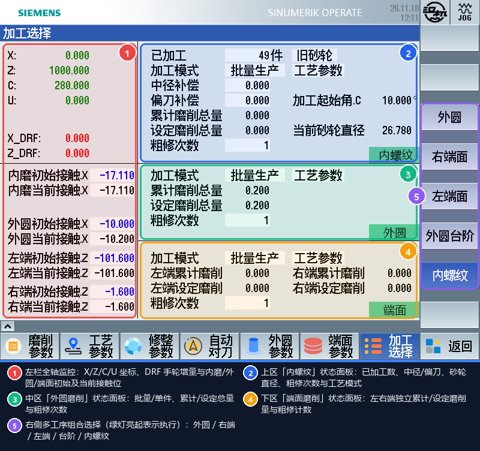

# 9.1 加工选择看板与多工序联合调度

**磨削中心（Grinding Center）** 是 `Horizon-Juicer` 面向高精度滚珠螺母、液压套筒及复合轴套类零件的旗舰功能集。仅一次装夹即可顺序完成 **外圆磨削 → 右端面/左端面磨削 → 外圆台阶磨削 → 内螺纹（及自动对刀）** 全部工序，消除二次装夹同轴度与垂直度误差。

## 1. 加工选择总看板布局（`a_centermain.com` / `Mask23`）

在磨削中心机型下，按下 **`CUSTOM → 磨削界面`** 默认直接进入 **加工选择总看板（`Mask23`）**。画面将三大子系统信息高度浓缩在一张屏幕上：

1. **左栏：实时轴坐标与四大接触位监控**
   - 实时显示当前 `X`、`Z`、`C`、（若有 `U` 轴显示 `U`）、`A` 轴机械坐标以及手轮偏置 `X_DRF`、`Z_DRF`；
   - 集中罗列并允许查看 **`内磨`**、**`外圆`**、**`左端`**、**`右端`** 四大工艺当前的 `初始磨削接触` 与 `当前磨削接触`；
2. **中栏：三大磨削单元状态总览（上/中/下三段）**
   - **上段（内螺纹）**：显示已加工件数、单件/批量模式、`中径调整`/`偏刀调整`、当前砂轮状态与直径、粗修次数及快捷入口 **`工艺界面`**、**`变螺距使能`**；
   - **中段（外圆）**：显示外圆加工模式、累计/设定总量、粗修次数及快捷入口 **`工艺界面`**（若开启外圆在线测量还显示 `在线测量` 使能开关）；
   - **下段（端面）**：同屏显示左端面与右端面各自的累计/设定磨削总量、粗修次数及 **`工艺界面`**；
3. **底部水平软键区（`HS1`～`HS8`）**：
   - `HS1 磨削参数` / `HS2 工艺参数` / `HS3 修整参数`：管辖 **内螺纹** 核心参数；
   - `HS4 自动对刀`：统管 **自动对刀** 寻位与跳动/长度校验（若未配置/未启用自动对刀，系统运行时自动隐藏并禁用 `HS4`）；
   - `HS5 外圆参数`：管辖 **外圆 + 台阶一/台阶二**；
   - `HS6 端面参数`：管辖 **左/右端面**；
   - `HS7 加工选择`：即本看板。

## 2. 右侧垂直软键工序组合选择与执行顺序（`A_GRIND_CENTER.SPF`）

右侧垂直软键区提供 5 枚独立的高亮复选切换开关：**`外圆`**（NC：`PROCESS[43]` / HMI：`PROCESS[44]`）、**`右端面`**（NC：`PROCESS[45]` / HMI：`PROCESS[46]`）、**`左端面`**（NC：`PROCESS[44]` / HMI：`PROCESS[45]`）、**`外圆台阶`**（NC：`PROCESS[94]` / HMI：`PROCESS[95]`）、**`内螺纹`**（NC：`PROCESS[41]` / HMI：`PROCESS[42]`）。点击任意按键即由灰白翻转为**绿色激活态**（如总览实拍图右下所示），支持单选独立加工或任意组合多选连续作业！

### NC 调度执行顺次与安全互锁逻辑（`A_GRIND_CENTER.SPF`）

在 `AUTO` 模式启动后，主控程序严格按如下顺序串联执行已亮起的绿色工序开关：

1. **安全门与侧门检校**：若配置自动门则关闭（非手动对刀态）；若开启 `侧门检测`（`TOOL_SET[18]=1`）则强制等待 <code>&#36;A_DBB[80]==1</code> 方才继续；
2. **测量机构缩回与初始防碰停泊**：确保在线测量退回且所有对刀探头/接近开关缩回，执行 `P_GRIND_CENTER_POS` 将各轴移动到安全初始停泊位；
3. **自动对刀优先级抢占**：若操作面板 **手动/自动对刀键** 点亮，先执行对刀流程；若为自动对刀测量结束，自动顺接下方的勾选工序（视配置而定）；
4. **外磨工艺联合链（外圆 → 端面 → 外圆台阶）**：
   - 先运行 `H_GRINDING.SPF`（若勾选 **`外圆`**，如设置 `TECHNOLOGY[37]=1` 还可直接顺带靠磨左端清根）；
   - 接着运行 `L_GRINDING.SPF`（若勾选 **`左端面`** 或 **`右端面`**）；
   - 再运行 `Q_GRINDING.SPF`（若勾选 **`外圆台阶`** 且内部开启了 `台阶一` 或 `台阶二`，非修整态）；
   - 以上外磨段结束时若 `INI[156]=1` 会自动慢速减速停止头架，并根据 `INI[92]` 设定决定外圆砂轮立刻停止或低速维持转动；
5. **内螺纹工序段**：最后执行 **`B_SCREW.SPF`** 完成内螺纹高精度磨削，并在结束后按 `PROCESS[118]` 决定若仅勾选了内螺纹是否跳过返回外磨 Z 安全位以压缩循环时间。

> **独立修整操作重要规则**：在磨削中心对 **任意一把砂轮执行手动点亮 `修整键` 修整前**，务必回到本看板 **只点亮当前要修整的那一个（或左/右端面）工序开关，关闭其他绿灯开关**（例如要修外圆砂轮，必须只亮绿 `外圆` 关闭 `内螺纹`/`端面`），避免修整动作串入其他砂轮循环造成干涉撞机！
