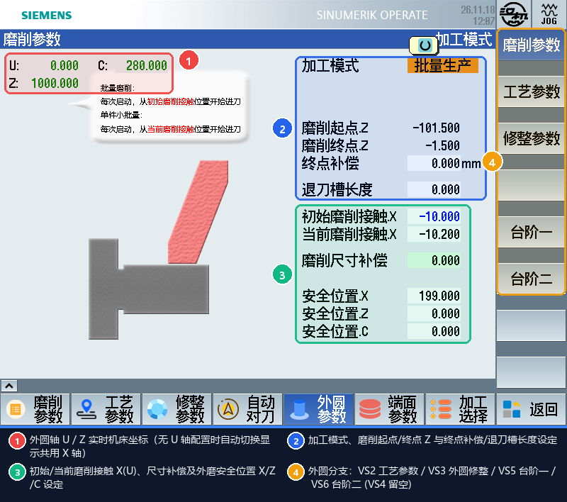
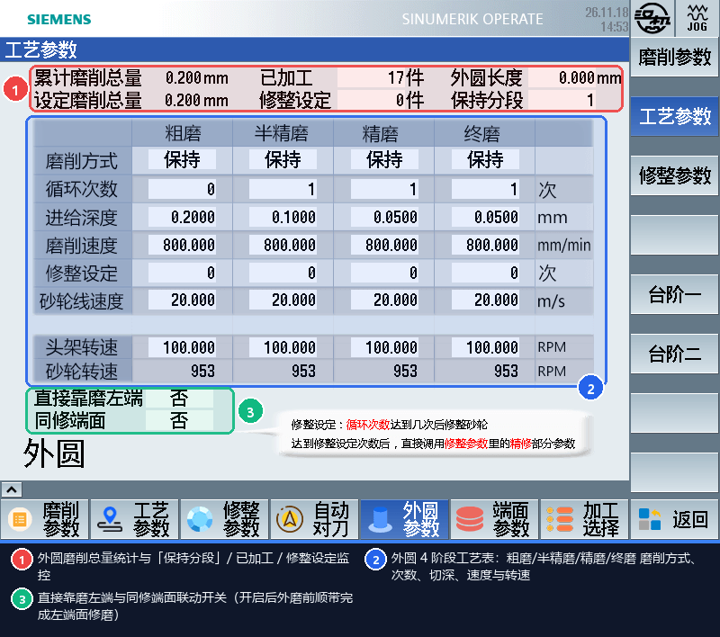
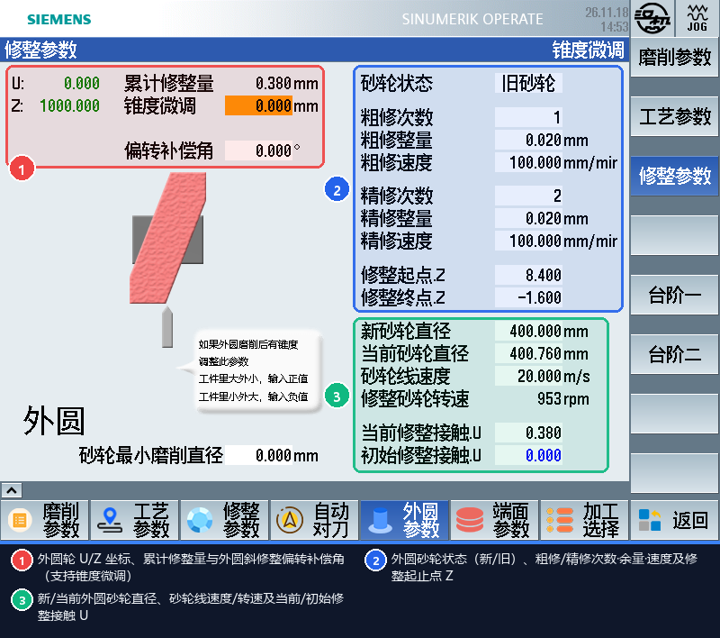
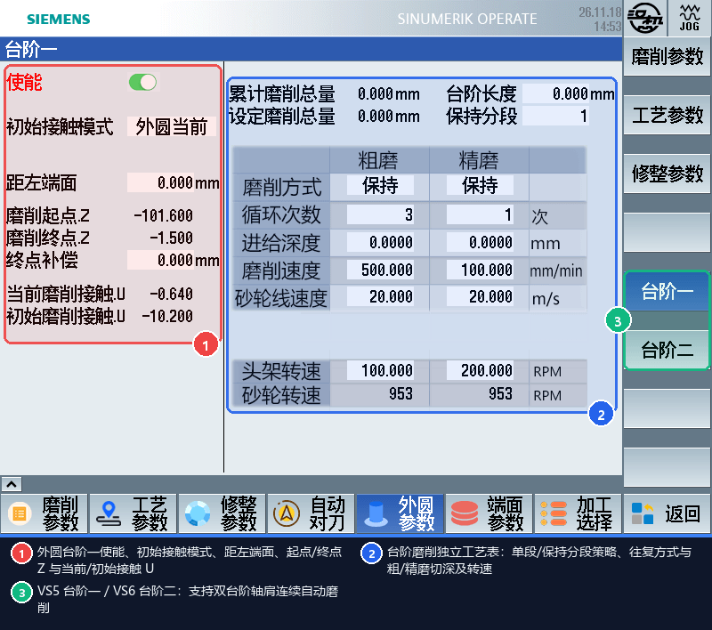

# 9.2 外圆与外圆台阶磨削及修整

在 **加工选择** 看板底部按 **`HS5 外圆参数`**，即可进入 `a_centerwaiyuan.com` 专属管理区。通过右侧垂直软键可依次切换：**`VS1 磨削`**（`Mask31`）、**`VS2 工艺`**（`Mask24`）、**`VS3 修整`**（`Mask26`）、**`VS5 台阶一`**（`Mask33`）与 **`VS6 台阶二`**（`Mask34`）。

## 1. 外圆磨削参数（`Mask31`）与轴系兼容差异

### 1.1 自动识别的轴系坐标差异（U 轴 vs 共用 X 轴）
依据 `HorizonJuicerCreator` 选配结果，界面左侧坐标读数与切入方向自动适配（`AXIS_EW` / `PROCESS[57]`）：
- **配有独立外圆轴 `U`（`;ifIsHasU`）**：使用 **`U` 轴** 执行外圆切入，`PROCESS[57] = 1`；
- **无 `U` 轴共用 `X` 轴**：若外圆砂轮位于前面（`ifIsNotHasUFront`），`PROCESS[57] = 1`；若位于后方（`ifIsNotHasUFront` 反之即 `Back`），`PROCESS[57] = -1`。

### 1.2 核心字段与起止点自动联动公式
- **`磨削起点`** 与 **`磨削终点`** 无需手工填死，程序 **自动依据 `端面参数` 页面内的左/右端面初始接触位计算**（对应关系：`起点 = 左端面初始接触 + 0.1 mm`，`终点 = 右端面初始接触 + 0.1 mm`）；
- **`退刀槽长度`（`PROCESS[112]`）**：根据工件左端根部退刀槽实际宽度填写。从起点向右端进给时自动跳过退刀槽避免砂轮尖角重载崩坏或拉出振纹，反向回来再扫清退刀槽根部；
- **`外圆初始磨削接触`（`PROCESS[46]`）** / **`当前磨削接触`（`PROCESS[20]`）**：手动对刀用砂轮轻触外圆后，建议往安全侧回退 `0.05 ~ 0.1 mm` 输入 `初始接触`（*注：磨削中心的自动对刀只管测量端面/跳动/内孔，**外圆和端面的实际磨削起点位置均以此处手动输入为准***）；
- **`磨削尺寸补偿`（`TECHNOLOGY[296]`）**：范围 `-1.0 ~ 1.0 mm`，微调外圆成品最终外径尺寸（**正值成品变大，负值变小**；该补偿项开放 **`ac7` 钥匙开关 0 档** 权限，便于操作工日常批产直接微调尺寸，而 **`VS2 工艺`** 表内粗/半精/精/终磨循环次数与进给深度统一受 **`ac4` 钥匙开关 3 档** 保护）；
- **`外圆退刀位`（`INI[107]`）** & **`台面磨削起始`（`INI[108]`）**：务必把 `外圆退刀位` 设在外圆轴极限安全退避点，防止加工内螺纹期间发生机械干涉及碰撞。

## 2. 外圆工艺表：保持分段 vs 来回拉磨（`Mask24`）

外圆四道工艺表（粗磨/半精磨/精磨/终磨）支持两种截然不同的进刀策略（`TECHNOLOGY[239..242]`）：
1. **`保持`（切入磨）**：砂轮切入到深度后不左右水平拉动直接停留（`INI[146]` / `TECHNOLOGY[27..29]`），适合粗磨快速去余量；若 **`外圆长度`（`INI[30]`）** 大于外圆砂轮宽度，可在右上角设置 **`保持分段`（`INI[145]`，`1~10` 段）**，令每段宽度略小于砂轮宽度分段切入剥余量；
2. **`来回`（纵磨拉磨）**：切入后 Z 轴在起终点之间往返平滑磨削一次，适合半精磨与精磨抛光表面粗糙度；
3. **`外圆终点补偿`（`TECHNOLOGY[44]`）**：防止砂轮拉出右端面过远，可输入如 `5 mm` 提前结束行程；
4. **`直接靠磨左端`（`TECHNOLOGY[37]`）**：开启后外圆一磨完顺势向左靠磨 1 个循环的左端面精/粗量清根，提升复合节拍；
5. **`同修端面`（`INI[41]`）**：开启后每逢外圆磨削过程中触发自动修整，同时顺带修一轮端面（调用端面精修次数）保持两面垂直度！

## 3. 外圆金刚笔修整参数（`Mask26`）

- 设置 **`修整起点.Z`（`DRESSER[93]`）** 与 **`修整终点.Z`（`DRESSER[72]`）**（建议各自超出砂轮端缘约 `5 mm` 安全区间，若用液压外圆修整器需先伸出后再对位置）；
- **`锥度微调`（`DRESSER[132]`）**：仅用作外圆母线轻微锥度纠偏（建议在 `0 ~ 0.02 mm` 范围内微调）：**实测工件“里大外小（左大右小）”输正值，反之输负值**；
- **`偏转补偿角`（`DRESSER[59]`）**：默认 `0°`（外磨砂轮外圆和侧面均定期修整保持垂直 `90°` 夹角）。若设备采用斜置砂轮且从始至终 **不修端面仅修外圆**，必须填入实际倾斜装配角度，让系统每修一次外圆自动折算补偿左右端面 Z 初始接触坐标；
- **`外磨修整头架固定角`（`DRESSER[54/55]`）**：如需要求修整外磨砂轮时头架转至并锁在特定躲避角可开启使用。

## 4. 外圆台阶一 & 台阶二加工（`Mask33` / `Mask34`）

当工件外圆存在一处或两处台肩需要单独清磨时，分别点击右侧 **`VS5 台阶一`** 或 **`VS6 台阶二`**：
1. 打开各自子画面左上角的红色 **`使能`**（台阶一 `PROCESS[24]` / 台阶二 `PROCESS[25]`）；
2. 设定 **`台阶一距左端面`（`PROCESS[55]`）** 与 **`台阶长度`**（`INI[12]` / `TECHNOLOGY[185]`）以及各自的分段与 `台阶终点补偿`；
3. 选择台阶 **`初始接触模式`**（台阶一 `TECHNOLOGY[36]` / 台阶二 `TECHNOLOGY[184]`）：默认取 **`外圆当前`**（紧接外圆已磨到的最新接触位向里或沿面精修；因此常规顺序应在加工选择栏 **先勾选外圆再/同时勾选台阶**，或在未完全磨好外圆时切为 `外圆初始`）；
4. 独立填写下方简化的两列工艺表（**粗磨** 与 **精磨**）即可投入运行。

## 5. 外圆在线量仪闭环控制（`J_GRIND_ONLINE.SPF`）

当设备配有外圆主动量仪并在 **机床配置 → 第四类磨削中心配置** 中开启 **`外圆在线测量显示`**（NC：`INI[149] = 1` / HMI：`INI[150]`）时，外圆切入阶段由 `J_GRIND_ONLINE.SPF` 执行三段闭环分级进给与退刀：

1. **快速 IO 参数门槛**：控制器需配合西门子快速硬件输入/输出参数 **`MD21220`** / **`MD21230`** 响应量仪微米级到达信号；
2. **三段分级进给减速（`INI[116..119]` / HMI：`INI[117..120]`）**：砂轮先以进给速率 **`FA`** 切入，依次触发量仪粗磨/半精/到寸信号并在 **`FMA[3]`** 与 **`FMA[2]`** 阶段降速及延时精磨，最终触发停进并进入 **`STA`** 光磨；
3. **量仪气缸缩回互锁（`M92` / `M93`）**：磨削开始时发 `M92` 伸出量仪测爪卡入外圆，到寸触发或退刀结束前发 **`M93`** 强迫量仪气缸完全缩回，确保后续 Z 向退出或内螺纹主轴切入零碰撞。
