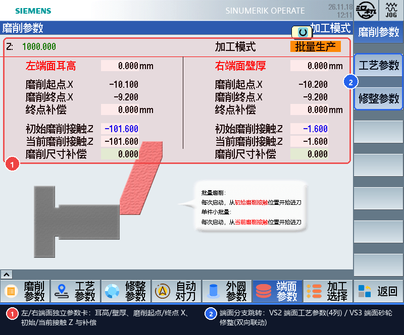
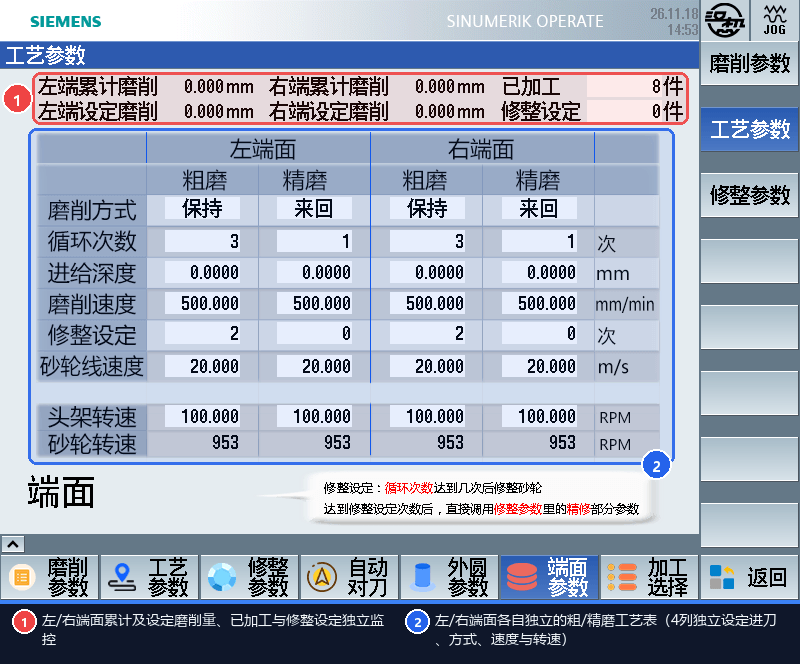
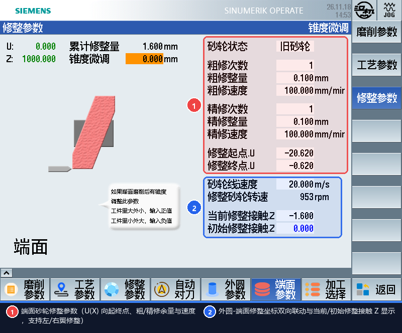

# 9.3 左右端面磨削、修整及交叉补偿

在 **加工选择** 看板底部按 **`HS6 端面参数`**（`a_centerduanmian.com`），即可统筹控制工件左、右端面与内端阶面的高精度磨削及砂轮侧面修整。右侧垂直软键对应 **`VS1 磨削`**（`Mask32`）、**`VS2 工艺`**（`Mask25`）与 **`VS3 修整`**（`Mask27`）。

## 1. 端面磨削参数与起止点自动公式（`Mask32`）

`Mask32` 采用对称双栏设计，**左半屏专属左端面、右半屏专属右端面**：

| 区域 | 关键输入字段 | NC 变量 | 自动起止位置计算公式与规则 |
| :--- | :--- | :--- | :--- |
| **公共** | **加工模式** | `INI[103]` | `0` 单件小批量 / `1` 批量生产（同样控制从初始接触还是当前接触起刀） |
| **左端面（左侧栏）** | **耳高** | `INI[43]` | 实测工件左端凸缘/耳环径向高度（精确至 `0.1 mm`）。系统自动据此算得左端切入范围： • `磨削起点` $\approx$ 外圆当前接触 $\pm 0.1\text{ mm}$ • `磨削终点` $\approx$ 外圆当前接触 $\pm \text{耳高} \pm 1\text{ mm}$（随外磨有 U 轴 / X 前置 / X 后置方向自动确定符号） |
| | **左端终点补偿 / 初始 & 当前接触 .Z / 磨削补偿** | `TECHNOLOGY[45]` / `PROCESS[48/34]` / `TECHNOLOGY[297]` | 手动靠磨左端面后退约 `0.05 ~ 0.1 mm` 输入 `初始接触.Z`；成品轴向偏差微调使用 `磨削补偿`（`±1 mm`，开放 **`ac7` 钥匙开关 0 档** 权限以便日常尺寸微调；`VS2 工艺` 表内次数与进给量则统一为 **`ac4` 钥匙开关 3 档**） |
| **右端面（右侧栏）** | **壁厚** | `PROCESS[27]` | 实测工件右端壁面径向厚度（精确至 `0.1 mm`）。自动算得右端切入范围： • `磨削起点` $\approx$ 外圆当前接触 $\mp \text{壁厚}$ • `磨削终点` $\approx$ 外圆当前接触 $\pm 1\text{ mm}$ |
| | **右端终点补偿 / 初始 & 当前接触 .Z / 磨削补偿** | `TECHNOLOGY[46]` / `PROCESS[47/37]` / `TECHNOLOGY[298]` | 手动靠磨右端面后填入 `初始接触.Z`；若仅需磨右端而不完全离开外圆面可填写 `右端终点补偿`（但不可大到令终点反超起点）；`磨削补偿` 同样支持 **`ac7` 钥匙开关 0 档** 直接微调 |

## 2. 左右端面独立工艺表（`Mask25`）

端面工艺表 `Mask25` 同时呈现 **四列独立参数**（**左端面 粗磨 / 精磨** ｜ **右端面 粗磨 / 精磨**），方便针对左右端不同的余量分布独立优化：
- 同样支持 **`保持`**（轴向快速进刀停留磨削，适合去余量）与 **`来回`**（沿端面径向来回光刀）；
- 粗磨推荐 **`保持`**，头架转速建议设为 **`120 ~ 200 RPM`** 以上以提升端面平面度；
- 表格底部提供 `砂轮线速度`、自动换算 `头架转速` 与定转速模式下的 `砂轮转速`。

## 3. 端面修整参数与双向交叉补偿机制（`Mask27`）

- **标定端面修整区间**：
  - 如果是液压控制外圆修整器，先伸出修整器后再对刀标定；
  - 将金刚笔移到外圆砂轮外前侧 5 mm 处，记录 `U/X` 坐标到 **`修整起点`**（`DRESSER[100]`）；移到后侧合适位置记录到 **`修整终点`**（`DRESSER[101]`）；
  - 手动在左侧将金刚笔尖轻触砂轮侧面，记录 `Z` 坐标填入 **`初始接触`**（`DRESSER[126]`）与 **`当前接触`**（`DRESSER[108]`）；
- **端面锥度微调（`DRESSER[136]`）**：若修磨出来的端面有轻微中凹或中凸（里大外小 / 里小外大），微调 `±0.02 mm` 修正砂轮侧面母线垂直度（正值“前大后小”，负值“前小后大”）。

> **极其重要的交叉联动机制（注意安全）**：  
> - **修整外圆砂轮外径** 时，系统会自动顺带调整 **端面修整的起点/终点**（防止外圆半径变小后修端面空气空切或干涉）；  
> - **修整端面侧面** 时，系统也会自动顺带补偿 **外圆修整的起点/终点**（防止端面修薄后修外圆位置错位）；  
> - 每次更换新外圆砂轮，**务必重新同时标定外圆和端面两侧的所有修整起止点及初始磨削接触位**！
