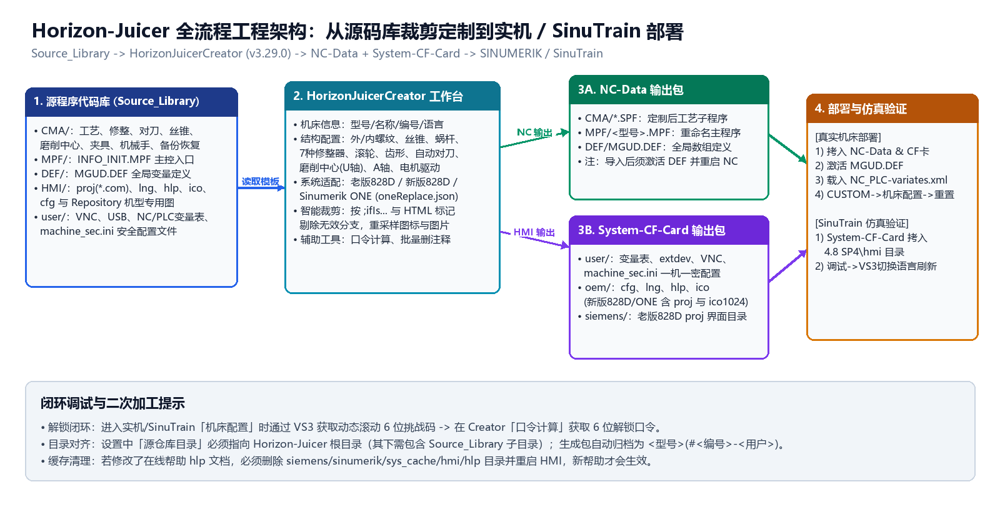

# Horizon-Juicer 数控螺纹磨床系统与程序生成器完全指南

欢迎使用 **Horizon-Juicer** 完整用户与调试手册。本手册整合了上游工程配置生成工具 **HorizonJuicerCreator（v3.29.0）** 与下游西门子 SINUMERIK 数控磨床标准工艺软件库 **Horizon-Juicer（Source_Library）** 的全部操作说明、参数定义、配置联动逻辑、仿真调试及故障排查方法。

## 1. 适用对象与阅读建议

| 读者角色 | 重点阅读章节 | 核心目标 |
| :--- | :--- | :--- |
| **软件选型 / 项目工程师** | 第 1 章 ～ 第 3 章 | 掌握工作路径配置、按机械结构裁剪生成专用 NC/HMI 程序包、清理注释及计算动态解锁口令 |
| **电气调试 / 售后工程师** | 第 4 章、第 5 章、第 8 章、第 10 章 | 完成 CF 卡/网络部署与 SinuTrain 仿真验证，配置机床底层选项、自动对刀标定、报警与 PLC 信号排障 |
| **机床操作 / 工艺工程师** | 第 5 章 ～ 第 9 章 | 熟练操作磨削、工艺、修整、滚轮校准、齿形设定、丝锥/蜗杆/环形槽、多段补偿及磨削中心复合加工 |

## 2. 支持的数控系统平台与软件版本

- **配置生成软件**：`HorizonJuicerCreator.exe`（当前文档对应版本：`V3.29.0`），基于 Qt 桌面端开发，配置文件持久化于当前系统用户目录 `~/HorizonJuicerCreator.json`。
- **支持的目标数控系统**：
  - **SINUMERIK 828D（老版）**：使用 `siemens` 系统层级目录与 `ico800` 图标集，兼容 SinuTrain `840D sl 4.8 SP4` 仿真预览。
  - **SINUMERIK 828D（新版）**：使用 `oem` 系统层级目录与 `ico1024`（`1024×768` / `1280×768`）高清界面图标集。
  - **SINUMERIK ONE**：自动启用 `oneReplace.json` 规则集，将老架构 <code>&#36;A_DBB[...]</code> 信号映射为 <code>&#36;A_IN[...]</code> / `digitInpVal` 等新平台接口，并适配 `DB10.DBX107.0/1` 及 `1170×600` 宽屏 `ico1024` 图示资源。
  - **SINUMERIK 840D sl / SinuTrain 4.8 SP4 仿真环境**：支持将生成包内 `System-CF-Card` 目录直接导入仿真 `hmi` 目录，实现真机同款界面联动预览与调试。

## 3. 全书结构总览

- **第一部分：HorizonJuicerCreator 配置生成软件指南**（第 1～3 章）
  - 介绍工作台界面、源码库路径规范、机床机械/电气配置全矩阵、输出目录与 `specificationInfo` 编码、口令计算器与批量去注释工具。
- **第二部分：程序部署与系统管理**（第 4～5 章）
  - 介绍真机 NC/CF 卡部署、GUD 内存参数校验（`MD18120`）、USB 逻辑驱动器、SinuTrain 仿真及文本缓存刷新、`CUSTOM` 主页、机床系统密码解锁配置、加工统计/配件寿命与参数备份恢复。
- **第三部分：Horizon-Juicer 机床操作与工艺功能指南**（第 6～9 章）
  - 深入剖析外螺纹/内螺纹主磨削流程、精简/扩展工艺表、丝锥/蜗杆/环形槽及变径/分段/多螺距/反向孔倒角高级模块、砂轮修整与滚轮校准、通用齿形与双圆弧公式、自动对刀标定、磨削中心复合外圆/端面/台阶加工。
- **第四部分：附录与故障排查**（第 10 章）
  - 汇总全套报警代码对照表、M 代码与桁架机械手握手协议、PLC-NC 交互信号表、全局变量词典及条件编译标记索引。

> **索引基准提醒**：西门子 EasyScreen `.com` 界面脚本对 NC 数组采用 **1-based** 索引（如 `INI[17]`），而 NC 子程序 `*.SPF`、`MGUD.DEF` 与 `Parameter_Index.md` 采用 **0-based** 索引（对应 `INI[16]`）。阅读参数对照表时请注意区分 **NC 索引** 与 **HMI 索引（NC + 1）**。
